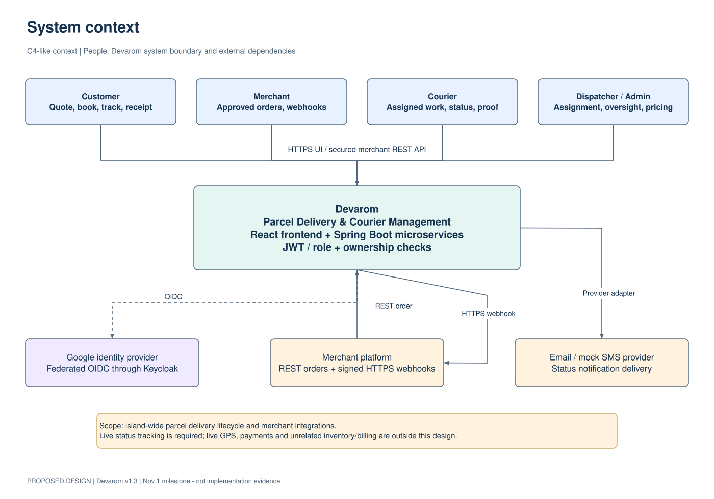
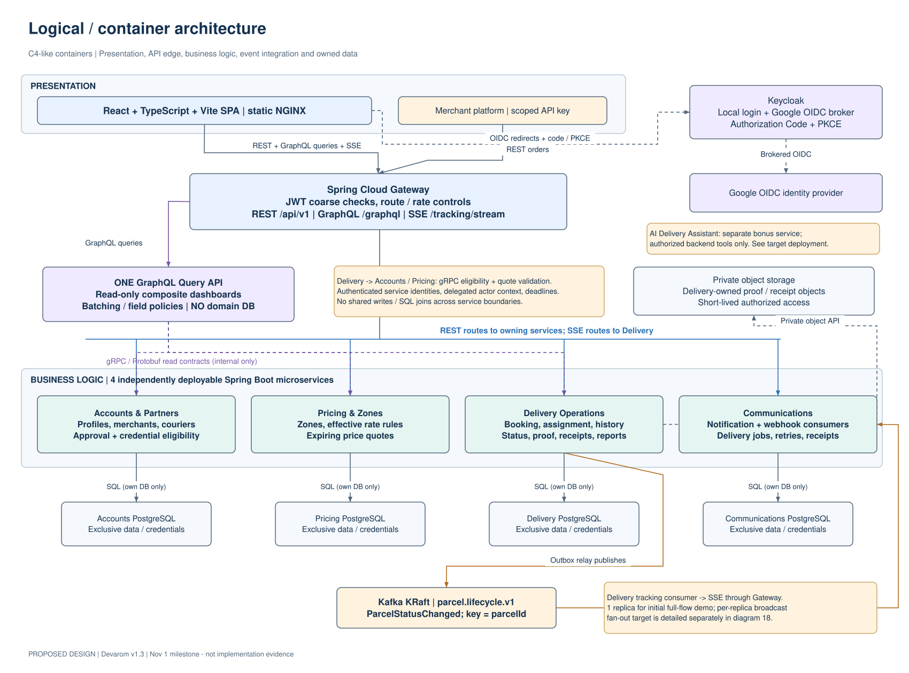
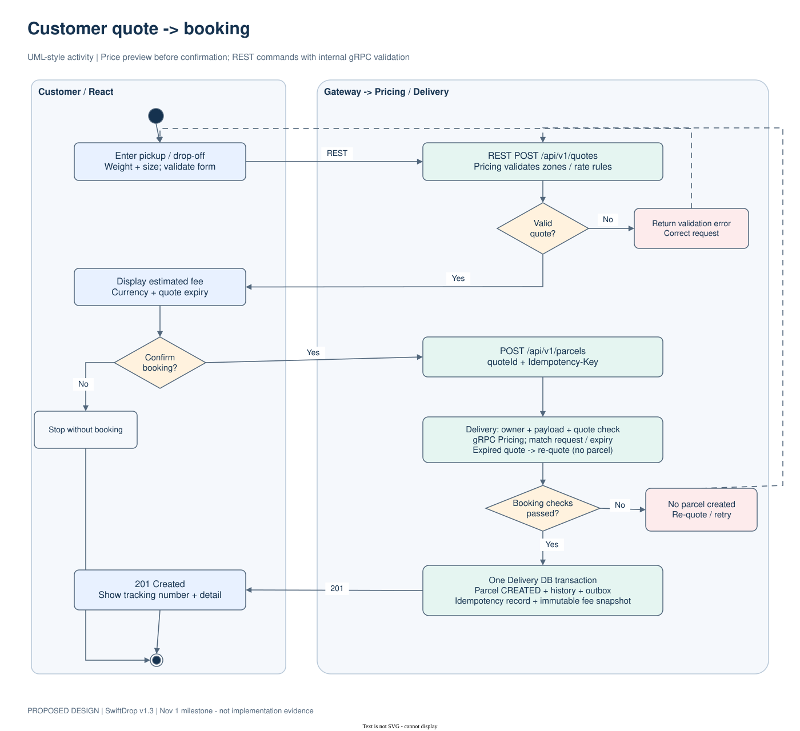
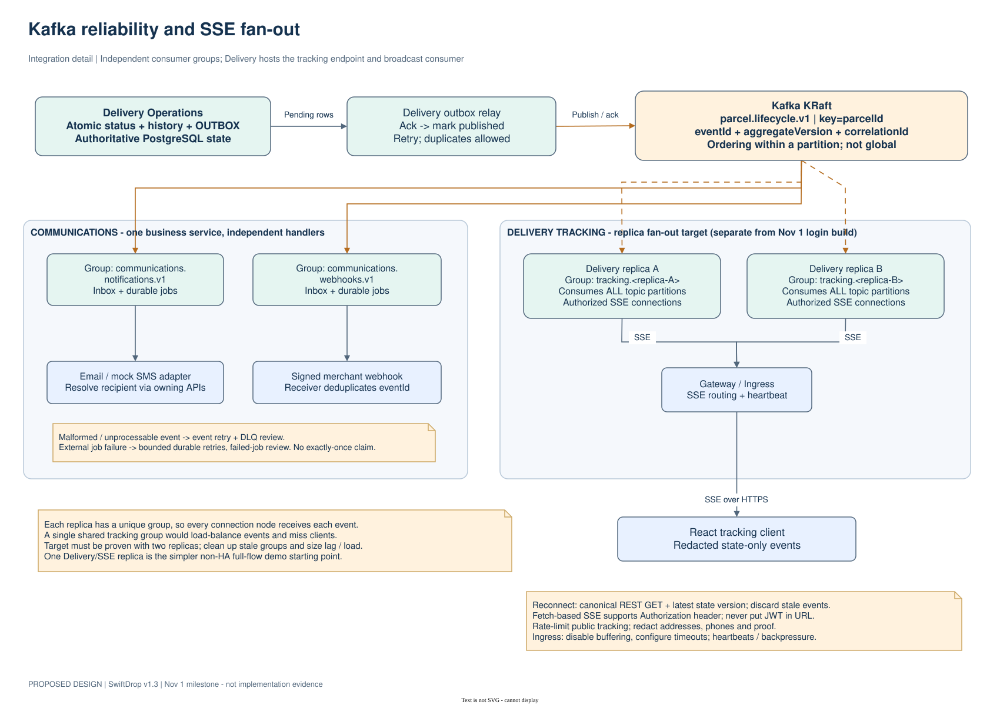
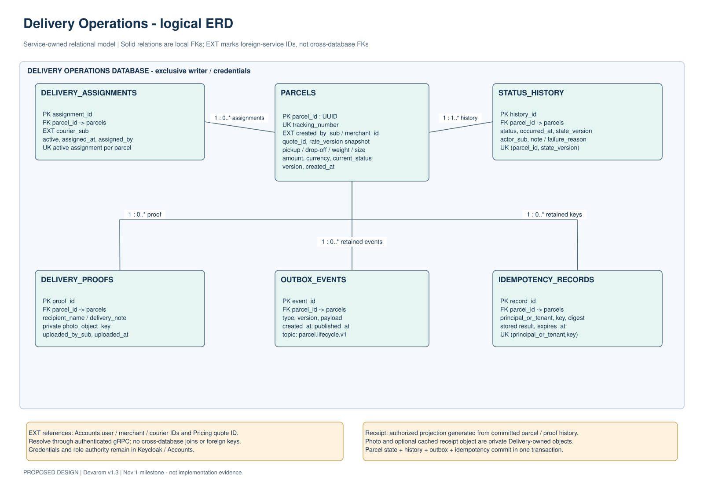
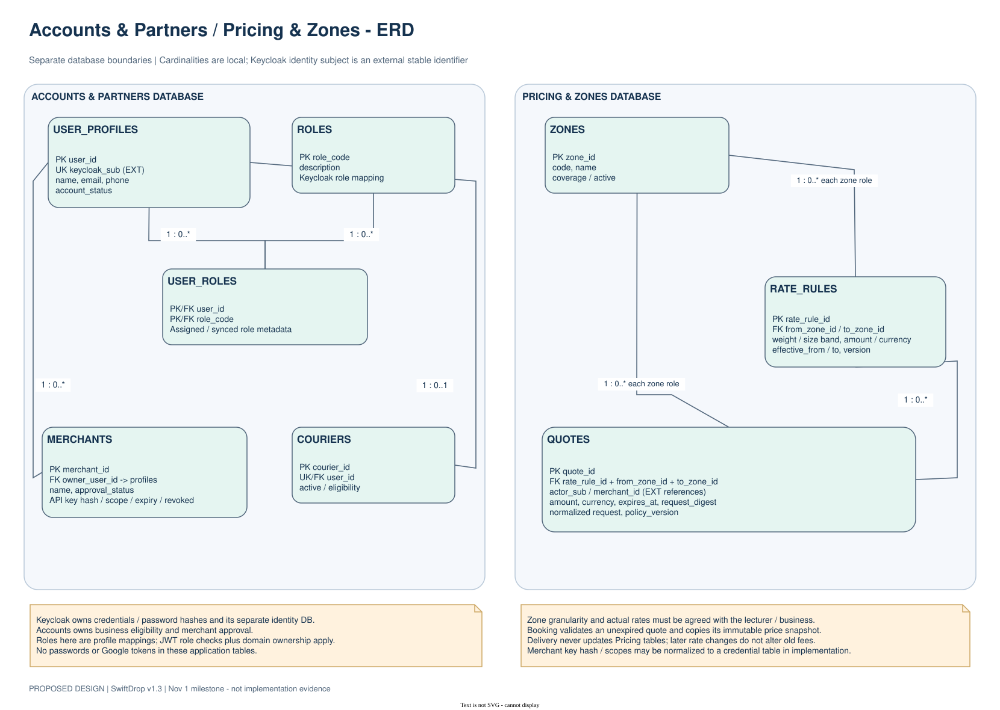
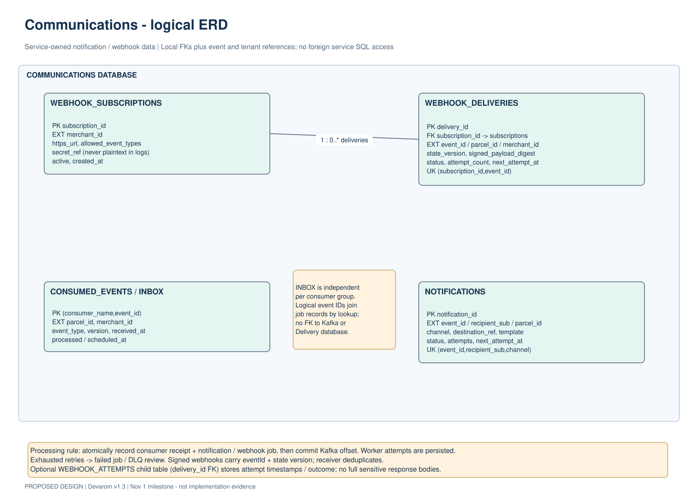

# SwiftDrop

**A secure, event-driven parcel delivery and courier management platform**

SwiftDrop is an enterprise application development project for managing parcel deliveries from quotation and booking through courier assignment, delivery execution, tracking, notifications and operational reporting. It brings customers, merchants, couriers, dispatchers and administrators into one role-aware platform.

The system is built around a **React and TypeScript single-page application**, **Spring Boot microservices**, **Keycloak identity**, and a hybrid API architecture using **REST, read-only GraphQL, gRPC, Apache Kafka and Server-Sent Events (SSE)**. Each business service owns its data and enforces its own authorization boundary.

| Project | Details |
|---|---|
| Repository | [Suthankan1/swiftdrop](https://github.com/Suthankan1/swiftdrop) |
| Product | SwiftDrop — Parcel Delivery & Courier Management |
| Architecture baseline | SwiftDrop v1.3 |
| Integration branch | `test` |
| Primary runtime | Java 21, Spring Boot 4.1.1, React 19, TypeScript 6 |
| Hosting direction | Local-first Docker / k3d / K3s under a strict $0 cloud-spend policy |

---

## Contents

- [Project overview](#project-overview)
- [User roles and workflows](#user-roles-and-workflows)
- [System architecture](#system-architecture)
- [Services and responsibilities](#services-and-responsibilities)
- [Data ownership and persistence](#data-ownership-and-persistence)
- [Communication protocols](#communication-protocols)
- [Core delivery lifecycle](#core-delivery-lifecycle)
- [Security and reliability](#security-and-reliability)
- [Technology stack](#technology-stack)
- [Local development and running](#local-development-and-running)
- [API and event contracts](#api-and-event-contracts)
- [Testing and quality assurance](#testing-and-quality-assurance)
- [Deployment and hosting model](#deployment-and-hosting-model)
- [Architecture diagrams](#architecture-diagrams)
- [Repository structure](#repository-structure)
- [Contribution workflow](#contribution-workflow)
- [Project status and further documentation](#project-status-and-further-documentation)

---

## Project overview

Parcel delivery involves several parties and multiple hand-offs. SwiftDrop provides a shared application and service platform to coordinate those operations while keeping identity, pricing, parcel state, notifications and merchant integrations within explicit ownership boundaries.

The platform is designed to:

- Let customers obtain delivery quotations, book parcels, follow delivery progress and access their delivery history and receipts.
- Let merchants enrol, manage their business integration credentials, submit delivery orders and receive signed status webhooks.
- Let couriers view their own assignments, update delivery stages and submit proof of delivery or a failure reason.
- Let dispatchers monitor unassigned work, review courier availability and assign deliveries.
- Let administrators manage users and staff, review merchant enrolments, maintain delivery zones and pricing, and inspect operational reports.
- Provide public tracking without exposing private customer or recipient information.
- Process delivery events asynchronously and make notification and webhook failures visible and recoverable.

SwiftDrop is designed as a distributed application rather than a single monolithic backend. The browser communicates through a controlled API Gateway. Business services own their data and rules. Internal synchronous reads use authenticated gRPC, while delivery lifecycle events are distributed through Kafka.

## User roles and workflows

| Role | Main workflow areas |
|---|---|
| **Customer** | Register and sign in; request a quote; book a parcel; view booking confirmation, delivery history and status; follow authorized live updates; download an authorized PDF receipt; use public redacted tracking. |
| **Merchant** | Submit business enrolment for approval; use the merchant workspace; manage scoped API credentials; create and inspect merchant orders; configure webhook subscriptions; inspect delivery attempts and retry outcomes. |
| **Courier** | View own assignments; inspect parcel details; progress a parcel through guarded lifecycle stages; submit proof-of-delivery metadata; record a failed-delivery reason. |
| **Dispatcher** | Review the unassigned parcel queue; inspect eligible courier workloads; make controlled manual assignments; monitor operational outcomes and reports. |
| **Administrator** | Review and approve or suspend merchants; manage staff and user records; configure zones and versioned pricing; view administrative and delivery reports. |

The frontend contains role-specific route groups and feature modules. UI route guards improve navigation, but they are not the security boundary: the Gateway and the owning backend service must independently validate the caller and resource permissions. The current implementation and integration acceptance status for each workflow are recorded in the [project status register](docs/project/STATUS.md).

---

## System architecture

SwiftDrop follows the hybrid **Architecture Baseline v1.3**. A single React SPA is the browser-facing application. Spring Cloud Gateway provides the public API edge. Keycloak issues SwiftDrop identity tokens. Four business microservices own the domain data, and a separate GraphQL Query API composes read-only dashboards.

### System context

[Open the editable Draw.io source](docs/diagrams/editable/05_system_context.drawio) · [View the SVG](docs/diagrams/rendered/05_system_context.svg)

### Logical application architecture

[Open the editable Draw.io source](docs/diagrams/editable/06_logical_architecture.drawio) · [View the SVG](docs/diagrams/rendered/06_logical_architecture.svg)

### Main architecture layers

1. **Presentation layer — React SPA:** role-aware screens, forms, route navigation, authenticated API clients and tracking views.
2. **Identity layer — Keycloak:** account authentication, OIDC sessions, Google identity brokering and role claims.
3. **Edge layer — Spring Cloud Gateway:** external routing, JWT checks, CORS, request/header controls, rate limiting and safe error responses.
4. **Business layer — Spring Boot services:** Accounts & Partners, Pricing & Zones, Delivery Operations and Communications.
5. **Query layer — GraphQL:** read-only, role-scoped dashboard aggregation using internal service APIs; it does not own business data.
6. **Integration layer — gRPC and Kafka:** authenticated synchronous service reads and asynchronous parcel lifecycle events.
7. **Persistence and infrastructure layer:** isolated PostgreSQL logical databases, private S3-compatible object storage, local email capture and local container orchestration.

### Services and responsibilities

| Component | Main responsibility | Local HTTP port | Internal gRPC port |
|---|---|---:|---:|
| **React SPA** | Customer, merchant, courier, dispatcher and admin user experiences | 5173 (Vite) / 3000 (Compose) | — |
| **Keycloak** | Identity, OIDC login, Google federation and role issuance | 8090 (host mapping) | — |
| **API Gateway** | Public API entry point, routing and edge security | 8080 | — |
| **Accounts & Partners** | Profiles, merchant enrolment and approval, staff profiles, role reconciliation and merchant credential metadata | 8081 | 9081 |
| **Pricing & Zones** | Zones, versioned rate cards, quote calculation and quote validation | 8082 | 9083 |
| **Delivery Operations** | Parcel booking, assignments, lifecycle/history, proof metadata, receipts, outbox and tracking streams | 8083 | 9082 |
| **Communications** | Event consumers, notifications, merchant webhooks, retries and operator-visible replay | 8084 | — |
| **GraphQL Query API** | Read-only dashboard aggregation and bounded query execution | 8085 | gRPC clients |

The ports above describe the repository's documented local runtime conventions. Compose, development and Kubernetes profiles can use different internal or host bindings; use the relevant platform runbook when changing a runtime profile.

### Business service boundaries

- **Accounts & Partners** is authoritative for user/business profiles, merchant approval state, staff status, courier eligibility and scoped merchant credential records. Keycloak remains authoritative for authentication credentials and identity sessions.
- **Pricing & Zones** owns delivery zones, rate rules, versioned pricing and expiring quote records. It calculates the quote; Delivery stores the accepted price snapshot when a booking is made.
- **Delivery Operations** is the source of truth for parcels, assignments, lifecycle transitions, status history, proof references, receipts and transactional outbox records.
- **Communications** owns consumed-event receipts, notification jobs, merchant webhook subscriptions, delivery attempts, retry schedules, quarantine and replay audit.
- **GraphQL Query API** composes authorized read models from service APIs. It has no business database and does not expose mutations or subscriptions.
- **API Gateway** routes and applies edge controls. It does not replace authorization inside the business services.

### Data ownership and persistence

Each business service owns its schema, migrations, application role and transactions. Services do not query another service's tables, share business JPA entities or create cross-service foreign keys. Cross-service identifiers are opaque references resolved through an authorized API.

| Logical database | Owner | Example data |
|---|---|---|
| `accounts_db` | Accounts & Partners | User profiles, merchant records, staff profiles, merchant API-key metadata and reconciliation/audit records |
| `pricing_db` | Pricing & Zones | Delivery zones, rate versions, pricing rules, quote snapshots and pricing audit records |
| `delivery_db` | Delivery Operations | Parcels, idempotency records, assignments, status history, proof metadata, receipts and outbox events |
| `communications_db` | Communications | Consumed-event inbox, notification jobs, webhook subscriptions, deliveries, attempts and replay records |
| `keycloak_db` | Keycloak | Identity-provider-managed realm and account data; not a business-service database |

A local PostgreSQL server may host several isolated logical databases, but the application roles remain separated. The GraphQL Query API has **no domain database**.

### Communication protocols

| Protocol | Used for | Architectural rule |
|---|---|---|
| **REST / HTTP** | Browser commands, simple reads, quotes, parcel booking, tracking, status changes, merchant APIs and receipts | Public requests pass through Gateway; owning services independently enforce authentication, role and resource ownership. |
| **GraphQL over HTTP** | Composite role dashboards and bounded reporting reads | Read-only query surface; field-level role checks, pagination and complexity/result limits; no direct database access. |
| **gRPC / Protocol Buffers** | Selected internal reads such as quote validation, courier eligibility, merchant authorization and dashboard aggregation | Service authentication, delegated actor context, correlation metadata and bounded deadlines. Never exposed directly to the browser. |
| **Apache Kafka** | Parcel lifecycle event distribution | Delivery publishes from its transactional outbox; consumers are idempotent and version-aware. |
| **Server-Sent Events (SSE)** | One-way live parcel status updates to browser clients | Authorized stream access; reconnects reconcile against canonical REST reads. SSE is not GPS/location tracking. |
| **HTTPS webhooks** | Merchant system notifications | HTTPS destination validation, HMAC signing, bounded delivery attempts, retry scheduling and replay protection. |
| **S3-compatible API** | Private proof-of-delivery object storage | Backend-controlled object access; proof objects are not exposed as public URLs. |

### Core delivery lifecycle

A typical customer booking and delivery update follows this path:

1. The customer signs in through Keycloak and requests a quote through the Gateway.
2. Pricing calculates a quote using the configured zone and rate version.
3. The customer confirms the booking. Delivery validates the accepted quote and caller context, then persists the parcel, initial history and idempotency record.
4. Delivery writes the lifecycle event to its outbox in the same database transaction as the state change.
5. The outbox relay publishes the versioned event to Kafka using the parcel identifier as its key.
6. Communications consumes the event, records an inbox receipt and materializes durable notification and webhook jobs.
7. Delivery's tracking consumer distributes status changes to connected SSE clients. Clients can refresh canonical parcel data through REST after reconnecting.
8. Authorized users can retrieve the delivery receipt through the Delivery service.

[Editable booking activity diagram](docs/diagrams/editable/07_quote_booking_activity.drawio)

### Event delivery, notifications and live tracking

[Editable Kafka and SSE diagram](docs/diagrams/editable/18_kafka_sse_topology.drawio)

Kafka provides asynchronous event distribution, not the canonical parcel history. The Delivery database remains authoritative. Consumers use durable inbox/idempotency controls because event delivery and external side effects can be retried.

---

## Security and reliability

Security is enforced at multiple independent boundaries. A successful login or a hidden frontend route does not itself grant access to a parcel, merchant tenant, staff operation or courier assignment.

### Identity and access control

- Keycloak provides OpenID Connect identity and issues SwiftDrop API tokens.
- The browser uses the Authorization Code flow with PKCE through a public OIDC client; no client secret is embedded in the SPA.
- Google sign-in is brokered through Keycloak. A Google identity token is not accepted as a SwiftDrop API bearer token.
- The Gateway and each protected service validate the SwiftDrop token, issuer, signature, audience, expiry and required role.
- Business services enforce resource ownership, merchant tenant status and active staff/assignment state independently of frontend checks.
- Public registration is restricted to the CUSTOMER role. Merchant approval and staff provisioning are controlled operations.
- Merchant API credentials are scoped, revocable and represented by protected metadata in Accounts; plaintext credentials are not logged or stored in the frontend.
- Untrusted identity headers are stripped at the Gateway. Internal gRPC calls use service identity and validated actor-delegation metadata.

### Data protection

- Public parcel tracking returns redacted information and does not expose private customer or recipient details.
- Kafka event payloads avoid sensitive personal information and private proof-object URLs.
- Proof-of-delivery objects are stored in a private MinIO bucket; the browser does not receive storage administrator credentials.
- Webhooks use HMAC signatures and HTTPS destination validation. Secrets and credentials must be supplied through local ignored environment files or deployment secret stores, never committed to Git.
- Error responses and logs are designed to avoid disclosing stack traces, tokens, secret values or internal security context.

### Reliability and operational controls

- **Idempotent booking:** request keys and durable records protect against duplicate booking after retries or lost responses.
- **Optimistic concurrency:** parcel and assignment mutations check expected versions and reject stale updates.
- **Transactional outbox:** parcel state, history and event intent commit atomically in Delivery.
- **Durable inbox:** Communications records consumed events before acknowledging work, preventing duplicate side effects.
- **Bounded retries and quarantine:** failed notifications/events have visible outcomes, retry limits and controlled replay paths.
- **gRPC deadlines:** internal calls have explicit bounded timeouts and fail closed when authorization or required data cannot be established.
- **Correlation IDs and metrics:** request context is propagated across service boundaries; operational dashboards and alert rules are provided with the local monitoring stack.
- **Recovery safeguards:** backup, restore, rollout and rollback procedures are documented; application rollback must not silently destroy persistent database volumes.

For the detailed security and operational policies, see [Authentication](docs/security/AUTHENTICATION.md), [Authorization Matrix](docs/security/AUTHORIZATION_MATRIX.md), [Threat Review](docs/security/THREAT_REVIEW.md), [Terraform State and OIDC Boundary](docs/security/TERRAFORM_STATE_AND_OIDC_BOUNDARY.md) and the [operator handover runbook](docs/deployment/N10_ZC06_ZERO_COST_OPERATOR_HANDOVER.md).

---

## Technology stack

| Area | Technology |
|---|---|
| Frontend | React 19, TypeScript 6, Vite 8, React Router, TanStack Query |
| Frontend toolchain | Node.js 24 LTS, pnpm 12 |
| Backend runtime | Java 21 LTS, Spring Boot 4.1.1, Maven Wrapper |
| API edge | Spring Cloud Gateway, Spring Security, OAuth2 Resource Server |
| Identity | Keycloak 26.8, OpenID Connect, OAuth 2.0, PKCE, Google identity brokering |
| External API contracts | REST, OpenAPI 3.0.3, RFC 7807 Problem Details |
| Query API | Spring GraphQL, GraphQL SDL |
| Internal APIs | gRPC, Protocol Buffers v3 |
| Event streaming | Apache Kafka 4.2.1 in KRaft mode |
| Relational persistence | PostgreSQL 16, Spring Data JPA, Flyway migrations |
| Object storage | MinIO with an S3-compatible API |
| Local email testing | Mailpit |
| Containers and orchestration | Docker, Docker Compose, k3d, K3s, Kubernetes, Helm |
| Infrastructure policy | Terraform plan-only/static validation and an explicit Azure allowlist |
| Observability | Prometheus, Grafana and Alertmanager-based monitoring |
| Automated quality | JUnit, Testcontainers, Vitest, React Testing Library, Python unittest, Gitleaks, Trivy and workflow validation |
| CI/CD and image registry | GitHub Actions and GitHub Container Registry (GHCR) |

Exact dependency versions are pinned in the relevant Maven POMs, frontend package manifest/lockfile, container definitions and platform charts. Those files are authoritative when updating the toolchain.

---

## Local development and running

### Prerequisites

For source development and local integration, install:

- Git 2.40 or later.
- Docker Engine/Desktop with Docker Compose v2 and a running daemon.
- Java 21 LTS.
- Node.js 24 LTS and pnpm 12.11.2 (Corepack can provide the pinned pnpm version).
- Python 3.10 or later for repository verification scripts.
- Helm and k3d/K3s only when using the Kubernetes profile.

The full Compose runtime is resource-intensive. Its operator guide recommends approximately 4 CPUs and 4 GiB of Docker memory. Review the host capacity preflight and the relevant runbook before starting the full stack.

### Option A — Full local Compose runtime

The repository includes a persistent local integration profile that brings up the approved application/identity images and their supporting databases, Kafka, MinIO and Mailpit.

From the repository root:

~~~bash
./platform/compose/start.sh
./platform/compose/status.sh
./platform/compose/verify.sh
./platform/compose/smoke.sh
~~~

To stop the containers while preserving their named data volumes:

~~~bash
./platform/compose/stop.sh
~~~

The startup script initializes a local `platform/compose/.env` from the example when needed. Review the generated local configuration, keep credentials local, and never commit `.env` files. The runtime scripts are designed to preserve existing volumes; do not replace them with destructive database or volume-reset commands.

See the [Full-Stack Compose Runtime Guide](platform/compose/README.md) for topology, host ports, environment configuration, health checks, persistence and verification details.

### Option B — Frontend development server

From the repository root:

~~~bash
cd frontend
corepack pnpm install --frozen-lockfile
corepack pnpm dev
~~~

The Vite development server listens at [http://localhost:5173](http://localhost:5173). The SPA expects the local identity and API Gateway configuration described in the [Clean-Clone Runbook](docs/development/CLEAN_CLONE_RUNBOOK.md).

Useful frontend checks:

~~~bash
corepack pnpm typecheck
corepack pnpm test --run
corepack pnpm lint
corepack pnpm build
~~~

### Option C — Java service development

The Java services use checked-in Maven wrappers. Install the shared contract and security artifacts before building services that depend on them:

~~~bash
cd shared/proto-contracts
./mvnw clean install

cd ../security-adapter
./mvnw clean install
~~~

Then build the required service from its directory, for example:

~~~bash
cd ../../services/delivery-service
./mvnw clean verify
~~~

Use the service-specific README for its database variables, ports, local dependencies and integration-test requirements. PostgreSQL Testcontainers integration tests require a working Docker engine.

### Clean-clone and operator guides

For a reproducible setup, use these maintained guides rather than guessing environment variables or starting services in an arbitrary order:

- [Clean-Clone Setup, Verification and Demonstration](docs/development/CLEAN_CLONE_RUNBOOK.md)
- [Full-Stack Docker Compose Runtime](platform/compose/README.md)
- [Local Development Environment](platform/local/README.md)
- [Business Dependencies — PostgreSQL, Kafka and MinIO](platform/dependencies/README.md)
- [Keycloak Identity and OIDC Foundation](platform/identity/README.md)
- [Local k3d/K3s Operator Runbook](platform/kubernetes/k3d/README.md)
- [Helm Deployment Runbook](platform/kubernetes/helm/README.md)

---

## API and event contracts

SwiftDrop maintains machine-readable contracts as the integration source of truth.

| Contract | Canonical location | Purpose |
|---|---|---|
| Accounts REST API | [OpenAPI — Accounts](contracts/rest/openapi-accounts.yaml) | Profiles, merchant enrolment, staff and merchant operations |
| Pricing REST API | [OpenAPI — Pricing](contracts/rest/openapi-pricing.yaml) | Zones, quote calculation and pricing administration |
| Delivery REST API | [OpenAPI — Delivery](contracts/rest/openapi-delivery.yaml) | Booking, parcel reads, tracking, assignments, status and proof/receipt operations |
| Communications REST API | [OpenAPI — Communications](contracts/rest/openapi-communications.yaml) | Webhook subscriptions, delivery logs and communication operations |
| Shared REST errors | [Problem Details schema](contracts/rest/problem-detail.yaml) | Consistent RFC 7807 error payloads |
| Dashboard API | [GraphQL schema](contracts/graphql/schema.graphql) | Role-scoped read-only dashboard queries |
| Internal RPCs | [Protobuf contracts](contracts/grpc/README.md) | Accounts, Pricing and Delivery service-to-service APIs |
| Parcel lifecycle event | [JSON Schema](contracts/events/parcel.status.changed.v1.schema.json) · [Example](contracts/events/parcel.status.changed.v1.example.json) | Versioned Kafka parcel status event |

Cross-protocol conventions include integer minor-unit currency values with an ISO currency code, UTC timestamps, bounded pagination, stable identifiers, version-aware state changes and privacy-safe event payloads. Contract changes must follow the repository's compatibility and review policy.

---

## Testing and quality assurance

Testing is distributed across the frontend, each Java service, shared libraries, contract validation, security, recovery, infrastructure and end-to-end journeys.

| Test area | Location | What it verifies |
|---|---|---|
| Frontend unit/component tests | `frontend/src/**` | React behavior, role routes, API adapters, session handling and user journeys |
| Java unit and integration tests | `services/*/src/test/**` | Domain rules, controllers, persistence, authorization and service behavior |
| Shared contract/security tests | `shared/*/src/test/**` | Protobuf descriptors, gRPC metadata, JWT validation and actor delegation |
| API and event contracts | `tests/contracts/` | REST, GraphQL, Protobuf, Kafka schema and cross-protocol compatibility |
| Customer/courier journeys | `tests/e2e/` | Booking, assignment, parcel lifecycle, live tracking and receipt flows |
| Security E2E | `tests/security-e2e/` | JWT rejection, role separation, tenant/resource ownership and identity isolation |
| Recovery consistency | `tests/recovery/` | Outbox/inbox, assignment, quote provenance, status history and durable job invariants |
| Kubernetes policy and templates | `tests/kubernetes/` | Helm templates, pod security, network policies, storage, rollout and recovery contracts |
| Terraform and cloud denial policy | `tests/terraform-policy/` | Empty Azure allowlist, no cloud deployment authorization and OIDC/state safeguards |
| Capacity and performance budgets | `tests/capacity/` | Bounded workloads, measurement primitives and configured capacity budgets |
| Compose and hosting feasibility | `tests/platform-compose/`, `tests/hosting-feasibility/` | Local runtime specification, endpoint policy and hosting restrictions |
| CI/CD regression | `tests/ci/` | Required jobs, release approval policy, artifact provenance and workflow behavior |

### Common verification commands

Frontend:

~~~bash
cd frontend
corepack pnpm install --frozen-lockfile
corepack pnpm typecheck
corepack pnpm test --run
corepack pnpm lint
corepack pnpm build
~~~

Contract regression suite:

~~~bash
python3 tests/contracts/run_contract_regressions.py
~~~

Python policy and platform suites:

~~~bash
python3 -m unittest discover -s tests/terraform-policy -p "test_*.py" -v
python3 -m unittest discover -s tests/kubernetes -p "test_*.py" -v
python3 -m unittest discover -s tests/recovery -p "test_*.py" -v
python3 -m unittest discover -s tests/ci -p "test_*.py" -v
~~~

Run the relevant Maven `./mvnw clean verify` command in each changed Java module. Some integration tests require Docker/Testcontainers or a running local dependency stack. A skipped, blocked or unexecuted test is not a passing acceptance result.

The repository CI workflows are maintained in [`.github/workflows/`](.github/workflows/). They include frontend, Java service, contract, infrastructure-policy, container and security verification. The CI workflow and its latest run results—not this README—are authoritative for the current commit's check status.

---

## Deployment and hosting model

SwiftDrop follows a **local-first, strict zero-cloud-spend hosting decision**. The supported platform work targets existing local hardware using Docker, k3d/K3s and Helm. The repository includes:

- A full-stack persistent Docker Compose profile.
- A local k3d cluster definition and non-destructive lifecycle scripts.
- Helm charts for application workloads, data services, messaging and monitoring.
- PostgreSQL persistent workloads with service-owned logical databases and roles.
- Kafka KRaft and private MinIO storage.
- Local ingress/TLS, scoped Kubernetes NetworkPolicies, non-root workloads and readiness/liveness probes.
- Monitoring dashboards and alert rules.
- Backup, restore, verification, promotion and rollback runbooks.

**Cloud deployment is not authorized.** The Azure resource allowlist is intentionally empty and the current spending ceiling is USD 0.00. Azure promotional credits do not change that decision. The optional Azure K3s proposal is a separate future authorization path, not an approved deployment target. See [ADR-0011](docs/architecture/adr/ADR-0011-strict-zero-cost-hosting-and-azure-allowlist.md) and the [optional Azure spending-authorization gate](docs/deployment/OPTIONAL_AZURE_K3S_SPENDING_AUTHORIZATION.md).

Local cluster manifests and deployment diagrams do not imply that a public cloud environment exists. Follow the operator ownership and approval rules in the deployment documentation before performing infrastructure-mutating operations.

---

## Architecture diagrams

The repository contains **20 editable Draw.io diagrams** and matching SVG previews. The SVGs can be viewed directly in GitHub; the `.drawio` files can be opened and edited with [diagrams.net](https://app.diagrams.net/) or Draw.io Desktop.

### Data model diagrams

Delivery Operations ERD

[Editable Draw.io source](docs/diagrams/editable/14_delivery_erd.drawio)

Accounts and Pricing ERD

[Editable Draw.io source](docs/diagrams/editable/15_accounts_pricing_erd.drawio)

Communications ERD

[Editable Draw.io source](docs/diagrams/editable/16_communications_erd.drawio)

### Complete diagram catalogue

| # | Diagram | SVG preview | Editable Draw.io |
|---:|---|---|---|
| 01 | Customer use cases | [View](docs/diagrams/rendered/01_customer_use_cases.svg) | [Edit](docs/diagrams/editable/01_customer_use_cases.drawio) |
| 02 | Merchant use cases | [View](docs/diagrams/rendered/02_merchant_use_cases.svg) | [Edit](docs/diagrams/editable/02_merchant_use_cases.drawio) |
| 03 | Courier use cases | [View](docs/diagrams/rendered/03_courier_use_cases.svg) | [Edit](docs/diagrams/editable/03_courier_use_cases.drawio) |
| 04 | Dispatcher/Admin use cases | [View](docs/diagrams/rendered/04_dispatcher_admin_use_cases.svg) | [Edit](docs/diagrams/editable/04_dispatcher_admin_use_cases.drawio) |
| 05 | System context | [View](docs/diagrams/rendered/05_system_context.svg) | [Edit](docs/diagrams/editable/05_system_context.drawio) |
| 06 | Logical architecture | [View](docs/diagrams/rendered/06_logical_architecture.svg) | [Edit](docs/diagrams/editable/06_logical_architecture.drawio) |
| 07 | Customer quote and booking activity | [View](docs/diagrams/rendered/07_quote_booking_activity.svg) | [Edit](docs/diagrams/editable/07_quote_booking_activity.drawio) |
| 08 | Dispatcher courier assignment activity | [View](docs/diagrams/rendered/08_assignment_activity.svg) | [Edit](docs/diagrams/editable/08_assignment_activity.drawio) |
| 09 | Status event activity | [View](docs/diagrams/rendered/09_status_event_activity.svg) | [Edit](docs/diagrams/editable/09_status_event_activity.drawio) |
| 10 | Customer delivery sequence | [View](docs/diagrams/rendered/10_customer_delivery_sequence.svg) | [Edit](docs/diagrams/editable/10_customer_delivery_sequence.drawio) |
| 11 | Merchant order API sequence | [View](docs/diagrams/rendered/11_merchant_order_sequence.svg) | [Edit](docs/diagrams/editable/11_merchant_order_sequence.drawio) |
| 12 | Courier status and webhook sequence | [View](docs/diagrams/rendered/12_courier_status_sequence.svg) | [Edit](docs/diagrams/editable/12_courier_status_sequence.drawio) |
| 13 | Google OIDC login sequence | [View](docs/diagrams/rendered/13_google_oidc_sequence.svg) | [Edit](docs/diagrams/editable/13_google_oidc_sequence.drawio) |
| 14 | Delivery Operations ERD | [View](docs/diagrams/rendered/14_delivery_erd.svg) | [Edit](docs/diagrams/editable/14_delivery_erd.drawio) |
| 15 | Accounts and Pricing ERD | [View](docs/diagrams/rendered/15_accounts_pricing_erd.svg) | [Edit](docs/diagrams/editable/15_accounts_pricing_erd.drawio) |
| 16 | Communications ERD | [View](docs/diagrams/rendered/16_communications_erd.svg) | [Edit](docs/diagrams/editable/16_communications_erd.drawio) |
| 17 | Parcel lifecycle state machine | [View](docs/diagrams/rendered/17_parcel_state_machine.svg) | [Edit](docs/diagrams/editable/17_parcel_state_machine.drawio) |
| 18 | Kafka reliability and SSE fanout | [View](docs/diagrams/rendered/18_kafka_sse_topology.svg) | [Edit](docs/diagrams/editable/18_kafka_sse_topology.drawio) |
| 19 | Kubernetes deployment target (bonus/design reference) | [View](docs/diagrams/rendered/19_kubernetes_bonus.svg) | [Edit](docs/diagrams/editable/19_kubernetes_bonus.drawio) |
| 20 | Docker Compose deployment target/design reference | [View](docs/diagrams/rendered/20_compose_target.svg) | [Edit](docs/diagrams/editable/20_compose_target.drawio) |

The [diagram guide](docs/diagrams/README.md) explains how to edit a source diagram and regenerate its SVG preview. Diagrams communicate the architecture and workflows; current code, contracts, tests and status records determine implementation readiness.

---

## Repository structure

~~~text
swiftdrop/
├── .github/
│   └── workflows/                  # CI, contract checks and security scans
├── contracts/
│   ├── rest/                       # OpenAPI contracts
│   ├── graphql/                    # Read-only GraphQL schema
│   ├── grpc/                       # Protobuf service definitions
│   └── events/                     # Kafka event schemas and examples
├── docs/
│   ├── architecture/               # Baseline, decisions, ADRs and ownership
│   ├── diagrams/                   # 20 editable Draw.io files and SVG previews
│   ├── deployment/                 # Compose, local hosting and release runbooks
│   ├── project/                    # Project context and evidence-based status
│   ├── security/                   # Identity, authorization and threat reviews
│   ├── team/                       # Team roles and ownership boundaries
│   └── testing/                    # Verification and operational test guidance
├── frontend/                       # React + TypeScript + Vite SPA
├── services/
│   ├── api-gateway/                # Spring Cloud Gateway
│   ├── accounts-service/           # Accounts and Partners
│   ├── pricing-service/            # Pricing and Zones
│   ├── delivery-service/           # Delivery Operations
│   ├── communications-service/     # Notifications and merchant webhooks
│   └── graphql-query-service/      # Read-only dashboard query API
├── shared/
│   ├── proto-contracts/            # Generated-at-build gRPC contract library
│   └── security-adapter/           # Shared JWT, gRPC and correlation security
├── platform/
│   ├── compose/                    # Persistent full-stack local Compose runtime
│   ├── dependencies/               # PostgreSQL, Kafka and MinIO dependencies
│   ├── identity/                   # Keycloak realm, theme and identity tooling
│   ├── kubernetes/                 # k3d, Helm, monitoring and recovery assets
│   ├── local/                      # Local startup and readiness checks
│   ├── security/                   # Azure allowlist and OIDC policy validation
│   └── terraform/                  # Plan-only Terraform policy baseline
├── tests/
│   ├── capacity/
│   ├── ci/
│   ├── contracts/
│   ├── e2e/
│   ├── hosting-feasibility/
│   ├── kubernetes/
│   ├── platform-compose/
│   ├── recovery/
│   ├── security-e2e/
│   └── terraform-policy/
├── AGENTS.md                       # Repository-wide engineering guardrails
├── PROJECT_STRUCTURE.md            # Historical starter structure reference
└── README.md                       # Project overview and documentation entry point
~~~

---

## Contribution workflow

SwiftDrop uses a feature-branch and pull-request workflow.

1. Read [AGENTS.md](AGENTS.md), the relevant module README, architecture baseline, contracts and ownership guide before making changes.
2. Fetch the latest `test` branch and create a focused feature branch from it.
3. Keep changes within the assigned service or platform ownership boundary.
4. Add or update tests and contracts alongside behavior changes.
5. Run the affected module tests and relevant repository validation.
6. Open a pull request targeting `test`; request review from the relevant domain owners.
7. Do not merge, deploy, change security posture or incur cloud spending without the required human authorization.

Useful references:

- [Team ownership and responsibilities](docs/team/OWNERSHIP.md)
- [Git workflow](docs/development/GIT_WORKFLOW.md)
- [Change policy](docs/development/CHANGE_POLICY.md)
- [Definition of Done](docs/development/DEFINITION_OF_DONE.md)
- [Contract-first integration rules](contracts/README.md)
- [AI/agent contribution guardrails](AGENTS.md)

---

## Project status and further documentation

The README describes the project and its architecture; it is not a substitute for release acceptance evidence. The [project status register](docs/project/STATUS.md), [release verification audit](docs/deployment/N10_P12_RELEASE_VERIFICATION.md) and [release acceptance evidence register](docs/handoff/N10_P12_RELEASE_ACCEPTANCE_EVIDENCE.md) contain dated verification results, outstanding blockers and human approval state.

The latest published release audit on the integration branch records **HOLD / NOT READY FOR PRODUCTION PROMOTION**. Passing automated tests, building images or having local deployment assets does not by itself constitute production approval. Check the current status and required reviewer/operator gates before presenting the system as a production release.

For the architecture and design rationale, start with:

- [Architecture Baseline v1.3](docs/architecture/BASELINE.md)
- [Protocol Matrix](docs/architecture/PROTOCOL_MATRIX.md)
- [Data Ownership](docs/architecture/DATA_OWNERSHIP.md)
- [Runtime Decision Register](docs/architecture/RUNTIME_DECISION_REGISTER.md)
- [Architecture Decision Records](docs/architecture/adr/README.md)
- [Project Context](docs/project/PROJECT_CONTEXT.md)
- [Assignment Scope](docs/requirements/ASSIGNMENT_SCOPE.md)

---

**SwiftDrop — Parcel Delivery & Courier Management System**
