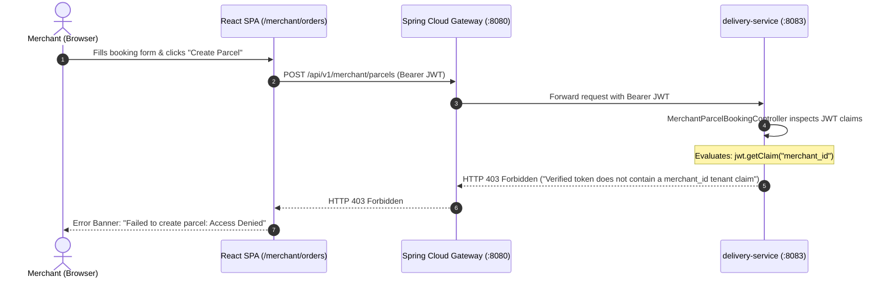
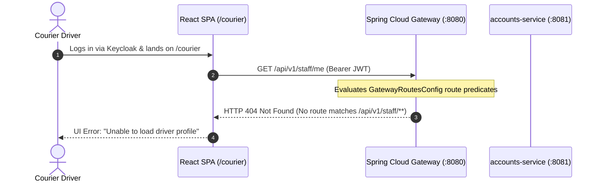

# SwiftDrop System Audit — End-to-End User Journeys & Traceability Matrix

This audit evaluates all 26 core operational and business workflows across SwiftDrop, tracing requests from the React Frontend through the API Gateway, downstream microservices, database transactions, Kafka events, and back to the client.

---

## 1. End-to-End Traceability & Journey Health Matrix

| Flow ID | Journey Name | Initiator / Role | Frontend Screen | Edge Gateway Path | Target Microservice | Status | Key Finding / Blocker |
|---|---|---|---|---|---|---|---|
| **WF-01** | Public Tracking | Unauthenticated Public | `/tracking/:number` | `/api/v1/parcels/public/**` | `delivery-service` | ✅ OPERATIONAL | Working; public rate limit enforced |
| **WF-02** | Customer Instant Quote | Customer / Guest | `/customer/quote` | `/api/v1/pricing/quote` | `pricing-service` | ✅ OPERATIONAL | Real-time quote with surcharge |
| **WF-03** | Customer Parcel Booking | Customer (Authenticated) | `/customer/book` | `/api/v1/parcels` | `delivery-service` | ✅ OPERATIONAL | Persists parcel, emits outbox event |
| **WF-04** | Live SSE Parcel Tracking | Customer / Public | `/tracking/:number` | `/api/v1/parcels/*/stream` | `delivery-service` | ✅ OPERATIONAL | Server-Sent Events with heartbeat |
| **WF-05** | Order History & Receipt | Customer | `/customer/history` | `/api/v1/parcels` | `delivery-service` | ✅ OPERATIONAL | PDF generated via client adapter |
| **WF-06** | Merchant Self-Enrollment | Prospective Merchant | `/merchant/enroll` | `/api/v1/merchants/enroll`| `accounts-service` | ✅ OPERATIONAL | Creates pending enrollment record |
| **WF-07** | Admin Merchant Review | System Administrator | `/admin` | `/api/v1/admin/merchants/*`| `accounts-service` | ✅ OPERATIONAL | Transitions merchant to ACTIVE |
| **WF-08** | Merchant API Key Provisioning| Approved Merchant | `/merchant/credentials` | `/api/v1/merchants/api-keys`| `accounts-service` | ✅ OPERATIONAL | Displays raw key once, stores hash |
| **WF-09** | M2M Parcel Booking (API Key) | Merchant Automated System| External REST Client | `/api/v1/merchant/parcels` | `delivery-service` | ✅ OPERATIONAL | Verifies `X-Merchant-Api-Key` |
| **WF-10** | Merchant Web Portal Booking | Merchant (Browser User) | `/merchant/orders` | `/api/v1/merchant/parcels` | `delivery-service` | ❌ BROKEN | `INT-005` (Missing `merchant_id` in JWT) |
| **WF-11** | Merchant Bulk CSV Order Upload | Merchant | `/merchant/orders` | N/A (Missing Backend Endpoint) | `frontend` (Mock) | ❌ BROKEN | `FE-001` (Orders discarded in memory) |
| **WF-12** | Webhook Registration | Merchant | `/merchant/webhooks` | `/api/v1/merchants/webhooks`| `communications-service`| ✅ OPERATIONAL | Stores URL, secret & subscribed events |
| **WF-13** | Webhook Test Ping Dispatch | Merchant | `/merchant/webhooks` | N/A (Missing Backend Endpoint) | `frontend` (Mock) | ❌ BROKEN | `FE-002` (Hardcoded simulated hash) |
| **WF-14** | Domain Event Outbox -> Kafka | System (Asynchronous) | N/A | Inter-service Kafka | `delivery-service` -> `communications`| ✅ OPERATIONAL | Transactional outbox pattern validated |
| **WF-15** | Webhook Retry & DLQ | System (Asynchronous) | N/A | Outbound HTTP Webhooks | `communications-service`| ✅ OPERATIONAL | 5-tier retry backoff + DLQ storage |
| **WF-16** | Courier Login & Profile Fetch | Courier | `/courier` | `/api/v1/staff/me` | `accounts-service` | ❌ BROKEN | `BE-001` (Gateway 404 on staff route) |
| **WF-17** | Courier Active Runsheet | Courier | `/courier` | `/api/v1/parcels?courierId=*`| `delivery-service` | ✅ OPERATIONAL | Returns assigned parcels for driver |
| **WF-18** | Dispatcher Manual Assignment | Dispatcher | `/dispatcher` | `/api/v1/parcels/*/assign` | `delivery-service` | ✅ OPERATIONAL | Optimistic locking prevents race |
| **WF-19** | Courier Status: PICKED_UP | Courier | `/courier` | `/api/v1/parcels/*/status` | `delivery-service` | ✅ OPERATIONAL | State machine transition CREATED->ASSIGNED->PICKED_UP |
| **WF-20** | Courier Proof-of-Delivery | Courier | `/courier` | `/api/v1/parcels/*/deliver`| `delivery-service` | ✅ OPERATIONAL | Captures signature/photo, updates DELIVERED |
| **WF-21** | Courier Delivery Failure | Courier | `/courier` | `/api/v1/parcels/*/fail` | `delivery-service` | ✅ OPERATIONAL | Records failure reason code & notes |
| **WF-22** | Dispatcher Fleet Overview | Dispatcher | `/dispatcher` | `/graphql` | `graphql-query-service` | ⚠️ DEGRADED | GraphQL fallback port issue (`BE-002`) |
| **WF-23** | Admin Pricing Tier Config | Administrator | `/admin/pricing` | `/api/v1/admin/pricing/**` | `pricing-service` | ⚠️ RISK | `OPS-001` (YAML route precedence) |
| **WF-24** | Admin Daily Outcome Reports | Administrator | `/admin/reports` | `/graphql` | `graphql-query-service` | ❌ BROKEN | `INT-006` (`deliveryStats` UNAVAILABLE) |
| **WF-25** | AI Assistant FAQ & Inquiries | Public / Customer | Float Widget | Local Client Inference | Frontend Assistant | ✅ OPERATIONAL | Resilient client-side fallback |
| **WF-26** | Keycloak Authentication Callback | All Roles | `/auth/callback` | `/realms/swiftdrop/protocol/openid-connect/token` | Keycloak Identity | ⚠️ RISK | `UX-001` (Unassigned role dead-end) |

---

## 2. In-Depth Journey Breakdown for Broken & Degraded Workflows

### 2.1 Journey WF-10: Merchant Web Portal Booking

- **Diagnostic:** Keycloak issues JWT tokens containing realm roles (`MERCHANT`), username, and email. The merchant entity and ID are created inside `accounts-service` after admin approval. Because there is no token enrichment pipeline or dynamic claim resolver, browser sessions lack `merchant_id`.
- **Fix:** Update `delivery-service` to look up `merchant_id` from `accounts-service` using user `sub` if the claim is omitted from the JWT.

---

### 2.2 Journey WF-16: Courier Login & Profile Fetch

- **Diagnostic:** Gateway routes configuration covers `/api/v1/users/**`, `/api/v1/admin/**`, and `/api/v1/merchants/**`. The path `/api/v1/staff/**` was omitted in both `GatewayRoutesConfig.java` and `application.yml`.
- **Fix:** Register `/api/v1/staff/**` in `GatewayRoutesConfig.java` and `application.yml` pointing to `accounts-service`.

---

### 2.3 Journey WF-11: Merchant Bulk CSV Order Upload
- **Current Behavior:** In `BulkOrderUploadModal.tsx`, the file upload reads CSV lines, validates formats, but when the user clicks "Import Orders", the component executes a `setTimeout` of 1.5 seconds, displays an artificial progress bar, and calls `onImportComplete(validRows.length)`.
- **Backend Trace:** Zero network requests are logged in the browser Network panel. No parcels are created in `delivery-service`.
- **Fix:** Add a dedicated bulk booking endpoint in `delivery-service` and connect the modal via React Query mutation.

---

### 2.4 Journey WF-24: Admin & Dispatcher Operational Reports
- **Current Behavior:** The Reports page issues a GraphQL query `{ deliveryStats(from: "...", to: "...") { totalBooked inTransit delivered failed } }`.
- **Backend Trace:** `GraphqlRuntimeConfig.java` delegates to a gRPC stub that was deferred under ADR `LATER_11`. The method throws `Status.UNAVAILABLE.asRuntimeException()`.
- **Result:** The GraphQL response returns errors array: `{"message": "gRPC provider for deliveryStats is deferred"}`. The frontend catches this error and surfaces a persistent red alert banner.
- **Fix:** Provide a concrete implementation in `delivery-service` or return aggregated zeros rather than an unhandled gRPC exception.
