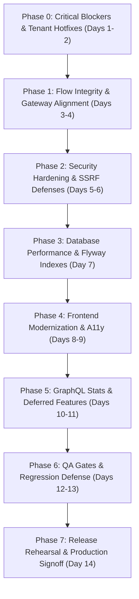

# SwiftDrop System Audit — Implementation Roadmap & Remediation Plan

This roadmap provides a sequenced, phased, and evidence-based plan to guide the engineering team from the current audited state (`test` branch) to a fully integrated, secure, resilient, and release-ready production system.

---

## Roadmap Phases Overview

---

## Phase 0: Immediate Critical Hotfixes (Days 1–2)
**Objective:** Restore broken staff login profiles, fix gateway port misdirection, resolve merchant browser tenant authentication, and eliminate fake UI mocks.

| Task ID | Finding ID | Description | Module / Files | Owner | Effort |
|---|---|---|---|---|---|
| **T0.1** | `BE-001` | Add Gateway Route for `/api/v1/staff/**` | `api-gateway`: `GatewayRoutesConfig.java`, `application.yml` | Platform Lead | 2h |
| **T0.2** | `BE-002` | Fix GraphQL Fallback Port Default to `8085` | `api-gateway`: `GatewayRoutesConfig.java` (Line 31) | Platform Lead | 30m |
| **T0.3** | `INT-005` | Resolve `merchant_id` for Browser Merchant Sessions | `delivery-service`: `MerchantParcelBookingController.java` | Delivery / Security Lead | 1.5d |
| **T0.4** | `FE-001` | Replace Mock Bulk Order Upload with Real Intake API | `frontend`: `BulkOrderUploadModal.tsx`, `delivery-service` | Frontend / Delivery Lead | 1d |
| **T0.5** | `FE-002` | Replace Simulated Webhook Ping with Authentic Endpoint | `frontend`: `WebhookSubscriptionList.tsx`, `communications` | Frontend / Comms Lead | 1d |

### Test Gate & Acceptance Criteria:
- Running `curl -H "Authorization: Bearer $STAFF_TOKEN" http://localhost:8080/api/v1/staff/me` returns HTTP 200 with staff member details.
- Authenticated merchant in React SPA can submit parcel booking and view orders without 403 Forbidden.
- Confirming bulk CSV import dispatches network requests and returns genuine parcel IDs.
- Webhook test ping issues an authentic outbound HTTP POST and displays real latency and status.

---

## Phase 1: Core Flow Integrity & Gateway Alignment (Days 3–4)
**Objective:** Eliminate YAML-Java configuration drift in API Gateway, deduplicate CORS response headers, and resolve unassigned role routing loops.

| Task ID | Finding ID | Description | Module / Files | Owner | Effort |
|---|---|---|---|---|---|
| **T1.1** | `OPS-001` | Declare `/api/v1/admin/pricing/**` Route in `application.yml` | `api-gateway`: `application.yml` | Platform Lead | 1h |
| **T1.2** | `SEC-002` | Configure Gateway CORS Deduplication Filter | `api-gateway`: `application.yml` | Gateway Lead | 2h |
| **T1.3** | `UX-001` | Redirect Unassigned Users to Informative `/unauthorized` Screen | `frontend`: `AuthPages.tsx`, `redirect.ts` | Frontend Lead | 3h |

### Test Gate & Acceptance Criteria:
- Preflight OPTIONS requests across all routes return exactly one `Access-Control-Allow-Origin` header.
- Users authenticated without assigned realm roles are directed to a status page with an explicit Logout button.

---

## Phase 2: Security & Tenant Hardening (Days 5–6)
**Objective:** Harden Server-Side Request Forgery (SSRF) defenses and verify private object storage access controls.

| Task ID | Finding ID | Description | Module / Files | Owner | Effort |
|---|---|---|---|---|---|
| **T2.1** | `SEC-001` | Add IPv6, Loopback & Cloud IMDS Checks in Webhook Validator | `communications-service`: `WebhookDestinationValidator.java` | Security Lead | 4h |
| **T2.2** | — | Verify S3/MinIO Pre-signed URL Expiry & MIME Whitelist | `delivery-service`: `DeliveryProofStorageAdapter.java` | Delivery Lead | 3h |
| **T2.3** | — | Verify Keycloak Token Refresh Rotation & Session Revocation | `shared/security-adapter`, `platform/identity` | Security Lead | 4h |

### Test Gate & Acceptance Criteria:
- Registering webhooks pointing to `169.254.169.254`, `[::1]`, or `[fe80::1]` throws `InvalidDestinationException`.
- Direct unauthenticated access to S3/MinIO bucket returns 403 Access Denied; pre-signed URLs expire within 15 minutes.

---

## Phase 3: Database Performance & Flyway Indexes (Day 7)
**Objective:** Optimize database query performance and index foreign keys ahead of production volume.

| Task ID | Finding ID | Description | Module / Files | Owner | Effort |
|---|---|---|---|---|---|
| **T3.1** | `DB-001` | Add Composite Index on `parcels (merchant_id, created_at DESC)` | `delivery-service`: `db/migration/V11__add_idx_parcels_merchant_id.sql` | DB Reliability Lead | 2h |
| **T3.2** | — | Audit All PostgreSQL Schemas for Missing Foreign Key Indexes | All backend services | DB Reliability Lead | 4h |

### Test Gate & Acceptance Criteria:
- Running `EXPLAIN ANALYZE SELECT * FROM parcels WHERE merchant_id = 'm_123'` proves an index scan is utilized.

---

## Phase 4: Frontend Modernization & A11y Remediation (Days 8–9)
**Objective:** Eliminate large bundle chunk warnings, implement route-level code splitting, and achieve WCAG 2.2 AA compliance.

| Task ID | Finding ID | Description | Module / Files | Owner | Effort |
|---|---|---|---|---|---|
| **T4.1** | `FE-003` | Implement `React.lazy()` Route Splitting & Manual Chunks | `frontend`: `routes.tsx`, `vite.config.ts` | Frontend Lead | 4h |
| **T4.2** | `A11Y-001`| Replace `window.alert()` with Inline Accessible Alert Banner | `frontend`: `BulkOrderUploadModal.tsx` | Senior UI/UX Engineer | 1h |
| **T4.3** | `A11Y-002`| Add `focus-visible` Keyboard Focus Rings to Timeline Milestones | `frontend`: `TrackingTimeline.tsx` | Senior UI/UX Engineer | 1h |

### Test Gate & Acceptance Criteria:
- `npm run build` completes with zero chunks exceeding 300 kB.
- No `window.alert` calls remain in the codebase.
- Full keyboard Tab navigation on `/tracking/:number` visually illuminates every interactive element.

---

## Phase 5: GraphQL Deferred Feature Completion (Days 10–11)
**Objective:** Implement deferred `deliveryStats` gRPC service to eliminate GraphQL runtime errors on Admin and Dispatcher reports.

| Task ID | Finding ID | Description | Module / Files | Owner | Effort |
|---|---|---|---|---|---|
| **T5.1** | `INT-006` | Implement gRPC `DeliveryStatsService` in `delivery-service` | `delivery-service`: `grpc/DeliveryStatsServiceImpl.java` | Delivery Lead | 1.5d |
| **T5.2** | `INT-006` | Implement `DeliveryStatsResolver` in `graphql-query-service` | `graphql-query-service`: `resolvers/` | GraphQL Lead | 1d |
| **T5.3** | — | Close ADR `LATER_11_GRAPHQL_DELIVERY_STATS.md` | `docs/architecture/adr/` | Microservices Architect | 2h |

### Test Gate & Acceptance Criteria:
- Querying `{ deliveryStats { totalBooked inTransit delivered failed } }` via GraphQL playground returns valid non-null metrics with zero errors.
- Admin Reports page loads without error alert banners.

---

## Phase 6: QA Gates & Regression Defense (Days 12–13)
**Objective:** Close test blindspots in Gateway routing and automated integration suites.

| Task ID | Finding ID | Description | Module / Files | Owner | Effort |
|---|---|---|---|---|---|
| **T6.1** | `QA-001` | Add Exhaustive Route Test Suite in `GatewayRoutesConfigTest` | `api-gateway`: `src/test/java/...` | QA Lead | 3h |
| **T6.2** | `QA-002` | Support Local Gateway Fallback in Python Ingress Tests | `tests/`: `test_ingress.py` | QA Lead | 2h |
| **T6.3** | — | Add Contract Test for Raw Keycloak Merchant JWT Session | `delivery-service`: `src/test/java/...` | QA / Delivery Lead | 4h |

### Test Gate & Acceptance Criteria:
- `mvn test` across all services asserts 100% of defined routes.
- `python3 -m unittest discover -s tests` passes 316 tests with 0 skipped when pointing to local gateway.

---

## Phase 7: Final Release Rehearsal & Production Signoff (Day 14)
**Objective:** Full end-to-end dress rehearsal in staging k3d cluster and formal release gate signoff.

| Task ID | Description | Verification Method | Owner | Effort |
|---|---|---|---|---|
| **T7.1** | Clean Local Cluster Rehearsal | `./scripts/deploy-k3d.sh` from scratch | DevOps Lead | 2h |
| **T7.2** | Automated Smoke & E2E Run | Execute full Python test suite against running cluster | QA Lead | 2h |
| **T7.3** | Performance & Load Sanity Check | K6/JMeter load test: 100 concurrent bookings/sec | SRE Lead | 3h |
| **T7.4** | Final Release Signoff | Sign off all items in `RELEASE_READINESS_CHECKLIST.md` | Lead Architect | 1h |
