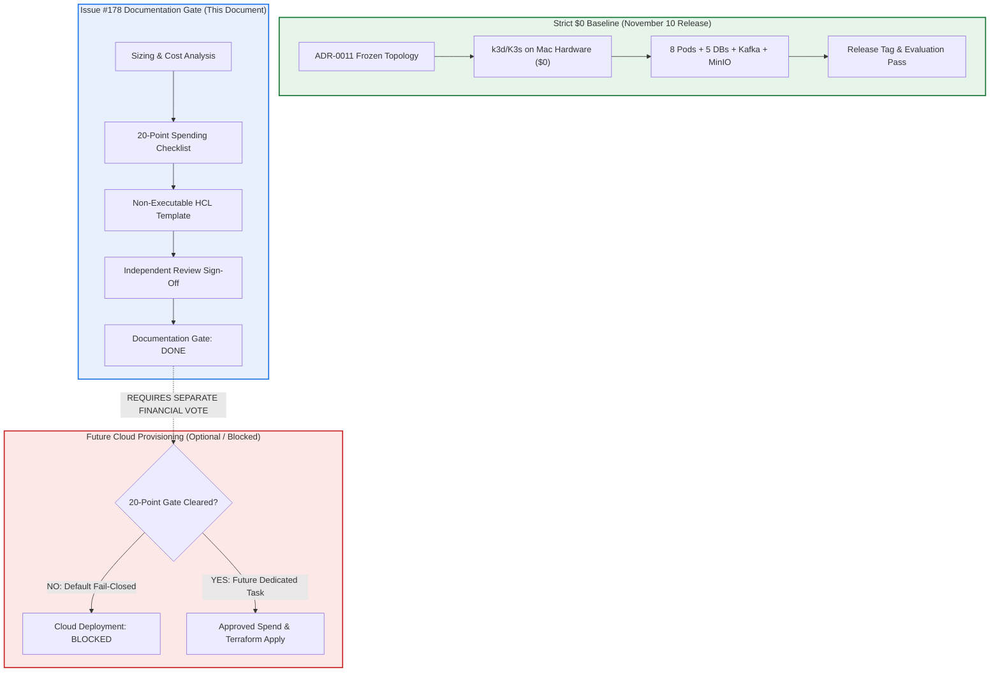
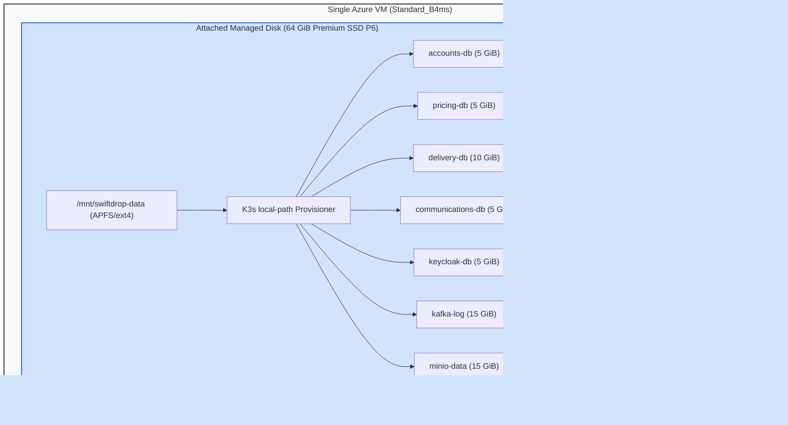
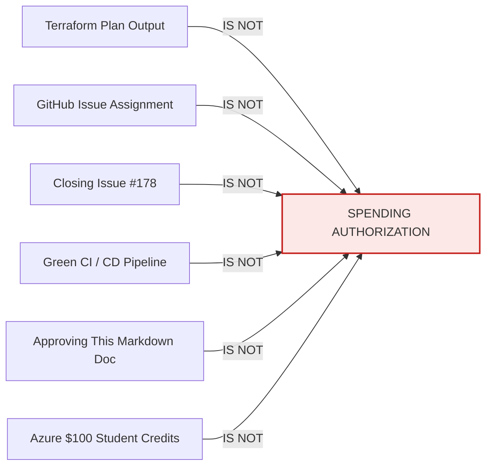

# SwiftDrop Optional Future Azure Cloud K3s Spending Authorization Gate & Sizing Analysis

**Document Status:** PROPOSED — PLANNING ONLY / CLOUD DEPLOYMENT STRICTLY BLOCKED  
**Canonical Architecture Reference:** [`docs/architecture/adr/ADR-0011-strict-zero-cost-hosting-and-azure-allowlist.md`](../architecture/adr/ADR-0011-strict-zero-cost-hosting-and-azure-allowlist.md)  
**Machine-Readable Allowlist Contract:** [`platform/security/azure-allowlist-policy.yaml`](../../platform/security/azure-allowlist-policy.yaml)  
**OIDC & State Boundary Reference:** [`docs/security/TERRAFORM_STATE_AND_OIDC_BOUNDARY.md`](../security/TERRAFORM_STATE_AND_OIDC_BOUNDARY.md)  
**Release Evidence & Operator Handover:** [`docs/deployment/N10_ZC06_ZERO_COST_OPERATOR_HANDOVER.md`](N10_ZC06_ZERO_COST_OPERATOR_HANDOVER.md)  
**Originating Delivery Task:** [GitHub Issue #178 (Optional Future Work)](https://github.com/Suthankan1/swiftdrop/issues/178)  
**Primary Author & Platform Lead:** Suthankan1 (@Suthankan1 — Platform / Cloud Architect / DevOps Lead)  
**Required Independent Reviewers:** Harithkeshan (@Harithkeshan — Platform Architecture), Vibhushan (@Vibhushan-2003 — Security & Quality)  
**Milestone:** November 10, 2026 — Full SwiftDrop Release (Optional Future Bonus, Excluded from Critical Path)  

---

> [!CAUTION]
> ### AUTHORITATIVE SPENDING & DEPLOYMENT STATUS: STRICTLY NOT AUTHORIZED
>
> - **Azure Cloud K3s: OPTIONAL FUTURE WORK**
> - **Implementation authorization: NOT AUTHORIZED**
> - **Spending authorization: NOT AUTHORIZED**
> - **Cloud deployment: BLOCKED**
> - **November 10 critical-path dependency: NO**
>
> This document defines a non-executable planning analysis, sizing framework, and formal spending authorization gate. **Approval of this document does NOT authorize cloud deployment, does NOT modify the operational $0 allowlist, does NOT provision infrastructure, and does NOT grant permission to incur financial charges or spend Azure promotional credits.**

---

## 1. Executive Summary & Authoritative Governance

SwiftDrop is an enterprise software platform consisting of eight application and identity workloads (React 19 SPA, Spring Cloud API Gateway, Accounts & Partners, Pricing & Zones, Delivery Operations, Communications, GraphQL Query API, and Keycloak Identity Provider) backed by five isolated PostgreSQL databases, Kafka KRaft, and MinIO object storage.

Under **ADR-0011**, the SwiftDrop project established a binding **strict $0 cost-safety ceiling** and froze the authoritative release topology to **local k3d / K3s running on existing hardware (`arm64`)** for the November 10, 2026 release milestone.

### 1.1 Separation of Documentation Gate vs. Deployment Authorization
This deliverable resolves [GitHub Issue #178](https://github.com/Suthankan1/swiftdrop/issues/178) by establishing the complete optional-future sizing assessment, billable category breakdown, and multi-signature governance gate. The completion of this documentation gate is strictly decoupled from cloud deployment:



### 1.2 Core Guarantees Retained
1. **Zero Cloud Provisioning:** No Azure Virtual Machines, Managed Disks, Public IPs, NAT Gateways, Load Balancers, AKS clusters, or Azure Storage accounts are provisioned or declared in executable code.
2. **Deny-by-Default Allowlist:** `platform/security/azure-allowlist-policy.yaml` remains `deployment_authorized: false` with empty allowlists (`[]`).
3. **Promotional Credits Disqualified:** Azure for Students credits ($100 balance) do not satisfy the strict $0 rule and cannot be consumed.
4. **No Critical Path Impact:** The November 10 release proceeds entirely on the local k3d/K3s baseline ([#175](https://github.com/Suthankan1/swiftdrop/issues/175), [#176](https://github.com/Suthankan1/swiftdrop/issues/176), [#177](https://github.com/Suthankan1/swiftdrop/issues/177)).

---

## 2. Future Conceptual Architecture (Planning Level Only)

If and when a future spending authorization is granted by unanimous team consent and academic sponsor funding, SwiftDrop could be hosted on a cloud-hosted virtual machine running K3s. The conceptual architecture below is documented **strictly for technical evaluation and sizing**.

### 2.1 Cluster Topology & Node Architecture
- **Control Plane & Data Plane Model:** Single-node K3s deployment (`server` mode with `--disable traefik` or embedded Traefik). For a staging/evaluation environment, a single VM hosting both control plane (embedded SQLite / etcd) and worker workloads minimizes control plane overhead.
- **Host Operating System:** Canonical Ubuntu 24.04 LTS (`amd64` / `x86_64`). Enterprise kernel, systemd service supervision, standard cgroups v2, and ufw / iptables packet filtering.
- **CPU & Memory Architecture:** Architecture translation from local development (`arm64` Apple Silicon) to cloud (`amd64`). Multi-architecture container images must be built and tested for `linux/amd64` provenance.

### 2.2 System Resource Budget & VM Sizing Analysis
Based on real profiling and JVM heap configurations documented in ADR-0011 §7.3, SwiftDrop's eight workloads and stateful backing services demand a strict minimum working set:

| Workload Component | Process Type | Heap / Max Memory Allocation | Minimum Working Set (RSS) |
|---|---|---|---|
| **JVM Business Services** | Accounts, Pricing, Delivery, Communications (4 Spring Boot apps) | 512 MiB heap each (`-Xmx512m`) | ~2,048 MiB |
| **Edge Gateways** | Spring Cloud API Gateway + GraphQL Query API (2 apps) | 512 MiB heap each (`-Xmx512m`) | ~1,024 MiB |
| **Keycloak IdP** | Quarkus JVM Runtime | 1,024 MiB heap (`-Xmx1024m`) | ~1,024 MiB |
| **Relational Databases** | 5 PostgreSQL database instances | Shared buffer pools + cache | ~768 MiB |
| **Event Broker** | Apache Kafka KRaft broker | 512 MiB heap (`-Xmx512m`) | ~640 MiB |
| **Object Storage & Mail** | MinIO S3 + Mailpit SMTP | Compiled Go binaries | ~256 MiB |
| **Frontend Static Host** | NGINX container serving `frontend/dist/` | Lightweight static web process | ~128 MiB |
| **K3s Node Overhead** | `k3s-server`, containerd, Flannel CNI, CoreDNS | Control plane daemons | ~768 MiB |
| **Linux OS Overhead** | Kernel, systemd, sshd, journald, disk cache | Base operating system | ~512 MiB |
| **Total Stack Requirement** | **Complete SwiftDrop Enterprise Stack** | **Peak Memory Demand** | **~7,168 MiB (~7.0 GiB)** |

> [!WARNING]
> ### Sizing Trap: Rejection of Standard_B2s (4 GiB RAM)
> A common cloud miscalculation is selecting a cheap `Standard_B2s` VM (2 vCPUs, 4 GiB RAM, ~$30.37/mo). At 4 GiB physical RAM, the Linux kernel Out-Of-Memory killer (`oom-killer`) would immediately terminate Keycloak, Kafka, or PostgreSQL processes during container startup.
>
> Therefore, the **minimum viable VM tier is 16 GiB RAM / 4 vCPUs**:
> - **Option 1 (Burstable):** `Standard_B4ms` (4 vCPUs, 16 GiB RAM, 2,880 max IOPS). Cost: ~$121.18/mo (730h) or ~$6.64 for a 40-hour demonstration window.
> - **Option 2 (General Purpose):** `Standard_D4s_v5` (4 vCPUs, 16 GiB RAM, 6,400 max IOPS). Cost: ~$140.16/mo (730h) or ~$7.68 for a 40-hour demonstration window.

### 2.3 Storage Architecture: Local-Path vs. Cloud Managed Disks
SwiftDrop utilizes seven distinct Persistent Volume Claims (PVCs):
- 5 PVCs for isolated PostgreSQL databases (`accounts`, `pricing`, `delivery`, `communications`, `keycloak`)
- 1 PVC for Kafka KRaft transaction logs and commit partitions
- 1 PVC for MinIO proof-of-delivery photos and PDF artifacts



- **Architectural Decision on Storage:** Attaching individual Azure Managed Disks per PVC via Azure Disk CSI driver is **REJECTED**:
  1. A `Standard_B4ms` VM supports a maximum of 8 data disk attachments; consuming 7 attachments for PVCs leaves zero expansion headroom.
  2. 7 individual Premium SSD P4 disks (32 GiB minimum each) would cost $5.28 × 7 = **$36.96/month** in static storage fees alone.
  3. **Selected Future Design:** Attach a single 64 GiB Premium SSD (`P6`, 240 IOPS, $10.21/mo) mounted at `/mnt/swiftdrop-data`. The standard K3s `local-path` provisioner binds PVCs to isolated subdirectories on this high-performance volume, preserving dynamic volume isolation at 72% lower storage cost.

### 2.4 Ingress, Networking, and External HTTPS Access
- **Network Interface & Public IP:** The VM requires one Static Standard Public IPv4 address ($0.005/hr = ~$3.65/mo) bound to its Network Interface (NIC).
- **Ingress Controller:** K3s embedded Traefik or ingress-nginx listening directly on host ports 80 (HTTP) and 443 (HTTPS). This eliminates the need for an Azure Standard Load Balancer ($18.25/mo) or Azure NAT Gateway ($32.85/mo).
- **TLS & Certificate Automation:** `cert-manager` deploying Let's Encrypt production certificates via ACME HTTP-01 challenge against the public domain.
- **DNS Routing:** Wildcard DNS record pointing to the Public IP (e.g., `*.swiftdrop.example.com` or free wildcard IP DNS `*.20.x.x.x.nip.io`).
- **Network Security Group (NSG) Rules:**
  - Port 22 (SSH): Restricted to authorized operator IP addresses only.
  - Port 80 (HTTP): Open to Internet (automatic 301 redirect to HTTPS).
  - Port 443 (HTTPS): Open to Internet (terminates at Ingress).
  - All internal ports (`:5432`, `:9090`, `:9092`, `:9000`): Strictly denied from external ingress; routable only within the K3s Flannel overlay network (`10.42.0.0/16`).

### 2.5 Backup, Observability, and Operational Custody
- **Database Backups:** Automated cron job executing `pg_dump` on all 5 databases daily, compressed with gzip, encrypted with AES-256-GCM, and stored locally or uploaded to cold storage.
- **In-Cluster Observability:** Prometheus and Grafana deployed inside K3s with strict resource quotas (256 MiB RAM limit). Azure Monitor and Log Analytics are **strictly prohibited** to eliminate variable per-GB ingestion billing.
- **Named Operator Role:** A specific human engineer must be designated as active cluster operator and billing custodian to perform security patching, verify backup integrity, and ensure prompt deallocation.

---

## 3. Architecture Comparison: Local k3d vs. Azure VM K3s vs. Azure Kubernetes Service (AKS)

The table below contrasts the three architectures across technical, operational, and financial dimensions:

| Architectural Dimension | 1. Local k3d / K3s (Frozen Target) | 2. Azure VM-Hosted K3s (Optional Future) | 3. Azure Kubernetes Service (AKS) |
|---|---|---|---|
| **Hosting Environment** | Local Apple Silicon MacBook Pro (`arm64`) | Single Azure IaaS VM (`Standard_B4ms`, `amd64`) | Azure Managed Control Plane + VM Agent Pool |
| **Control Plane Sizing** | Lightweight containerized k3s server | In-VM embedded SQLite / etcd k3s server | Managed Highly-Available Kubernetes API |
| **Worker Compute Nodes** | Host Docker daemon containers | 1 VM acting as single node (master + worker) | Minimum 2-3 worker VMs (`Standard_D2s_v5`) |
| **Compute Base Cost** | **$0.00** (Existing hardware) | **$121.18 / mo** (or ~$6.64 for 40h demo) | **~$140.16 – $210.24 / mo** (2-3 nodes) |
| **Cluster Management Fee**| **$0.00** | **$0.00** (K3s is free open source) | $0.00 (Free Tier) / $73.00/mo (Standard SLA) |
| **Persistent Storage Cost**| **$0.00** (Local NVMe SSD APFS) | **$13.22 / mo** (32GB OS + 64GB Data Disk) | **~$36.96 – $73.92 / mo** (Individual CSI Disks) |
| **Public IP & Ingress** | **$0.00** (Localhost / Loopback / Tunnel) | **$3.65 / mo** (1 Static Standard IPv4) | **~$21.90 / mo** (Standard LB + Public IP) |
| **Egress Networking** | **$0.00** (Local network) | $0.00 (First 100 GB free globally) | $0.00 (First 100 GB free globally) |
| **Total Monthly Spend** | **$0.00 USD (STRICT ZERO COST)** | **~$138.05 / mo** (24/7) or **~$10.00** (40h demo)| **~$199.02 – $306.06 / month** |
| **Hardware Headroom** | 10 CPU cores, 16 GiB RAM, 93 GiB SSD | 4 vCPUs, 16 GiB RAM, 64 GiB SSD | 4-6 vCPUs, 16-24 GiB RAM |
| **Operational Overhead** | Zero cloud maintenance; operator host custody | Moderate: Linux OS patching, NSG maintenance | High: Managed K8s upgrades, CNI/CSI drivers |
| **Billing Failure Risk** | **Zero financial risk** | Risk of credit card overdraft if VM left running| **Severe financial cliff-edge** |
| **Policy Determination** | **APPROVED DEFAULT FOR NOV 10** | **OPTIONAL FUTURE BONUS (BLOCKED)** | **PERMANENTLY REJECTED — PROHIBITIVE** |

### 3.1 Rationale for Rejecting Azure Kubernetes Service (AKS)
AKS is widely marketed as offering a "Free" control plane. However, in enterprise deployment:
1. **Worker Node Mandate:** The control plane is free, but worker nodes require full VM compute charges. Running SwiftDrop's 7.5 GiB memory stack across a recommended 2-node cluster requires at least two `Standard_D2s_v5` instances (~$140.16/mo).
2. **Mandatory Load Balancer Fees:** AKS automatically provisions an Azure Standard Load Balancer for ingress routing, adding $18.25/mo plus $0.005 per GB of data processed.
3. **CSI Managed Disks:** Dynamic volume provisioning creates independent Azure Managed Disks for each PVC, incurring ~$37/mo in unattached storage meters.
4. **Conclusion:** AKS is a commercial enterprise solution costing >$200/month. Attempting to run AKS on student credits would exhaust the entire $100 balance in fewer than 15 days, resulting in immediate cluster termination.

### 3.2 Open Source K3s Does Not Mean Free Azure Infrastructure
K3s is an open-source, CNCF-certified lightweight Kubernetes distribution with a binary size under 100 MB. However, **open-source software licensing does not eliminate cloud provider infrastructure fees**. Running K3s in the cloud still incurs compute, disk, network, and IP meter charges.

---

## 4. Comprehensive Future Cost & Subscription Assessment

Every material potential spending category for hosting K3s on Azure has been researched against official Microsoft Azure pricing documentation as of **October 29, 2026**.

### 4.1 Target Azure Region & Offer Eligibility
- **Candidate Region:** `East US` (or `West Europe`). Selected for lowest baseline VM/disk pricing and broad SKU availability.
- **Subscription Type:** Microsoft Azure Pay-As-You-Go (`MS-AZR-0003P`) or academic direct sponsorship.
- **Promotional Credit Invariant:** Azure for Students promotional credit (`MS-AZR-0170P`) is explicitly **disqualified**. Any future deployment must be funded by an approved monetary grant or credit card backing with a proven hard spending cap.

### 4.2 Comprehensive 18-Category Spending Breakdown

| # | Spending Category | Azure Meter / SKU | Pricing Unit | 24/7 Qty (730h/mo) | 24/7 Cost (USD) | Demo Qty (40h) | Demo Cost (USD) | Calculation Basis & Assumptions | Official Pricing Source URL | Date Verified | Overage Exposure & Risk | Policy Classification |
|---|---|---|---|---|---|---|---|---|---|---|---|---|
| **1** | **Primary VM Compute** | `Standard_B4ms` (Linux, 4 vCPU, 16 GiB RAM) | $0.166 / hour | 730 hours | $121.18 | 40 hours | $6.64 | East US on-demand rate. Burstable CPU credits sufficient for baseline workloads. | [azure.microsoft.com/pricing/details/virtual-machines/linux/](https://azure.microsoft.com/en-us/pricing/details/virtual-machines/linux/) | 2026-10-29 | Billed while VM is in `Running` state; $0 when `Deallocated`. | **OPTIONAL FUTURE — BILLABLE** |
| **2** | **OS Managed Disk** | 32 GiB Standard SSD (`E4` LRS) | $1.54 / month | 1 disk | $1.54 | 1 disk (prorated) | $0.20 | Base Ubuntu OS, container runtimes, k3s binaries. Persistent fixed fee. | [azure.microsoft.com/pricing/details/managed-disks/](https://azure.microsoft.com/en-us/pricing/details/managed-disks/) | 2026-10-29 | Bills continuously even when VM is deallocated until deleted. | **OPTIONAL FUTURE — BILLABLE** |
| **3** | **Data Managed Disk** | 64 GiB Premium SSD (`P6` LRS, 240 IOPS) | $10.21 / month | 1 disk | $10.21 | 1 disk (prorated) | $1.36 | Dedicated volume for 7 K3s PVCs (5 DBs, Kafka, MinIO). High IOPS prevents DB locks. | [azure.microsoft.com/pricing/details/managed-disks/](https://azure.microsoft.com/en-us/pricing/details/managed-disks/) | 2026-10-29 | Bills continuously even when VM is stopped until deleted. | **OPTIONAL FUTURE — BILLABLE** |
| **4** | **Disk I/O Transactions**| Standard/Premium IOPS Operations | $0.0014 / 10k ops | ~10M transactions | $1.40 | ~1M transactions | $0.14 | Kafka commits, DB WAL writes. Standard SSDs meter transactions; Premium includes IOPS cap. | [azure.microsoft.com/pricing/details/managed-disks/](https://azure.microsoft.com/en-us/pricing/details/managed-disks/) | 2026-10-29 | Variable consumption meter based on disk write volume. | **OPTIONAL FUTURE — BILLABLE** |
| **5** | **Public IPv4 Address** | Standard Static Public IPv4 | $0.005 / hour | 730 hours | $3.65 | 40 hours | $0.20 | Basic IPs retired. Standard IP charged per hour allocated to NIC. | [azure.microsoft.com/pricing/details/ip-addresses/](https://azure.microsoft.com/en-us/pricing/details/ip-addresses/) | 2026-10-29 | Hourly charge while allocated, even if VM is deallocated. | **OPTIONAL FUTURE — BILLABLE** |
| **6** | **Outbound Egress** | Internet Egress (Zone 1) | Free <=100 GB; then $0.087/GB | 20 GB outbound | $0.00 | 5 GB outbound | $0.00 | Global Azure egress allowance: first 100 GB/month is free per subscription. | [azure.microsoft.com/pricing/details/bandwidth/](https://azure.microsoft.com/en-us/pricing/details/bandwidth/) | 2026-10-29 | Overages beyond 100 GB incur metered charges ($0.087/GB). | **OPTIONAL FUTURE — MONITORED** |
| **7** | **Inbound Ingress** | Internet Ingress | $0.00 / GB | Unlimited | $0.00 | Unlimited | $0.00 | All inbound data transfer to Azure is free of charge. | [azure.microsoft.com/pricing/details/bandwidth/](https://azure.microsoft.com/en-us/pricing/details/bandwidth/) | 2026-10-29 | None. | **NON-BILLABLE** |
| **8** | **VNet & Inter-Zone** | Intra-VNet Networking | $0.00 / GB | Single subnet | $0.00 | Single subnet | $0.00 | All traffic within a single VNet and availability zone is non-billable. | [azure.microsoft.com/pricing/details/virtual-network/](https://azure.microsoft.com/en-us/pricing/details/virtual-network/) | 2026-10-29 | Cross-region or cross-zone peering would incur meters. | **NON-BILLABLE (SINGLE ZONE)** |
| **9** | **Load Balancer** | Azure Standard Load Balancer | $0.025 / hour | 0 rules (Not used) | $0.00 | 0 rules | $0.00 | **AVOIDED:** Ingress binds directly to VM HostPort (80/443). LB is rejected ($18.25/mo saved). | [azure.microsoft.com/pricing/details/load-balancer/](https://azure.microsoft.com/en-us/pricing/details/load-balancer/) | 2026-10-29 | If deployed, incurs fixed $18.25/mo + $0.005/GB data fees. | **EXCLUDED / REJECTED** |
| **10**| **NAT Gateway** | Standard NAT Gateway | $0.045 / hour | 0 gateways (Not used)| $0.00 | 0 gateways | $0.00 | **AVOIDED:** VM uses direct public IP egress. NAT Gateway rejected ($32.85/mo saved). | [azure.microsoft.com/pricing/details/azure-nat-gateway/](https://azure.microsoft.com/en-us/pricing/details/azure-nat-gateway/) | 2026-10-29 | If deployed, incurs fixed $32.85/mo + $0.045/GB data fees. | **EXCLUDED / REJECTED** |
| **11**| **DNS Routing** | Azure DNS Hosted Zone | $0.50 / zone / mo | 0 zones (Not used) | $0.00 | 0 zones | $0.00 | **AVOIDED:** Wildcard IP DNS (`*.nip.io`) or external DNS (Cloudflare free) used instead. | [azure.microsoft.com/pricing/details/dns/](https://azure.microsoft.com/en-us/pricing/details/dns/) | 2026-10-29 | Fixed monthly zone fee + query transaction fees. | **EXCLUDED / REJECTED** |
| **12**| **Backup Cold Storage** | Azure Blob Storage (Cold Tier LRS)| $0.0036 / GB / mo | 15 GB database dumps | $0.05 | 15 GB dumps | $0.05 | Offsite encrypted pg_dump archives + MinIO snapshots. | [azure.microsoft.com/pricing/details/storage/blobs/](https://azure.microsoft.com/en-us/pricing/details/storage/blobs/) | 2026-10-29 | Write operations cost $0.05 per 10k transactions. | **OPTIONAL FUTURE — BILLABLE** |
| **13**| **Log Analytics Workspace**| Azure Monitor / Log Analytics | $2.30 / GB ingested | 0 GB (Not used) | $0.00 | 0 GB | $0.00 | **AVOIDED:** High log volume from Kafka/Keycloak would explode costs. Local logging used. | [azure.microsoft.com/pricing/details/monitor/](https://azure.microsoft.com/en-us/pricing/details/monitor/) | 2026-10-29 | Ingestion meter charges $2.30/GB. High financial risk. | **EXCLUDED / REJECTED** |
| **14**| **Azure Monitor Alerts**| Metric Alert Rules & Action Groups | $0.10 / rule / mo | 0 rules (Not used) | $0.00 | 0 rules | $0.00 | **AVOIDED:** Azure alert rules and SMS actions ($0.08/msg) rejected. In-cluster scripts used. | [azure.microsoft.com/pricing/details/monitor/](https://azure.microsoft.com/en-us/pricing/details/monitor/) | 2026-10-29 | Per-rule monthly fee + per-message telephony charges. | **EXCLUDED / REJECTED** |
| **15**| **Microsoft Defender** | Defender for Cloud (Server P1) | $5.00 / server / mo| 0 servers (Disabled)| $0.00 | 0 servers | $0.00 | **AVOIDED:** Automatically enabled on subscriptions unless opted out. Must be disabled. | [azure.microsoft.com/pricing/details/defender-for-cloud/](https://azure.microsoft.com/en-us/pricing/details/defender-for-cloud/) | 2026-10-29 | Fixed monthly security charge per VM. | **EXCLUDED / DISABLED** |
| **16**| **Key Vault** | Azure Key Vault Standard | $0.03 / 10k transactions| 0 vaults (Not used)| $0.00 | 0 vaults | $0.00 | **AVOIDED:** Kubernetes native Secret resources used. Eliminates Key Vault transaction fees. | [azure.microsoft.com/pricing/details/key-vault/](https://azure.microsoft.com/en-us/pricing/details/key-vault/) | 2026-10-29 | Metered per secret read/write transaction. | **EXCLUDED / REJECTED** |
| **17**| **Terraform Cloud State**| Azure Blob Storage (Hot Tier LRS) | $0.0184 / GB / mo | 0 accounts (Not used)| $0.00 | 0 accounts | $0.00 | **AVOIDED:** Safe state custody remains local to named operator outside Git checkout. | [azure.microsoft.com/pricing/details/storage/blobs/](https://azure.microsoft.com/en-us/pricing/details/storage/blobs/) | 2026-10-29 | Storage account base fees, read/write API operations. | **EXCLUDED / REJECTED** |
| **18**| **OS License** | Canonical Ubuntu Linux | $0.00 (Open Source) | 1 VM | $0.00 | 1 VM | $0.00 | Ubuntu Linux base image carries zero Microsoft licensing surcharge. | [azure.microsoft.com/pricing/details/virtual-machines/linux/](https://azure.microsoft.com/en-us/pricing/details/virtual-machines/linux/) | 2026-10-29 | Windows Server would incur ~$0.04/vCPU/hr licensing. | **NON-BILLABLE** |

### 4.3 Summary of Financial Scenarios (Nonbinding Projections)

```
+-----------------------------------------------------------------------------------------+
| SWIFTDROP CLUSTER COST PROJECTION MATRIX (ALL CHARGES IN USD)                           |
+------------------------------------+--------------------------+-------------------------+
| Scenario                           | Operating Duration       | Projected Total Cost    |
+------------------------------------+--------------------------+-------------------------+
| A. Continuous 24/7 (Standard_B4ms) | 1 Month (730 Hours)      | $138.03 / month         |
| B. Continuous 24/7 (Standard_D4s_v5)| 1 Month (730 Hours)      | $157.01 / month         |
| C. On-Demand Demonstration Window  | 40 Operating Hours       | $9.74 total             |
| D. Current Frozen Local Baseline   | Unlimited                | $0.00 USD (STRICT ZERO) |
+------------------------------------+--------------------------+-------------------------+
```

> [!NOTE]
> All figures above represent nonbinding forward-looking estimates based on official list prices as of October 29, 2026. They do not constitute approved spending, binding invoices, or authorization to provision resources. Any unverified or unmetered dependency fails closed as `UNKNOWN — NOT AUTHORIZED`.

---

## 5. The 20-Point Separate Spending Authorization Gate

Before any engineer or automated process can create an Azure Virtual Machine, attach a managed disk, or run `terraform apply` for K3s, the team must execute the formal **20-Point Spending Authorization Checklist**.

### 5.1 The Binding 20-Point Checklist
Every item must be explicitly documented, verified, and signed off in a dedicated GitHub Issue and pull request:

- [ ] **1. Separate Explicit Spending Vote:** Formal proposal passed by unanimous agreement of team members and academic sponsors.
- [ ] **2. Named Financial Approver:** Specific human sponsor named who assumes financial and credit card liability (no anonymous or shared accounts).
- [ ] **3. Specific Authorized Azure Subscription:** Verified Azure Subscription ID, Billing Account ID, and non-student offer type (e.g. `MS-AZR-0003P`).
- [ ] **4. Exact Approved Azure Region:** Singular geographic region authorized (e.g., `eastus`). Cross-region deployment strictly forbidden.
- [ ] **5. Exact Reviewed SKUs & Quantities:** Exactly 1 `Standard_B4ms` VM, 1 `E4` 32GB OS Disk, 1 `P6` 64GB Data Disk, 1 Standard Public IP. No extraneous SKUs.
- [ ] **6. Exhaustive List of Resource Dependencies:** All 18 cost categories verified; high-risk addons (NAT Gateway, Load Balancer, Log Analytics, Defender) verified disabled.
- [ ] **7. Itemized Projected Spending Schedule:** Total projected spend calculated for the planned operating duration with line-item precision.
- [ ] **8. Maximum Total Budget Hard Ceiling:** An absolute dollar cap (e.g., `$25.00 USD`) configured as an enforceable subscription spending limit or hard alert.
- [ ] **9. Maximum Monthly / Recurring Spending Limit:** Recurring monthly spending cap verified to prevent silent billing renewal.
- [ ] **10. Definite Deployment Start & End Dates:** Exact calendar timestamps defining the permitted infrastructure lifetime (e.g., `2026-11-12T00:00Z` to `2026-11-15T00:00Z`).
- [ ] **11. Maximum Permitted Operating Duration (TTL):** Automated scheduled shutdown (Azure Auto-Shutdown) configured at 18:00 UTC daily to prevent idle weekend burn.
- [ ] **12. Deprovisioning & Deletion Runbook:** Step-by-step deallocation and `terraform destroy` procedure verified to eliminate unattached disks and orphan IPs.
- [ ] **13. Cost Overrun Detection & Emergency Procedure:** Automated daily budget alerts; emergency shutdown script tested to immediately deallocate the VM upon threshold breach.
- [ ] **14. Named Infrastructure Operator:** Specific engineer designated as operational lead (e.g., `@Suthankan1`) with sole custody of SSH keys and execution tooling.
- [ ] **15. Named Billing Custodian:** Specific engineer designated to log into Azure Cost Management daily and record actual accrued charges.
- [ ] **16. Independent Security Review Sign-Off:** Written sign-off from `@Vibhushan-2003` verifying NSG firewall rules, SSH hardening, and secret isolation.
- [ ] **17. Independent Architecture Review Sign-Off:** Written sign-off from `@Harithkeshan` verifying K3s resource headroom, container limits, and ingress stability.
- [ ] **18. Reviewed & Approved Terraform Plan:** A reviewed, static plan-only artifact (`tfplan`) generated with clean policy validation and zero unreviewed resources.
- [ ] **19. Terraform State & Secret Custody Verification:** State stored strictly according to [`TERRAFORM_STATE_AND_OIDC_BOUNDARY.md`](../security/TERRAFORM_STATE_AND_OIDC_BOUNDARY.md) (encrypted local or dedicated non-public storage).
- [ ] **20. Final Human Deployment Go/No-Go Decision:** Formal written consensus recorded immediately prior to execution.

---

### 5.2 Negative Authorization Rules (What Does NOT Constitute Spending Approval)



1. **A Terraform Plan is NOT Spending Authorization:** Executing `terraform plan` and reviewing resource diffs does not authorize `terraform apply`.
2. **A GitHub Issue Assignment is NOT Spending Authorization:** Assigning an engineer to Issue #178 or any deployment issue does not grant financial authority.
3. **Closing Issue #178 is NOT Spending Authorization:** Merging this PR and marking Issue #178 as closed merely completes the **documentation gate**; it leaves deployment strictly blocked.
4. **A Successful CI Pipeline is NOT Spending Authorization:** Green status on `.github/workflows/ci.yml` verifies static code quality, not financial consent.
5. **Approving This Document is NOT Spending Authorization:** Peer review and merge of this document acknowledges that the sizing and gate criteria are sound; it does NOT authorize running cloud commands.
6. **Student Credits are NOT Spending Authorization:** Having promotional credits available in an Azure subscription does not bypass the need for explicit monetary approval.
7. **Scope Change Invalidation Rule:** Any change to the approved resource count, VM SKU, Azure region, operating duration, or pricing baseline immediately invalidates prior approvals and mandates a complete re-review of the 20-point checklist.

---

## 6. Non-Executable Conceptual Review Template

To ensure complete clarity on what infrastructure would be declared if authorization were ever granted in the future, the following HCL snippet is provided for **architectural review and static analysis only**.

> [!CAUTION]
> ### DO NOT APPLY — NON-EXECUTABLE SPECIFICATION FOR COST MODELING ONLY
> The configuration below is an illustrative markdown model. It is **NOT** present in `platform/terraform/main.tf`, cannot be applied, and would be rejected by `validate_terraform_policy.py`.

```hcl
# ==============================================================================
# NON-EXECUTABLE CONCEPTUAL MODEL: OPTIONAL FUTURE AZURE K3S HOSTING
# STATUS: UNAPPROVED / CONCEPTUAL PLANNING ONLY / DO NOT PROVISION
# ==============================================================================

# Conceptual Resource Group
# resource "azurerm_resource_group" "swiftdrop_rg" {
#   name     = "rg-swiftdrop-k3s-eastus"
#   location = "eastus"
#   tags = {
#     Environment = "OptionalFuture"
#     ManagedBy   = "Terraform"
#     Milestone   = "Post-Nov10"
#     Owner       = "Suthankan1"
#   }
# }

# Conceptual Virtual Network & Subnet
# resource "azurerm_virtual_network" "swiftdrop_vnet" {
#   name                = "vnet-swiftdrop-eastus"
#   address_space       = ["10.0.0.0/16"]
#   location            = azurerm_resource_group.swiftdrop_rg.location
#   resource_group_name = azurerm_resource_group.swiftdrop_rg.name
# }

# resource "azurerm_subnet" "swiftdrop_subnet" {
#   name                 = "snet-k3s"
#   resource_group_name  = azurerm_resource_group.swiftdrop_rg.name
#   virtual_network_name = azurerm_virtual_network.swiftdrop_vnet.name
#   address_prefixes     = ["10.0.1.0/24"]
# }

# Conceptual Static Public IPv4 Address
# resource "azurerm_public_ip" "swiftdrop_pip" {
#   name                = "pip-swiftdrop-k3s-eastus"
#   location            = azurerm_resource_group.swiftdrop_rg.location
#   resource_group_name = azurerm_resource_group.swiftdrop_rg.name
#   allocation_method   = "Static"
#   sku                 = "Standard" # $0.005/hour
# }

# Conceptual Network Security Group (NSG) Hardening
# resource "azurerm_network_security_group" "swiftdrop_nsg" {
#   name                = "nsg-swiftdrop-k3s-eastus"
#   location            = azurerm_resource_group.swiftdrop_rg.location
#   resource_group_name = azurerm_resource_group.swiftdrop_rg.name

#   # Rule 1: Allow SSH strictly from operator IP
#   security_rule {
#     name                       = "AllowOperatorSSH"
#     priority                   = 100
#     direction                  = "Inbound"
#     access                     = "Allow"
#     protocol                   = "Tcp"
#     source_port_range          = "*"
#     destination_port_range     = "22"
#     source_address_prefix      = "203.0.113.50/32" # Operator IP ONLY
#     destination_address_prefix = "*"
#   }

#   # Rule 2: Allow HTTPS for public web traffic
#   security_rule {
#     name                       = "AllowPublicHTTPS"
#     priority                   = 110
#     direction                  = "Inbound"
#     access                     = "Allow"
#     protocol                   = "Tcp"
#     source_port_range          = "*"
#     destination_port_range     = "443"
#     source_address_prefix      = "*"
#     destination_address_prefix = "*"
#   }

#   # Rule 3: Allow HTTP for Let's Encrypt ACME challenges (redirects to 443)
#   security_rule {
#     name                       = "AllowPublicHTTP"
#     priority                   = 120
#     direction                  = "Inbound"
#     access                     = "Allow"
#     protocol                   = "Tcp"
#     source_port_range          = "*"
#     destination_port_range     = "80"
#     source_address_prefix      = "*"
#     destination_address_prefix = "*"
#   }

#   # Rule 4: Deny all other inbound traffic explicitly
#   security_rule {
#     name                       = "DenyAllOtherInbound"
#     priority                   = 4096
#     direction                  = "Inbound"
#     access                     = "Deny"
#     protocol                   = "*"
#     source_port_range          = "*"
#     destination_port_range     = "*"
#     source_address_prefix      = "*"
#     destination_address_prefix = "*"
#   }
# }

# Conceptual Network Interface
# resource "azurerm_network_interface" "swiftdrop_nic" {
#   name                = "nic-swiftdrop-k3s-eastus"
#   location            = azurerm_resource_group.swiftdrop_rg.location
#   resource_group_name = azurerm_resource_group.swiftdrop_rg.name

#   ip_configuration {
#     name                          = "ipconfig-primary"
#     subnet_id                     = azurerm_subnet.swiftdrop_subnet.id
#     private_ip_address_allocation = "Dynamic"
#     public_ip_address_id          = azurerm_public_ip.swiftdrop_pip.id
#   }
# }

# Conceptual Single-Node Virtual Machine
# resource "azurerm_linux_virtual_machine" "swiftdrop_vm" {
#   name                            = "vm-swiftdrop-k3s-eastus"
#   location                        = azurerm_resource_group.swiftdrop_rg.location
#   resource_group_name             = azurerm_resource_group.swiftdrop_rg.name
#   size                            = "Standard_B4ms" # 4 vCPU, 16 GiB RAM
#   admin_username                  = "swiftdrop-admin"
#   network_interface_ids           = [azurerm_network_interface.swiftdrop_nic.id]
#   disable_password_authentication = true # SSH Keys only

#   admin_ssh_key {
#     username   = "swiftdrop-admin"
#     public_key = file("~/.ssh/swiftdrop_operator_rsa.pub")
#   }

#   os_disk {
#     name                 = "osdisk-swiftdrop-k3s"
#     caching              = "ReadWrite"
#     storage_account_type = "StandardSSD_LRS" # E4: 32 GiB
#     disk_size_gb         = 32
#   }

#   source_image_reference {
#     publisher = "Canonical"
#     offer     = "ubuntu-24_04-lts"
#     sku       = "server"
#     version   = "latest"
#   }
# }

# Conceptual Dedicated Data Disk for K3s PVCs
# resource "azurerm_managed_disk" "swiftdrop_data_disk" {
#   name                 = "datadisk-swiftdrop-k3s-pvc"
#   location             = azurerm_resource_group.swiftdrop_rg.location
#   resource_group_name  = azurerm_resource_group.swiftdrop_rg.name
#   storage_account_type = "Premium_LRS" # P6: 64 GiB (240 IOPS)
#   create_option        = "Empty"
#   disk_size_gb         = 64
# }

# resource "azurerm_virtual_machine_data_disk_attachment" "swiftdrop_data_attach" {
#   managed_disk_id    = azurerm_managed_disk.swiftdrop_data_disk.id
#   virtual_machine_id = azurerm_linux_virtual_machine.swiftdrop_vm.id
#   lun                = 10
#   caching            = "ReadWrite"
# }
```

---

## 7. Preservation of Terraform Security & OIDC Boundaries

This planning document leaves all repository security policies and automated CI/CD guardrails completely untouched:

1. **`platform/terraform/main.tf` Unchanged:**
   The active Terraform root configuration contains exactly **0 resources**. No provider aliases, modules, or backend blocks are added.
2. **`platform/security/azure-allowlist-policy.yaml` Invariants Preserved:**
   ```yaml
   azure:
     deployment_authorized: false
     subscription_status: "UNVERIFIED"
     promotional_credit_permitted: false
     billing_overage_permitted: false
     allowed_resources: []
     allowed_skus: {}
     allowed_regions: []
   ```
3. **`platform/security/github-oidc-trust-policy.yaml` Invariants Preserved:**
   ```yaml
   cloud_identity:
     enabled: false
     deployment_authorized: false
     authentication_authorized: false
   github:
     oidc:
       enabled: false
       approved_subjects: []
   ```
4. **CI/CD Credential Isolation:**
   - No `id-token: write` permission is enabled in any GitHub Actions workflow.
   - No `az login` or Azure CLI authentication is introduced into CI.
   - All PR validation workflows continue to run credential-free and read-only (`permissions: contents: read`).
5. **Terraform State Boundary:**
   - Remote state storage remains unconfigured. CI initializes with `-backend=false`.
   - Local state custody remains restricted to named custodian `@Suthankan1` under macOS FileVault encryption.

---

## 8. Milestone Alignment & Downstream Task Independence

The completion of Issue #178 has **zero impact** on the existing release milestones and operational runbooks:

- **November 10 Milestone Critical Path:**
  All required release capabilities proceed on the local k3d/K3s deployment architecture established in ADR-0011:
  - [#172](https://github.com/Suthankan1/swiftdrop/issues/172): Strict $0 hosting baseline frozen.
  - [#173](https://github.com/Suthankan1/swiftdrop/issues/173): Plan-only Terraform and deny-by-default policy tests active.
  - [#174](https://github.com/Suthankan1/swiftdrop/issues/174): Safe state custody and least-privilege OIDC boundary active.
  - [#175](https://github.com/Suthankan1/swiftdrop/issues/175): Measured local k3d cluster verified.
  - [#176](https://github.com/Suthankan1/swiftdrop/issues/176): $0 HTTPS reachability verified (Cloudflare Tunnel loopback).
  - [#177](https://github.com/Suthankan1/swiftdrop/issues/177): Operator handover, release evidence index, and runbooks published.
  - [#167](https://github.com/Suthankan1/swiftdrop/issues/167): Database backup, cold restore, and rollback drills verified locally.
  - [#170](https://github.com/Suthankan1/swiftdrop/issues/170): Final release candidate triage and promotion gate.

- **Issue #178 Status in Release Index:**
  In [`docs/handoff/N10_ZC06_RELEASE_EVIDENCE_INDEX.md`](../handoff/N10_ZC06_RELEASE_EVIDENCE_INDEX.md), Issue #178 is classified as:
  ```
  Item: EVID-178-01
  Status: OPTIONAL FUTURE BONUS — NOT AUTHORIZED
  Milestone Relevance: NOT APPLICABLE (Excluded from November 10 release path)
  ```

---

## 9. Verification Protocol & Audit Evidence

### 9.1 Local Policy & Static Quality Verification
The integrity of this planning gate is verified using the repository's automated test suite:

```bash
# 1. Terraform static validation (offline, backend-disabled)
terraform -chdir=platform/terraform fmt -check -recursive
terraform -chdir=platform/terraform init -backend=false -input=false -lockfile=readonly
terraform -chdir=platform/terraform validate -no-color

# 2. Deny-by-default policy test suite
python3 -m pytest tests/terraform-policy -v

# 3. Unittest discovery parity check
python3 -m unittest discover -s tests/terraform-policy -p "test_*.py" -v
```

### 9.2 Independent Review Allocation
In accordance with Issue #178 governance:
- **@Harithkeshan** (Platform Architecture Lead): Review sizing calculations, VM memory working set assumptions, and storage/networking trade-offs.
- **@Vibhushan-2003** (Security & FinOps Lead): Review the 20-point spending authorization gate, negative authorization rules, and deny-by-default policy tests.

```
+-----------------------------------------------------------------------------------------+
| SWIFTDROP GOVERNANCE SIGN-OFF STATUS                                                    |
+------------------------------------+-----------------------+----------------------------+
| Role / Artifact                    | Reviewer              | State                      |
+------------------------------------+-----------------------+----------------------------+
| Document Author                    | @Suthankan1           | SUBMITTED FOR PEER REVIEW  |
| Platform & Sizing Review           | @Harithkeshan         | PENDING PEER SIGN-OFF      |
| Security & FinOps Gate Review      | @Vibhushan-2003       | PENDING PEER SIGN-OFF      |
| Azure Cloud Deployment             | Entire Team           | STRICTLY NOT AUTHORIZED    |
+------------------------------------+-----------------------+----------------------------+
```
