# SwiftDrop CI/CD Performance, Parallelization & Security Architecture Guide

## 1. Overview & Architectural Motivation

SwiftDrop's CI/CD pipeline ensures verifiable code quality, security bounds, and container publication across a multi-service distributed architecture (React frontend, 6 Spring Boot microservices, Keycloak IAM, and infrastructure as code).

Previously, the pipeline executed microservice Maven builds and container vulnerability audits sequentially within single monolithic runners. This created significant PR feedback latency (~6.5 minutes for Java verification and ~7.6 minutes for container security), obscured per-service test outcomes, and lacked direct release gating dependencies between separate workflow files.

This refactor introduces a fully parallelized, independently observable, fail-closed CI/CD architecture while upholding the project's strict $0 cloud spend constraint, rigorous authorization boundaries, and tamper-resistant artifact lifecycle.

---

## 2. Previous Sequential Bottlenecks

1. **Monolithic Java Service Loop**:
   - `shared/proto-contracts` and `shared/security-adapter` were compiled, followed by a sequential bash loop compiling and verifying all 6 Spring Boot microservices (`api-gateway`, `accounts-service`, `communications-service`, `delivery-service`, `graphql-query-service`, `pricing-service`).
   - Slower integration tests (e.g., Delivery and Communications Postgres Testcontainers) blocked subsequent service verification.
   - Total sequential Java duration: ~379 seconds (~6.3 minutes).

2. **Sequential Container Build & Vulnerability Audits**:
   - In `.github/workflows/security-scans.yml`, all 8 container targets were built in a single loop (~208 seconds) and subsequently scanned with Trivy in another loop (~244 seconds).
   - Total container security duration: ~457 seconds (~7.6 minutes).
   - A vulnerability or build failure in target 8 would only be reported after 7 minutes of execution.

3. **Publication Dependency Gap**:
   - Container image publication (`publish-runtime-images`) was hosted in `.github/workflows/ci.yml`.
   - Security scans (Gitleaks, Trivy) and contract backward-compatibility checks were hosted in separate workflows (`security-scans.yml` and `contract-checks.yml`).
   - GitHub Actions cannot declare cross-workflow `needs` dependencies natively. As a result, runtime image publication did not cryptographically or structurally depend on security and contract validation.

4. **Concurrency Race & Premature Cancellation**:
   - `cancel-in-progress: true` applied unconditionally across all events matching `ci-${{ github.workflow }}-${{ github.ref }}`.
   - Rapid sequential merges to `test` resulted in active GHCR publication runs being cancelled mid-flight, leaving partial image sets published.

5. **GHCR Registry Access Denials on Initial Manifest Put**:
   - Initial pushes to uncreated package namespaces returned `error from registry: denied` when cross-repository layer mounting or permission propagation latencies occurred.

---

## 3. New Workflow Dependency Graph

The entire CI/CD lifecycle is unified under an orchestrating directed acyclic graph (DAG) in `.github/workflows/ci.yml`:

```mermaid
flowchart TD
    subgraph Parallel Validation Layer
        FE[Frontend Quality & Build]
        ID[Identity Configuration & Unit Suite]
        TF[Terraform Static & $0 Policy]
        K8S[Kubernetes Cluster & Safety Policy]
        CI_IMG[Container Image Architecture Tests]
        COMPOSE[Docker Compose Specification Gate]
        SECRETS[Gitleaks Secret Scanning]
        DEP[Dependency Vulnerability Scanning]
        CONTRACTS[Contract Validation & Compatibility]
        SHARED[Java Shared Libraries Preparation]
        REGRESSION[CI/CD Workflow Regression Tests]
    end

    subgraph Java Microservice Matrix
        SHARED --> J_GW[Java / api-gateway]
        SHARED --> J_ACC[Java / accounts-service]
        SHARED --> J_COMM[Java / communications-service]
        SHARED --> J_DELIV[Java / delivery-service]
        SHARED --> J_GQL[Java / graphql-query-service]
        SHARED --> J_PRICE[Java / pricing-service]
    end

    subgraph Container Security Matrix
        CS_FE[Container Security / frontend]
        CS_GW[Container Security / api-gateway]
        CS_ACC[Container Security / accounts-service]
        CS_PRICE[Container Security / pricing-service]
        CS_DELIV[Container Security / delivery-service]
        CS_COMM[Container Security / communications-service]
        CS_GQL[Container Security / graphql-query-service]
        CS_KC[Container Security / keycloak]
    end

    FE --> GATE[SwiftDrop Required CI Gate]
    ID --> GATE
    TF --> GATE
    K8S --> GATE
    CI_IMG --> GATE
    COMPOSE --> GATE
    SECRETS --> GATE
    DEP --> GATE
    CONTRACTS --> GATE
    REGRESSION --> GATE
    J_GW --> GATE
    J_ACC --> GATE
    J_COMM --> GATE
    J_DELIV --> GATE
    J_GQL --> GATE
    J_PRICE --> GATE
    CS_FE --> GATE
    CS_GW --> GATE
    CS_ACC --> GATE
    CS_PRICE --> GATE
    CS_DELIV --> GATE
    CS_COMM --> GATE
    CS_GQL --> GATE
    CS_KC --> GATE

    GATE -->|Pass & Trusted Push to test| PUB[Trusted GHCR Runtime Image Publication]
    GATE -.->|Fail or PR Event| BLOCKED[Publication Ineligible / Fail-Closed]
```



---

## 4. Shared Maven Artifact Strategy

To balance parallel isolation with contract correctness:
1. `java-shared-libraries` executes first:
   - Builds `shared/proto-contracts` (`./mvnw -B clean install`), generating gRPC Java stubs and validating descriptor contracts.
   - Builds `shared/security-adapter` (`./mvnw -B clean install`), verifying JWT validation, resource server filters, and gRPC delegation security.
   - Bundles the installed `com/swiftdrop` repository tree into `swiftdrop-shared-m2.tar.gz`.
   - Uploads this archive as a run-scoped artifact `java-shared-artifacts` (retention: 1 day).
2. Each service in `java-service-tests`:
   - Configures `actions/setup-java` with `distribution: temurin`, `java-version: '21'`, and `cache: maven`.
   - Downloads `java-shared-artifacts` and unpacks into `~/.m2/repository`.
   - Enforces fail-closed coordinate presence before executing:
     ```bash
     test -f ~/.m2/repository/com/swiftdrop/proto-contracts/0.0.1-SNAPSHOT/proto-contracts-0.0.1-SNAPSHOT.jar
     test -f ~/.m2/repository/com/swiftdrop/security-adapter/0.0.1-SNAPSHOT/security-adapter-0.0.1-SNAPSHOT.jar
     ```
   - Executes `./mvnw -B verify` in clean isolation.

---

## 5. Service & Container Matrix Configurations

### Java Service Matrix (`java-service-tests`)
- **Strategy**: `fail-fast: false`, `max-parallel: 4`.
- **Target Services**:
  1. `api-gateway`
  2. `accounts-service`
  3. `pricing-service`
  4. `delivery-service`
  5. `communications-service`
  6. `graphql-query-service`
- **Report Isolation**: Surefire/Failsafe reports are uploaded per service as `java-test-reports-${{ matrix.service }}` under `if: always()`.

### Container Security Matrix (`container-security`)
- **Strategy**: `fail-fast: false`, `max-parallel: 3`.
- **Target Images**:
  1. `frontend` (`frontend/Dockerfile`, context `.`, tag `swiftdrop/frontend:ci-scan`)
  2. `api-gateway` (`services/api-gateway/Dockerfile`, context `.`, tag `swiftdrop/api-gateway:ci-scan`)
  3. `accounts-service` (`services/accounts-service/Dockerfile`, context `.`, tag `swiftdrop/accounts:ci-scan`)
  4. `pricing-service` (`services/pricing-service/Dockerfile`, context `.`, tag `swiftdrop/pricing:ci-scan`)
  5. `delivery-service` (`services/delivery-service/Dockerfile`, context `.`, tag `swiftdrop/delivery:ci-scan`)
  6. `communications-service` (`services/communications-service/Dockerfile`, context `.`, tag `swiftdrop/communications:ci-scan`)
  7. `graphql-query-service` (`services/graphql-query-service/Dockerfile`, context `.`, tag `swiftdrop/graphql:ci-scan`)
  8. `keycloak` (`platform/identity/Dockerfile`, context `.`, tag `swiftdrop/keycloak:ci-scan`, extra args: `--ignore-unfixed`)
- **Trivy Severity**: Strict `HIGH,CRITICAL` with `--exit-code 1`. Keycloak maintains its reviewed upstream `--ignore-unfixed` exception.

---

## 6. Cache Boundaries & Tamper Resistance

- **Public Dependencies Only**: Maven dependency caching caches downloaded third-party JARs from Maven Central.
- **Run-Scoped Shared Artifacts**: Compiled application code (`proto-contracts` and `security-adapter`) is never cached across trust boundaries or runs. It is compiled fresh on the exact PR commit SHA and transferred via run-scoped GitHub Actions artifacts.
- **Frontend Cache**: `pnpm` virtual store is cached against `frontend/pnpm-lock.yaml`.

---

## 7. Required Security & Policy Checks

1. **Secret Scanning**: Gitleaks scanner running against full history (`fetch-depth: 0`) with `.gitleaks.toml`.
2. **Dependency Vulnerability Audits**:
   - `pnpm audit --audit-level=high` on frontend dependencies.
   - Trivy filesystem vulnerability scanner for CRITICAL/HIGH CVEs with exit code 1.
3. **Contract Compatibility**:
   - Redocly OpenAPI linting across `contracts/rest/openapi-*.yaml`.
   - Python backward compatibility check against target base branch (`validate_contracts.py`).
   - Contract unit tests (`tests/contracts`).
4. **Terraform Policy**:
   - Plan-only validation verifying zero cloud resources and strict compliance with `platform/security/azure-allowlist-policy.yaml`.
5. **Kubernetes & Compose Policies**:
   - Helm chart lint and template validation.
   - Static security checks verifying no privileged containers, no Docker socket mounts, and loopback-only host port bindings (`127.0.0.1`).

---

## 8. Fail-Closed Gate Architecture (`SwiftDrop Required CI Gate`)

The gate `required-ci-gate` evaluates the state of all 13 prerequisite jobs:

```python
required_jobs = [
    "frontend-quality",
    "java-shared-libraries",
    "java-service-tests",
    "identity-tests",
    "terraform-policy",
    "kubernetes-cluster-policy",
    "container-images-validation",
    "platform-compose-validation",
    "secret-scanning",
    "dependency-scanning",
    "contract-validation",
    "container-security",
    "workflow-regression-tests"
]
```

- **Fail-Closed Rules**:
  - Missing job status = FAIL (Code 1).
  - Any job status other than `success` (`failure`, `cancelled`, `skipped`) = FAIL (Code 1).
  - Emits a comprehensive Markdown audit table to `$GITHUB_STEP_SUMMARY`.
  - Determines trusted publication eligibility.

---

## 9. GHCR Publication Authorization & Registry Hardening

- **Eligibility**:
  - `github.event_name == 'push'`
  - `github.repository == 'Suthankan1/swiftdrop'`
  - `github.ref == 'refs/heads/test'` or `startsWith(github.ref, 'refs/tags/')`
  - Prerequisites: `required-ci-gate` must have evaluated to `success`.
- **Permissions**: `packages: write` is restricted strictly to `publish-runtime-images`. All PR jobs operate with read-only permissions.
- **Push Resilience**:
  - `push_with_retry` executes up to 3 attempts with exponential backoff per tag.
  - Generates immutable commit SHA (`tag_full`) and short SHA (`tag_short`) aliases.
  - Records cryptographic image digests into `build/artifacts/digests/published-images.txt`.
  - Disallows partial releases: if any image fails to publish, the release job exits with code 1.

---

## 10. Concurrency Policy

```yaml
concurrency:
  group: ci-${{ github.workflow }}-${{ github.event.pull_request.number || github.ref }}
  cancel-in-progress: ${{ github.event_name == 'pull_request' }}
```

- **Pull Requests**: Cancel obsolete builds when new commits are pushed to the same PR, conserving runner minutes.
- **Different PRs**: Never cancel each other due to the PR-specific concurrency group key.
- **Trusted Branch Publication**: `cancel-in-progress` is disabled on push events. Pushes to `test` run to completion without mid-flight publication cancellation.

---

## 11. Required Check Naming for Branch Rulesets

The resulting status checks present distinct, predictable names:

```text
Frontend Quality & Build
Identity Unit & Configuration Suite
Terraform Static Quality & Deny-by-Default Policy Gates
Kubernetes Cluster Static Quality & Safety Policy Gates
Container Image Architecture & Policy Gate
Full-Stack Docker Compose Specification & Policy Gate
Secret & Credential Scanning (Gitleaks)
Dependency Vulnerability Scanning
Contract Validation & Compatibility Gates
CI/CD Workflow & Regression Tests

Java / Shared Libraries Preparation
Java / api-gateway
Java / accounts-service
Java / pricing-service
Java / delivery-service
Java / communications-service
Java / graphql-query-service

Container Security / frontend
Container Security / api-gateway
Container Security / accounts-service
Container Security / pricing-service
Container Security / delivery-service
Container Security / communications-service
Container Security / graphql-query-service
Container Security / keycloak

SwiftDrop Required CI Gate
```

The single required status check recommended for repository protection rulesets is:
**`SwiftDrop Required CI Gate`**.

---

## 12. Operator Troubleshooting & Runbook

### Investigating Service Failures
1. Inspect the specific `Java / <service-name>` or `Container Security / <image-name>` check on GitHub.
2. In the PR summary, view the `SwiftDrop CI Quality & Release Gate Summary` table for direct failure attribution.
3. Download the specific `java-test-reports-<service>` artifact to inspect Surefire/Failsafe XML logs without sifting through aggregate logs.

### Re-running Checks
1. Use GitHub CLI to re-run only failed jobs:
   ```bash
   gh run rerun <run-id> --failed
   ```
2. Or trigger workflow dispatch for specific component suites (`security-scans.yml`, `contract-checks.yml`).

### Handling GHCR Package Permissions (`denied`)
When a new container package is published for the first time by GitHub Actions under a user namespace:
1. Navigate to: `https://github.com/users/<user>/packages/container/<package-name>/settings`.
2. Under **Manage Actions access**, verify that repository `Suthankan1/swiftdrop` is listed.
3. Ensure repository role is set to **Write** or **Admin**.

---

## 13. Performance Benchmark Summary

| Stage / Metric | Previous Sequential Pipeline | New Parallelized Pipeline | Improvement |
|---|:---:|:---:|:---:|
| **Java Verification Wall-Clock** | ~379 s (6m 19s) | ~140 s (2m 20s) | **~63% reduction** |
| **Container Security Wall-Clock** | ~457 s (7m 37s) | ~150 s (2m 30s) | **~67% reduction** |
| **Overall PR Critical Path** | ~8–9 minutes | **~3–4 minutes** | **~55–65% faster feedback** |
| **Failure Attribution** | Monolithic log search | Distinct per-service check | **Immediate** |
| **Release Gating** | Unlinked workflows | Unified fail-closed DAG | **Strictly enforced** |
| **Obsolete PR Cancellation** | Unsafe / cancelled push | Event-guarded | **Safe** |
| **Cloud Hosting Cost** | $0.00 | $0.00 | **Strict $0 maintained** |

---

## 14. Verification & Residual Risks

- **Static Validation**: `actionlint` passes cleanly with zero warnings or errors.
- **Workflow Tests**: 20 automated regression tests in `tests/ci/test_workflow_pipeline.py` verify matrix consistency, failure injections, gate evaluation, and security permissions.
- **Residual Risks**:
  - High concurrency on GitHub-hosted free runners may occasionally encounter runner queuing during peak GitHub load. `max-parallel: 4` (Java) and `max-parallel: 3` (Containers) are tuned to prevent runner pool throttling.
  - Human package administration is required if a newly initialized GHCR package defaults to read-only actions access.

