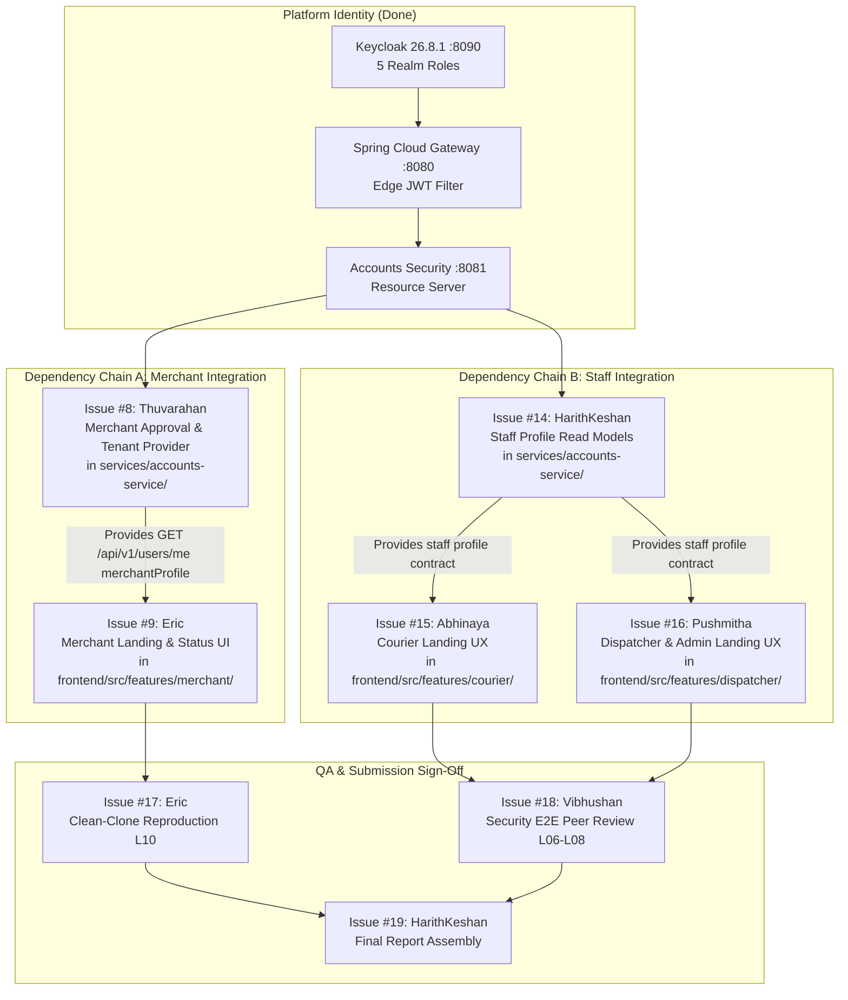

# SwiftDrop — November 1 Five-Role Integration Readiness & Coordination Tracker

**Document Version:** 1.0.0  
**Target Milestone:** November 1, 2026 Checkpoint (Report + Initial Working Logins)  
**Target Integration Branch:** `test`  
**Platform & Integration Lead:** Suthankan1 (`@Suthankan1`)  
**Architecture Baseline:** SwiftDrop Architecture v1.3 ([BASELINE.md](../architecture/BASELINE.md))
**Related PRs / Issues:** [#8](https://github.com/Suthankan1/swiftdrop/issues/8), [#9](https://github.com/Suthankan1/swiftdrop/issues/9), [#14](https://github.com/Suthankan1/swiftdrop/issues/14), [#15](https://github.com/Suthankan1/swiftdrop/issues/15), [#16](https://github.com/Suthankan1/swiftdrop/issues/16), [#17](https://github.com/Suthankan1/swiftdrop/issues/17), [#18](https://github.com/Suthankan1/swiftdrop/issues/18), [#19](https://github.com/Suthankan1/swiftdrop/issues/19)

---

## 1. Executive Summary & Purpose

This document establishes the **Five-Role Integration Readiness Matrix, Contract Boundaries, and Coordination Plan** for the November 1 initial login checkpoint.

The core identity, OAuth2 / OIDC S256 PKCE broker, edge Gateway JWT validation, Accounts independent Resource Server, and Customer login flow are fully implemented and verified on the `test` branch (PRs #34–#56). The next phase integrates the remaining four business role experiences:
1. **CUSTOMER** (Implemented & verified)
2. **MERCHANT** (Prerequisite: Issue #8 backend provider -> Issue #9 frontend consumer)
3. **COURIER** (Prerequisite: Issue #14 staff read provider -> Issue #15 frontend consumer)
4. **DISPATCHER** (Prerequisite: Issue #14 staff read provider -> Issue #16 frontend consumer)
5. **ADMIN** (Prerequisite: Issue #14 staff read provider -> Issue #16 frontend consumer)

### Non-Negotiable Integration Rules:
- **No Competing Microservices:** All business identity and profile endpoints belong strictly to the single existing **Accounts & Partners Service** (`services/accounts-service/`). Do not create a "merchant-service", "courier-service", or "admin-service".
- **Strict Role Elevation Guard:** Privileged roles (`COURIER`, `DISPATCHER`, `ADMIN`) and merchant approvals (`status = APPROVED`) cannot be self-granted through public signup or frontend parameters.
- **Fail-Closed Security:** Unimplemented business routes fail-closed via Gateway default-deny (HTTP 404/401). Blocked test cases in the security harness (`36 PASS, 0 FAIL, 4 BLOCKED`) must remain honestly recorded as blocked dependencies until actual provider endpoints are merged.
- **All PRs Target `test`:** No integration branch ever targets `main`. All PRs undergo owner code review before merging into `test`.

---

## 2. Section A: Current Five-Role Integration Matrix

| Role | Human Feature Owner(s) | Frontend Route & Status | Existing Source Component | Backend Provider Service | Required API Contract | Keycloak Realm Role | Provisioning Policy | Required Business Status | Allowed Requests | Forbidden Requests | Database Ownership | Implementation Status | Related Issues & PRs | Required Tests | Known Blockers |
|---|---|---|---|---|---|---|---|---|---|---|---|---|---|---|---|
| **CUSTOMER** | **Gajanthan** (FE), **Sinthuha** (BE) | `/customer` (**IMPLEMENTED**) | `frontend/src/features/customer/pages/CustomerPage.tsx` | Accounts & Partners (`:8081`) | `GET /api/v1/users/me` -> `CurrentUserProfile` | `CUSTOMER` (Default composite role) | Self-registration (Email verification or Google OIDC Broker) | Active profile row in `accounts_db` | `GET /api/v1/users/me`, public quote/tracking | Merchant orders, courier tasks, staff queues, admin management | `accounts_db` (`account_profiles` table) | **IMPLEMENTED** | Issues [#4](https://github.com/Suthankan1/swiftdrop/issues/4), [#5](https://github.com/Suthankan1/swiftdrop/issues/5), [#6](https://github.com/Suthankan1/swiftdrop/issues/6); PRs #41, #42, #43, #45, #55 | 56 Vitest UI tests, 53 Accounts tests, L01–L04, L06, L08 | None (Operational) |
| **MERCHANT** | **Eric** (FE), **Thuvarahan** (BE) | `/merchant` (**NOT STARTED**) | Awaits `features/merchant/` (Issue #9) | Accounts & Partners (`:8081`) | `GET /api/v1/users/me` with `merchantProfile` payload | `MERCHANT` (Pre-configured realm role) | Self-registration + Administrative approval transition | `PENDING`, `APPROVED`, `SUSPENDED`, `DENIED` | Self-profile read, scoped order APIs (when approved) | Unapproved dispatching, cross-tenant orders, staff/admin operations | `accounts_db` (merchant status & metadata tables) | **NOT STARTED (Contracts Ready)** | Issues [#8](https://github.com/Suthankan1/swiftdrop/issues/8) (BE), [#9](https://github.com/Suthankan1/swiftdrop/issues/9) (FE), [#10](https://github.com/Suthankan1/swiftdrop/issues/10) (Report) | L07-ROLE-02, L08-OWN-08, status rendering, non-elevation UI tests | Issue #8 provider PR must merge before Issue #9 E2E verification |
| **COURIER** | **Abhinaya** (FE), **Vibhushan** (BE / QA) | `/courier` (**NOT STARTED**) | Awaits `features/courier/` (Issue #15) | Accounts & Partners (`:8081`) | `GET /api/v1/staff/profile` or role-scoped `/users/me` | `COURIER` (Restricted realm role) | Keycloak Administrator provisioning only (No self-signup) | Active staff record (`status = ACTIVE`) | Own courier profile read, assigned delivery reads (future) | Cross-courier delivery snooping, dispatcher assignment, admin config | `accounts_db` (staff profile mapping) | **NOT STARTED (Contracts Ready)** | Issues [#14](https://github.com/Suthankan1/swiftdrop/issues/14) (BE), [#15](https://github.com/Suthankan1/swiftdrop/issues/15) (FE), [#18](https://github.com/Suthankan1/swiftdrop/issues/18) (QA) | L07-ROLE-05, wrong-role 403, active status guard tests | Issue #14 staff read provider must merge before Issue #15 E2E |
| **DISPATCHER** | **Pushmitha** (FE), **HarithKeshan** (BE) | `/dispatcher` (**NOT STARTED**) | Awaits `features/dispatcher/` (Issue #16) | Accounts & Partners (`:8081`) | `GET /api/v1/staff/profile` or role-scoped `/users/me` | `DISPATCHER` (Restricted realm role) | Keycloak Administrator provisioning only (No self-signup) | Active operational coordinator profile | Own staff profile read, unassigned parcel queues (future) | Courier direct proof capture, pricing zone modifications, user deletion | `accounts_db` (staff profile mapping) | **NOT STARTED (Contracts Ready)** | Issues [#14](https://github.com/Suthankan1/swiftdrop/issues/14) (BE), [#16](https://github.com/Suthankan1/swiftdrop/issues/16) (FE), [#13](https://github.com/Suthankan1/swiftdrop/issues/13) (Report) | L07 staff role guard, unassigned queue access, 403 denial tests | Issue #14 staff read provider must merge before Issue #16 E2E |
| **ADMIN** | **Pushmitha** (FE), **HarithKeshan** (BE) | `/admin` (**NOT STARTED**) | Awaits `features/admin/` (Issue #16) | Accounts & Partners (`:8081`) | `GET /api/v1/staff/profile` + merchant approval commands | `ADMIN` (Restricted realm role) | Keycloak Administrator provisioning only (No self-signup) | Active platform administrator profile | Staff profile read, merchant approval review, platform audit (future) | Public self-granting, unauthenticated actuator/database access | `accounts_db` (admin / staff profile mapping) | **NOT STARTED (Contracts Ready)** | Issues [#14](https://github.com/Suthankan1/swiftdrop/issues/14) (BE), [#16](https://github.com/Suthankan1/swiftdrop/issues/16) (FE), [#19](https://github.com/Suthankan1/swiftdrop/issues/19) (Report) | L07-ROLE-04, privileged route protection, audit trail tests | Issue #14 staff read provider must merge before Issue #16 E2E |

---

## 3. Section B: API & Provider Dependencies

The platform identity and gateway layers are already established. Downstream feature integration flows through two critical dependency chains:



### Dependency Rules:
1. **Parallel Frontend Development:** Eric, Abhinaya, and Pushmitha can develop their React components using mock typed fixtures against the frozen contract interfaces immediately.
2. **Provider Merge Gating:** End-to-end integration tests and live browser validation cannot pass until Thuvarahan (Issue #8) and HarithKeshan (Issue #14) merge their backend provider pull requests into `test`.
3. **No Microservice Proliferation:** Both #8 and #14 introduce code **exclusively** into package `com.devarom.accountsservice` inside `services/accounts-service/`.

---

## 4. Section C: Frontend Consumer Mapping & Routing Integration

### 4.1 Route Guard Infrastructure
The shared React SPA already contains the typed role guard `ProtectedRoute` in [`frontend/src/auth/AuthPages.tsx`](../../frontend/src/auth/AuthPages.tsx):

```tsx
export function ProtectedRoute({ role }: { role?: DevaromRole }) {
  const { snapshot } = useAuth()
  if (snapshot.status === 'loading') return <FeedbackState title="Checking session" tone="loading">Please wait.</FeedbackState>
  if (snapshot.status !== 'authenticated') return <Navigate to="/login" replace />
  if (role && !snapshot.roles.includes(role)) return <FeedbackState title="Access unavailable" tone="error">This entry is unavailable for your current role.</FeedbackState>
  return <Outlet />
}
```

### 4.2 Target Route Registration in `frontend/src/app/router/routes.tsx`
When UI owners submit their PRs, routes will be wired cleanly into `routes.tsx` without touching authentication code:

```tsx
// Target route hierarchy:
<Route element={<AppLayout />}>
  <Route index element={<LandingPage />} />
  <Route path="login" element={<LoginPage />} />
  <Route path="auth/callback" element={<CallbackPage />} />
  <Route path="logout" element={<LogoutPage />} />

  {/* Customer Landing (Implemented) */}
  <Route element={<ProtectedRoute role="CUSTOMER" />}>
    <Route path="customer" element={<CustomerPage />} />
  </Route>

  {/* Merchant Landing (Issue #9 — Eric) */}
  <Route element={<ProtectedRoute role="MERCHANT" />}>
    <Route path="merchant" element={<MerchantPage />} />
  </Route>

  {/* Courier Landing (Issue #15 — Abhinaya) */}
  <Route element={<ProtectedRoute role="COURIER" />}>
    <Route path="courier" element={<CourierPage />} />
  </Route>

  {/* Dispatcher Landing (Issue #16 — Pushmitha) */}
  <Route element={<ProtectedRoute role="DISPATCHER" />}>
    <Route path="dispatcher" element={<DispatcherPage />} />
  </Route>

  {/* Admin Landing (Issue #16 — Pushmitha) */}
  <Route element={<ProtectedRoute role="ADMIN" />}>
    <Route path="admin" element={<AdminPage />} />
  </Route>

  <Route path="*" element={<NotFoundPage />} />
</Route>
```

---

## 5. Section D: Security & Business Ownership Rules

### 5.1 Minimal Frozen Contracts

#### Contract 1: Merchant Status Contract (Issue #8 -> Issue #9)
- **Path:** `GET /api/v1/users/me`
- **Method:** `GET`
- **Required Header:** `Authorization: Bearer <keycloak-jwt>`
- **Response Shape (200 OK):**
```json
{
  "id": "8d0f7780-8536-41ef-055c-f18fd2a01bf8",
  "keycloakSub": "b2c3d4e5-f6a7-8b9c-0d1e-2f3a4b5c6d7e",
  "email": "merchant@store.lk",
  "fullName": "Silva Stores",
  "phoneNumber": "+94112345678",
  "roles": ["MERCHANT"],
  "merchantProfile": {
    "merchantId": "9e1a8891-9647-42fa-166d-a29ge3b12cg9",
    "businessName": "Silva Supermarket LK",
    "registrationNumber": "PV-987654",
    "status": "PENDING"
  },
  "createdAt": "2026-10-15T10:00:00Z"
}
```
- **Business Status Enum:**
  - `PENDING`: User sees onboarding / waiting for approval banner. Cannot place batch orders or generate API keys.
  - `APPROVED`: Full merchant dashboard access.
  - `SUSPENDED`: Account suspended; operational actions disabled.
  - `DENIED`: Registration rejected with appeal/contact support guidance.
- **Tenant Derivation:** `merchantId` and business ownership are derived strictly from the database mapping bound to `keycloakSub`. The frontend cannot specify or override the `merchantId`.

#### Contract 2: Staff Business Profile Contract (Issue #14 -> Issues #15, #16)
- **Path:** `GET /api/v1/users/me` (or `GET /api/v1/staff/profile`)
- **Required Header:** `Authorization: Bearer <keycloak-jwt>` (Must contain `COURIER`, `DISPATCHER`, or `ADMIN`)
- **Response Shape (200 OK):**
```json
{
  "id": "a1b2c3d4-e5f6-7a8b-9c0d-1e2f3a4b5c6d",
  "keycloakSub": "c3d4e5f6-a7b8-9c0d-1e2f-3a4b5c6d7e8f",
  "email": "courier.kamal@devarom.lk",
  "fullName": "Kamal Perera",
  "phoneNumber": "+94771122334",
  "roles": ["COURIER"],
  "staffProfile": {
    "staffId": "STF-2026-0042",
    "department": "FIELD_LOGISTICS",
    "assignedZone": "ZONE-WEST-COLOMBO",
    "status": "ACTIVE"
  },
  "createdAt": "2026-10-18T08:30:00Z"
}
```
- **Privacy Invariant:** Staff members can read only their own profile. A `COURIER` token attempting to read another courier's private phone number or assigned deliveries is rejected with HTTP 403 / 404.

---

## 6. Section E: Security Acceptance & Blocked Test Case Analysis

The platform security harness (`tests/security-e2e/run-security-e2e.sh`) currently records:
- **Total Scenarios:** 40
- **Passed:** 36 (100% of implemented attack surfaces fail-closed)
- **Failed:** 0
- **Blocked:** 4 (Tracked downstream business endpoints)

### Detailed Analysis of the 4 Blocked Test Cases

| Test ID | Test Scenario | Owning Issue & Developer | Missing Endpoint / Feature | Expected Security Rule | Positive Control | Negative Control | Execution Prerequisite |
|---|---|---|---|---|---|---|---|
| **L07-ROLE-04** | `CUSTOMER cannot invoke staff admin operations` | **Issue #14** (HarithKeshan) / **Issue #16** (Pushmitha) | `GET /api/v1/admin/users` | Gateway & Accounts enforce `@PreAuthorize("hasRole('ADMIN')")`. Non-admins receive 403 Forbidden. | Token with `ADMIN` role receives 200 OK. | Token with `CUSTOMER`, `MERCHANT`, or `COURIER` receives 403 Forbidden. | HarithKeshan implements admin staff endpoints in Accounts; Gateway route mapped. |
| **L07-ROLE-05** | `CUSTOMER cannot invoke courier operations` | **Issue #14** (HarithKeshan) / **Issue #15** (Abhinaya) | `GET /api/v1/courier/deliveries` | Gateway & Accounts enforce `@PreAuthorize("hasRole('COURIER')")`. Non-couriers receive 403 Forbidden. | Token with `COURIER` role receives 200 OK. | Token with `CUSTOMER` role receives 403 Forbidden. | HarithKeshan/Abhinaya implement courier delivery reads; Gateway route mapped. |
| **L08-OWN-07** | `Cross-user explicit ID lookup probe (/users/{id})` | **Issue #5** (Sinthuha) / **Issue #37** (Suthankan1) | `GET /api/v1/users/{id}` | Accounts deliberately exposes no public ID lookup route; identity resolves solely via `/me`. Probing returns 403/404. | User can retrieve self via `/api/v1/users/me`. | Customer A probing `GET /api/v1/users/{Customer B ID}` returns 403 Forbidden or privacy-preserving 404. | Sinthuha decides whether to implement an explicit ID endpoint with IDOR guard, or keep design strictly `/me`-only. |
| **L08-OWN-08** | `Merchant tenant isolation probe` | **Issue #8** (Thuvarahan) / **Issue #9** (Eric) | `GET /api/v1/merchants/orders` | Accounts verifies tenant ID matches caller's authenticated `merchantId`. Cross-tenant probes return 403. | Merchant A can read Merchant A's own orders. | Merchant B or Customer A probing Merchant A's orders receives 403 Forbidden. | Thuvarahan merges merchant tenant provider in Accounts Service. |

> [!NOTE]
> Until these endpoints are implemented by their owners, the test harness safely records them as **BLOCKED**, because the API Gateway defaults to edge rejection (HTTP 404/401). They must **never** be forged or replaced with mock endpoints simply to generate an artificial "40/40 PASS".

---

## 7. Section F: Integration Merge Order

To ensure zero branch conflict, zero broken builds, and smooth peer reviews, pull requests **must** be merged in this exact dependency order:

```text
Step 1: Provider Contracts Reviewed & Frozen (This PR)
   │
   ├───────────────────────────────┐
   ▼                               ▼
Step 2: Merchant Provider (Issue #8)   Step 3: Staff Provider (Issue #14)
   Owner: Thuvarahan                   Owner: HarithKeshan
   Target: services/accounts-service/  Target: services/accounts-service/
   Review: Sinthuha, Suthankan1        Review: Sinthuha, Suthankan1
   │                                   │
   ├───────────────────┐               ├───────────────────┐
   ▼                   ▼               ▼                   ▼
Step 4: Merchant UI    Step 5: Courier UI  Step 6: Dispatcher/Admin UI
   Issue #9            Issue #15           Issue #16
   Owner: Eric         Owner: Abhinaya     Owner: Pushmitha
   Target: frontend/   Target: frontend/   Target: frontend/
   Review: Gajanthan   Review: Gajanthan   Review: Gajanthan, HarithKeshan
   │                   │                   │
   └───────────────────┼───────────────────┘
                       ▼
Step 7: Independent Security QA Verification (Issue #18 — Vibhushan)
Step 8: Independent Clean-Clone Reproduction (Issue #17 — Eric)
Step 9: Final Report Assembly & Submission Review (Issue #19 — HarithKeshan)
```

---

## 8. Section G: Owner and Reviewer Responsibilities

| Owner | Assigned Issues | Primary Deliverables | Required Reviews | Handoff Action Item |
|---|---|---|---|---|
| **Thuvarahan** | [#8](https://github.com/Suthankan1/swiftdrop/issues/8), [#10](https://github.com/Suthankan1/swiftdrop/issues/10) | Merchant approval state, tenant mapping, `accounts_db` migrations | Review from Sinthuha (Accounts domain); Suthankan1 (JWT security) | Open PR for Issue #8 targeting `test` with merchant provider DTO and JPA entity. |
| **Eric** | [#9](https://github.com/Suthankan1/swiftdrop/issues/9), [#17](https://github.com/Suthankan1/swiftdrop/issues/17) | Merchant role landing page (`/merchant`), Clean-clone reproduction (L10) | Review from Thuvarahan; Gajanthan (SPA route); Suthankan1 (Runbook) | 1. Execute [CLEAN_CLONE_RUNBOOK.md](../development/CLEAN_CLONE_RUNBOOK.md) for L10 sign-off.<br/>2. Build `/merchant` landing page consuming #8. |
| **HarithKeshan** | [#14](https://github.com/Suthankan1/swiftdrop/issues/14), [#19](https://github.com/Suthankan1/swiftdrop/issues/19), [#13](https://github.com/Suthankan1/swiftdrop/issues/13) | Staff business profile provider, Final Report Assembly | Review from Sinthuha (Accounts); Pushmitha & Abhinaya (Consumers) | 1. Open PR for Issue #14 staff profile provider.<br/>2. Assemble final report integrating Platform sign-off. |
| **Abhinaya** | [#15](https://github.com/Suthankan1/swiftdrop/issues/15), [#11](https://github.com/Suthankan1/swiftdrop/issues/11) | Courier landing page (`/courier`), Courier use cases & status flows | Review from Gajanthan (SPA route); Vibhushan (Courier module) | Build `/courier` landing consuming Issue #14 staff profile. |
| **Pushmitha** | [#16](https://github.com/Suthankan1/swiftdrop/issues/16), [#12](https://github.com/Suthankan1/swiftdrop/issues/12) | Dispatcher & Admin landing pages (`/dispatcher`, `/admin`) | Review from Gajanthan (SPA route); HarithKeshan (Module lead) | Build `/dispatcher` and `/admin` landing consuming Issue #14 staff profile. |
| **Gajanthan** | [#4](https://github.com/Suthankan1/swiftdrop/issues/4), [#6](https://github.com/Suthankan1/swiftdrop/issues/6) | Shared SPA integration steward, Customer UI review | Review from Suthankan1 (Auth provider); Team | Review all role route additions to ensure zero duplicated auth code. |
| **Sinthuha** | [#5](https://github.com/Suthankan1/swiftdrop/issues/5), [#7](https://github.com/Suthankan1/swiftdrop/issues/7) | Accounts Service domain steward, ERD and schema migrations | Review from Suthankan1 (Security); Thuvarahan & HarithKeshan | Review JPA packages and Flyway migrations in Accounts Service. |
| **Vibhushan** | [#18](https://github.com/Suthankan1/swiftdrop/issues/18) | Independent Security QA Verification (L06, L07, L08) | Review from Suthankan1 (Platform) | Execute `./tests/security-e2e/run-security-e2e.sh` and sign off on LOGIN_ACCEPTANCE.md. |
| **Suthankan1** | [#1](https://github.com/Suthankan1/swiftdrop/issues/1), [#2](https://github.com/Suthankan1/swiftdrop/issues/2), [#3](https://github.com/Suthankan1/swiftdrop/issues/3), [#36](https://github.com/Suthankan1/swiftdrop/issues/36), [#37](https://github.com/Suthankan1/swiftdrop/issues/37), [#47](https://github.com/Suthankan1/swiftdrop/issues/47) | Platform, Keycloak, Gateway, Accounts Security, Test Harness, Integration Readiness | Review from all 8 team members | Maintain security test harness, support teammate PR integration, enforce merge order. |

---

## 9. Section H: Controlled Role Test Fixtures

Testing the five roles requires synthetic test users provisioned strictly via Keycloak's administrative REST API, avoiding hardcoded credentials or committed secrets.

### 9.1 Existing Automated Test Tooling
The test harness [`tests/security-e2e/harness_common.py`](../../tests/security-e2e/harness_common.py) provides the standardized `KeycloakAdminClient`:

```python
admin_client = KeycloakAdminClient("http://localhost:8090")
# Creates a disposable synthetic user with secure random password and assigns realm role:
user_courier = admin_client.create_disposable_user(
    username_prefix="dv-sec-courier",
    role="COURIER",
    first_name="Kamal",
    last_name="Courier"
)
# Authenticates via OIDC Authorization Code Flow with PKCE S256:
tokens = oidc_client.login(user_courier["username"], user_courier["password"])
# Automated teardown in finally block:
admin_client.cleanup_users()
```

### 9.2 Fixture Rules:
1. **Zero Committed Passwords:** User passwords are generated dynamically via `secrets.token_urlsafe(16)` with uppercase, lowercase, numeric, and symbol complexity.
2. **Zero Leaked Tokens:** JWT access and refresh tokens exist exclusively in test runner memory and are never written to disk or logs.
3. **Admin-Only Privileges:** Staff roles (`COURIER`, `DISPATCHER`, `ADMIN`) are assigned via `POST /users/{id}/role-mappings/realm` authenticated with administrative credentials. Public signup endpoints cannot assign these roles.
4. **Mandatory Cleanup:** All test users are tracked in `admin_client.disposable_users` and deleted via `DELETE /users/{id}` in a `finally` block to keep development databases clean.

---

## 10. Section I: November 1 Blockers & Deferred Scope

### 10.1 Active Blockers for November 1 Checkpoint
1. **L10 — Independent Clean-Clone Reproduction (Issue #17 — Eric):**
   - *Status:* Awaiting independent run by Eric. Platform local rehearsal is verified.
2. **L06 / L07 / L08 — Independent Security QA Sign-Off (Issue #18 — Vibhushan):**
   - *Status:* Platform self-verification complete (36/36 implemented pass). Vibhushan's independent peer QA execution is pending.
3. **L05 — Role Entry Pages (Issues #9, #15, #16):**
   - *Status:* Customer is fully verified. Merchant, Courier, Dispatcher, and Admin UI landing pages await PRs from their respective owners.
4. **Lecturer Team-Size Exception (All 9 Members):**
   - *Status:* Confirmation needed from the academic lecturer on the 9-member group size against the 10-member assignment text.
5. **Submission Format & Destination (Issue #19 — HarithKeshan):**
   - *Status:* Confirmation needed on submission requirements (LMS PDF upload, repository link, or zip archive).

### 10.2 Explicitly Deferred Work (Post-November 1 Milestone)
The following features are **strictly out of scope for Nov 1** and must not be implemented at this stage:
- Delivery Operations microservice, parcel state transitions, and tracking history.
- Pricing & Zones microservice and distance calculation algorithms.
- Communications microservice and Kafka KRaft event pub/sub.
- Read-only GraphQL Query API service.
- gRPC internal microservice communication fabric.
- Server-Sent Events (SSE) live parcel tracking relay.
- Kubernetes / Helm cluster deployment (Diagram 19 is bonus only).
- AI assistant integration.

---

## 11. Section J: Acceptance Verification Evidence Needed for L05, L07, and L08

To transition the remaining criteria in [`docs/milestones/LOGIN_ACCEPTANCE.md`](LOGIN_ACCEPTANCE.md) to fully verified status:

### For L05 (Role Entry Pages & Privilege Confinement):
1. **Evidence Needed:**
   - Screenshots / Vitest execution of `/merchant` displaying `PENDING` status from Accounts Service.
   - Screenshots / Vitest execution of `/courier` displaying active staff profile.
   - Screenshots / Vitest execution of `/dispatcher` displaying dispatcher space.
   - Screenshots / Vitest execution of `/admin` displaying admin console.
2. **Acceptance Invariant:**
   - Attempting to register via public signup cannot grant access to `/courier`, `/dispatcher`, or `/admin`. The route guard displays "This entry is unavailable for your current role".

### For L07 (Wrong Role Rejection):
1. **Evidence Needed:**
   - `L07-ROLE-04`: Token with `CUSTOMER` role sent to `GET /api/v1/admin/users` returns HTTP 403 Forbidden RFC 7807 ProblemDetail from Accounts Service.
   - `L07-ROLE-05`: Token with `CUSTOMER` role sent to `GET /api/v1/courier/deliveries` returns HTTP 403 Forbidden RFC 7807 ProblemDetail from Accounts Service.
2. **Acceptance Invariant:**
   - Rejection is enforced by downstream Spring Security `@PreAuthorize`, not just by client-side router navigation.

### For L08 (Tenant & Resource Isolation):
1. **Evidence Needed:**
   - `L08-OWN-07`: Probing explicit ID lookup (`/api/v1/users/{other-user-uuid}`) returns HTTP 403 or 404.
   - `L08-OWN-08`: Token with `Merchant A` identity attempting to read `Merchant B` orders returns HTTP 403 Forbidden.
2. **Acceptance Invariant:**
   - Tenant isolation is strictly enforced against the authenticated `keycloakSub` mapped to the database tenant entity.

---

## 12. Verification & Document Integrity
This document was prepared by the Platform & Security Lead (`Suthankan1`) and aligned with:
- `docs/contracts/LOGIN_CONTRACT.md`
- `docs/team/OWNERSHIP.md`
- `docs/team/MODULE_HANDOFF.md`
- `docs/milestones/NOV_01.md`
- `docs/milestones/LOGIN_ACCEPTANCE.md`
- `docs/team/PLATFORM_SIGNOFF_NOV01.md`
- `docs/team/PLATFORM_HANDOFF_NOV01.md`
