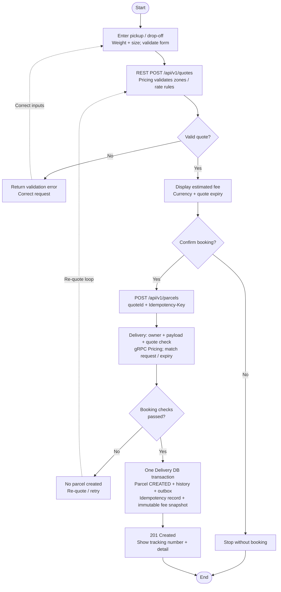
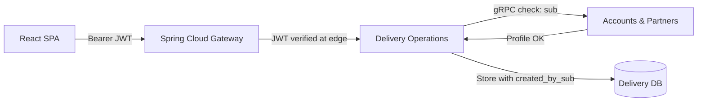

# Customer Journey Review: Use Cases, Quote/Booking Activity, and Sequence Design

> **Branding revision — 2026-10-20:** The platform was previously referred to as Devarom during initial development and was renamed SwiftDrop on 2026-10-20 by the project owner. Dated evidence, prior review wording and technical identifiers below retain their original values. See the [Phase 1 audit](../branding/PHASE_1_AUDIT.md).

> **Document Context & Metadata**
> - **Product:** SwiftDrop — Parcel Delivery & Courier Management Platform (Architecture v1.3)
> - **Issue Reference:** Refs [#4 — [NOV-05] Review Customer report use cases, quote/booking flow and sequence](https://github.com/Suthankan1/swiftdrop/issues/4)
> - **Milestone:** November 1, 2026 — Report + Initial Working Logins
> - **Module:** Customer
> - **Original Feature Steward:** Gajanthan ([@Gajanthan23](https://github.com/Gajanthan23))
> - **Acting Contributor & Author:** Suthankan1 (Platform & Cross-Module Integration Lead)
> - **Independent Reviewers:** Pushmitha (Cross-Actor Workflow Correctness) & Sinthuha (Accounts & Domain Profile Boundaries)
> - **Stewardship Notice:** Temporary task coverage during Gajanthan's hardware repair; feature ownership remains with Gajanthan upon return.
> - **Implementation Status:** Design and technical documentation review only. No booking microservice implementation, pricing engine code, or Kafka streaming is claimed as implemented at this checkpoint.
> - **Source Limitation Record:** The external design package draft and compiled PDFs are intentionally excluded from this software repository (per [`docs/milestones/NOV_01.md`](../milestones/NOV_01.md)); this review evaluates the checked-in canonical Draw.io source diagrams ([`docs/diagrams/editable/`](../diagrams/editable/)) and rendered SVG previews ([`docs/diagrams/rendered/`](../diagrams/rendered/)).

---

## Executive Summary

This document presents a comprehensive architectural and technical review of the **Customer** journey within the SwiftDrop platform. It provides university-level analysis and formal documentation for:
1. **Figure 01:** UML Customer Use Case Diagram ([`01_customer_use_cases.svg`](../diagrams/rendered/01_customer_use_cases.svg))
2. **Figure 07:** UML Customer Quote-to-Booking Activity Diagram ([`07_quote_booking_activity.svg`](../diagrams/rendered/07_quote_booking_activity.svg))
3. **Figure 10:** UML Customer Delivery Booking Sequence Diagram ([`10_customer_delivery_sequence.svg`](../diagrams/rendered/10_customer_delivery_sequence.svg))

The review cross-references the diagrams against the approved [Architecture Baseline v1.3](../architecture/BASELINE.md), [Data Ownership Rules](../architecture/DATA_OWNERSHIP.md), [Open Decisions Register](../architecture/OPEN_DECISIONS.md), [REST API Contract Outline](../contracts/REST.md), and [gRPC Contract Plan](../contracts/GRPC.md).

---

## A. Customer Actor and Use Cases (Figure 01)

### 1. Customer Actor Definition and System Boundary
In SwiftDrop, the **Customer** represents an individual or non-merchant business actor who dispatches, monitors, and receives parcels through the digital delivery platform. The system boundary—formally designated as **SwiftDrop**—encompasses all internal services (API Gateway, Accounts & Partners, Pricing & Zones, Delivery Operations, Communications, and the GraphQL Query API).

External to the system boundary resides the **Identity Provider** (`Keycloak`, federating upstream identity brokers such as Google OIDC). The Customer interacts with the platform via a single-page application (React 19 + TypeScript + Vite SPA) hosted under a secure browser runtime.

```
       +-----------------------------------------------------------+
       |                    SWIFTDROP PLATFORM                     |
       |                                                           |
       |   (u0) Sign up / local or Google login <====================> [Identity Provider]
       |   (u1) Request delivery fee estimate                      |   (Keycloak / Google)
       |   (u2) Create delivery request                            |
[Customer] (u3) View own composite dashboard                       |
 (Primary) |   (u4) Track parcel live status                       |
       |   (u5) View own delivery history                          |
       |   (u6) Download delivery receipt                          |
       |   (u7) Public-number mobile tracking                      |
       |                                                           |
       +-----------------------------------------------------------+
```

### 2. Major Customer System Interactions
Figure 01 specifies eight discrete use cases:

1. **Sign up / local or Google login (`u0`):** Initiates identity federation via OpenID Connect (OIDC) with PKCE. The Customer authenticates against Keycloak (or Google brokered by Keycloak) to obtain short-lived bearer JWT access tokens.
2. **Request delivery fee estimate (`u1`):** Submits origin, destination, parcel weight, and volumetric dimensions to receive an authoritative, expiring price quotation before committing to a booking.
3. **Create delivery request (`u2`):** Submits an authenticated booking command linked to an active `quoteId` and an `Idempotency-Key` to create a parcel record in `CREATED` status.
4. **View own composite dashboard (`u3`):** Queries composite operational views (active parcels, recent deliveries, aggregate metrics) through the read-only GraphQL Query API.
5. **Track parcel live status (`u4`):** Establishes an authorized Server-Sent Events (SSE) streaming connection to receive real-time status transitions (`PICKED_UP`, `IN_TRANSIT`, `OUT_FOR_DELIVERY`, `DELIVERED`, `FAILED`).
6. **View own delivery history (`u5`):** Queries paginated historical delivery audits and chronological lifecycle records owned by Delivery Operations.
7. **Download delivery receipt (`u6`):** Requests a cryptographically verifiable PDF receipt generated from the immutable fee snapshot and completion metadata.
8. **Public-number mobile tracking (`u7`):** Queries the current delivery milestone using only a tracking number without requiring user authentication.

### 3. Classification of Operations and Privacy Protections

To prevent unauthorized data exposure and comply with privacy-by-design standards, Customer interactions are strictly categorized:

| Operational Category | Use Cases Included | Authentication Requirement | Authorization & Data Redaction Rules |
|---|---|---|---|
| **Public Operations** | `u7` (Public tracking) | Unauthenticated (Anonymous) | **Strictly Redacted:** Exposes only the parcel tracking number, current high-level milestone status, timestamp, and general destination city/zone. **Redacts** sender name, recipient full address, contact phone numbers, parcel item details, and financial fees. |
| **Authenticated Domain Operations** | `u1` (Quote), `u2` (Booking) | Valid Bearer JWT | Validates Keycloak `sub`, active customer status in Accounts & Partners, and validates the quote against Pricing & Zones. |
| **Customer-Owned Protected Data** | `u3` (Dashboard), `u4` (Live SSE), `u5` (History), `u6` (Receipt) | Valid Bearer JWT + Strict Resource Ownership | **Strict Ownership Enforcement:** The service independently extracts the Keycloak subject identifier (`sub`) from the verified token and enforces `WHERE created_by_sub = :callerSub`. Customers cannot access parcels belonging to other customers or merchants. |

### 4. November 1 Milestone Scope vs. Future Implementation

| Feature / Interaction | November 1 Milestone State | Production / Future Target State |
|---|---|---|
| **Sign up / Login (`u0`)** | **Active Implementation Goal:** Keycloak container realm configuration, React OIDC client with Authorization Code + PKCE, API Gateway JWT validation, Accounts subject mapping. | Biometric MFA, social login self-service account linking, multi-region identity failover. |
| **Fee Quotation (`u1`)** | **Design Only:** Contract defined in [`docs/contracts/REST.md`](../contracts/REST.md). Pricing logic is an architectural design. | Dynamic zone calculation engine, fuel surcharges, multi-tier pricing strategies. |
| **Create Delivery (`u2`)** | **Design Only:** Sequence and state models frozen. No active service persistence. | Distributed Delivery Operations service, PostgreSQL transactional outbox. |
| **Composite Dashboard (`u3`)** | **Design Only:** Schema outlined in [`docs/contracts/GRAPHQL.md`](../contracts/GRAPHQL.md). | Spring Boot Netflix DGS GraphQL server aggregating gRPC calls from core services. |
| **Live Tracking SSE (`u4`)** | **Design Only:** Protocol specified (auth-header SSE with REST recovery). | High-concurrency reactive SSE broker with Redis/Kafka partition fanout. |
| **Delivery History (`u5`)** | **Design Only:** Relational schema modeled in Figure 14. | Audited append-only event-sourced tracking projection. |
| **Delivery Receipt (`u6`)** | **Design Only:** Explicitly deferred cross-module slice owned by Suthankan1. | Authorized backend PDF renderer reading immutable price snapshots. |
| **Public Tracking (`u7`)** | **Design Only:** Redaction policy specified. | Rate-limited edge-cached public REST endpoint. |

---

## B. Customer Quote and Booking Activity (Figure 07)

### 1. Workflow Architecture
Figure 07 details the lifecycle of a delivery fee estimation and subsequent parcel booking, dividing responsibilities between two primary swimlanes:
- **Customer / React:** Client-side presentation, form validation, and decision governance.
- **Gateway -> Pricing / Delivery:** API Gateway edge routing, Pricing calculation, and Delivery transactional execution.



### 2. Happy Path Walkthrough
1. **Form Input & Client Validation:** The Customer enters origin, destination, weight, and dimensions. React executes immediate client-side validation (ensuring positive weights, complete postal addresses, and supported bounding boxes).
2. **Quote Generation (`POST /api/v1/quotes`):** The client transmits the validated parameters through the API Gateway to **Pricing & Zones**. Pricing evaluates the geographic zones, selects active rate rules, computes the fee, and persists an ephemeral quote entity containing `quote_id`, `amount`, `currency`, `request_digest`, and `expires_at`.
3. **Fee Presentation:** React displays the estimated amount, currency, and an active expiration countdown timer.
4. **Booking Confirmation:** The Customer clicks "Confirm Booking". React dispatches `POST /api/v1/parcels` with a client-generated UUID `Idempotency-Key` and the accepted `quote_id`.
5. **Synchronous Internal Validation:** Delivery Operations intercepts the command, verifies the authenticated caller's identity via gRPC with Accounts & Partners, and validates the quote via gRPC with Pricing & Zones.
6. **Atomic Transactional Commit:** Upon successful validation, Delivery Operations executes an atomic local database transaction persisting:
   - The parcel entity in `CREATED` status.
   - An initial `STATUS_HISTORY` record (`state_version = 1`).
   - An `IDEMPOTENCY_RECORDS` entry binding the key to the parcel response.
   - An `OUTBOX_EVENTS` entry containing the `parcel.status.changed.v1` domain event.
   - An immutable snapshot of the agreed delivery fee and currency.
7. **Response & Presentation:** The server responds with `201 Created` containing the tracking reference; React navigates the Customer to the confirmation and tracking view.

### 3. Alternative Decision Paths & Failure Handling

- **Invalid Form or Quote Inputs (Validation Failure):** If Pricing & Zones detects unserviceable postal codes, negative weights, or missing required attributes, it returns `400 Bad Request` or `422 Unprocessable Entity` with RFC 7807 problem details. The activity diagram models a dashed loop back to the form, prompting user correction without recording state.
- **Customer Cancellation:** The Customer retains autonomous authority to abandon the workflow upon reviewing the estimated fee. Choosing "Cancel" directs the flow to a terminal stop node without booking, reserving resources, or charging fees. Ephemeral quotes naturally expire in Pricing & Zones without consequence.
- **Quote Expiration Prior to Booking:** If the Customer hesitates until `expires_at` has elapsed, Delivery Operations detects the expiration during internal gRPC quote verification. The booking is rejected, no parcel is created, and the activity diagram routes the user to a re-quote transition.
- **Idempotency Collisions & Repeat Submissions:** 
  - If a Customer double-clicks or experiences a transient network timeout and retransmits the same `Idempotency-Key` with an identical payload, Delivery Operations detects the existing idempotency record and returns the cached `201 Created` parcel response without creating duplicate parcels.
  - If an identical key is reused with a conflicting payload (e.g., changed address), Delivery Operations rejects the request with `409 Conflict`.
- **System Failure Prior to Commit:** If gRPC validation fails, network timeouts occur, or the database transaction aborts, the transaction rolls back cleanly. No partial state, orphan outbox record, or premature tracking number is ever published.

---

## C. Customer Delivery Booking Sequence (Figure 10)

### 1. Structural Interaction Architecture
Figure 10 details the exact temporal sequence and protocol boundaries across six participating components:
1. `Customer / React` (Client User Agent)
2. `Gateway` (Spring Cloud Gateway Edge Policy Enforcer)
3. `Pricing` (Pricing & Zones Service)
4. `Delivery` (Delivery Operations Service)
5. `Accounts` (Accounts & Partners Service)
6. `Delivery DB` (PostgreSQL Dedicated Logical Database)

```
[Customer/React]       [Gateway]           [Pricing]          [Delivery]          [Accounts]       [Delivery DB]
       |                   |                   |                  |                   |                  |
       |--- 1. POST quote ->|                   |                  |                   |                  |
       |    (JWT, params)  |--- 2. Route ----->|                  |                   |                  |
       |                   |<-- 3. quoteId ----|                  |                   |                  |
       |<-- 4. Fee preview-|                   |                  |                   |                  |
       |                   |                   |                  |                   |                  |
       |=== Customer Confirms Booking =======================================================================|
       |                   |                   |                  |                   |                  |
       |--- 5. POST parcel->|                   |                  |                   |                  |
       |    (quoteId, key) |--- 6. Validated ->|                  |                   |                  |
       |                   |       JWT command |                  |--- 7. gRPC check->|                  |
       |                   |                   |                  |    (eligibility)  |                  |
       |                   |                   |                  |<-- 8. Eligible ---|                  |
       |                   |                   |<-- 9. gRPC check-|                   |                  |
       |                   |                   |    (quote/expiry)|                   |                  |
       |                   |                   |--- 10. Snapshot->|                   |                  |
       |                   |                   |                  |--- 11. BEGIN TX -------------------->|
       |                   |                   |                  |    Insert parcel, history,           |
       |                   |                   |                  |    idempotency, outbox, snapshot     |
       |                   |                   |                  |<-- 12. COMMIT OK --------------------|
       |                   |<-- 13. 201 Created-------------------|                   |                  |
       |<-- 14. Tracking # |                   |                  |                   |                  |
```

### 2. Detailed Message Sequence Breakdown

1. `msg0`: `Customer / React` dispatches `POST /api/v1/quotes` bearing the customer's Keycloak JWT access token, origin, destination, weight, and size.
2. `msg1`: `Gateway` validates JWT integrity and routes the payload to `Pricing`.
3. `msg2`: `Pricing` evaluates zone matrices, validates request parameters, generates an expiring quote record, and returns `quoteId`, `amount`, `currency`, and `expires_at`.
4. `msg3`: `Gateway` returns the quote payload to `Customer / React`, which renders the fee preview.
5. `msg4`: Upon confirmation, `Customer / React` issues `POST /api/v1/parcels` containing the `quoteId` and an HTTP request header `Idempotency-Key: <UUID>`.
6. `msg5`: `Gateway` validates the bearer JWT, ensures required claims are present, strips untrusted client-supplied identity headers, and proxies the request to `Delivery`.
7. `msg6`: `Delivery` initiates a synchronous internal gRPC call to `Accounts` to verify actor eligibility (`keycloak_sub` presence, profile standing, non-suspended status).
8. `msg7`: `Accounts` returns an affirmative eligibility confirmation.
9. `msg8`: `Delivery` initiates a synchronous internal gRPC call to `Pricing` to validate the quote: verifying that the quote exists, belongs to the calling customer, has not expired (`now() < expires_at`), and matches the payload digest.
10. `msg9`: `Pricing` returns the validated accepted price snapshot.
11. `msg10`: `Delivery` initiates a local ACID transaction in `Delivery DB`:
    - Inserts `PARCELS` row (`current_status = 'CREATED'`, `version = 1`, snapshotted price/currency).
    - Inserts `STATUS_HISTORY` row (`status = 'CREATED'`, `state_version = 1`, `occurred_at = now()`).
    - Inserts `IDEMPOTENCY_RECORDS` row (`key`, `digest`, `response_payload`).
    - Inserts `OUTBOX_EVENTS` row (`topic = 'parcel.lifecycle.v1'`, `event = 'parcel.status.changed.v1'`).
12. `msg11`: `Delivery DB` successfully commits the transaction.
13. `msg12`: `Delivery` returns HTTP `201 Created` with the generated tracking number and resource URI.
14. `msg13`: `Gateway` proxies the response to `Customer / React` for user display.

### 3. Core Architectural Guarantees

#### Immutable Price Snapshotting
A fundamental rule of SwiftDrop v1.3 is that **an accepted delivery fee is immutable**. Once committed in message 11, the fee is permanently stored within the `PARCELS` table in Delivery Operations. Delivery Operations never queries Pricing tables during subsequent parcel transitions, nor do future tariff modifications alter historical bookings.

#### Idempotency Safeguards
Network retries are common in mobile and web environments. By requiring an `Idempotency-Key` header on `POST /api/v1/parcels`, Delivery Operations ensures safe retry semantics:
- The idempotency record stores a cryptographic hash (`digest`) of the request payload alongside the generated response.
- Identical requests return the original `201 Created` response.
- Conflicting requests reusing an existing key return `409 Conflict`.

#### Service Boundary and Database Independence
As demonstrated in messages 6 through 11, Delivery Operations queries Accounts and Pricing strictly over internal **gRPC** interfaces. There are:
- **No cross-service SQL joins.**
- **No shared entity jars or common database schemas.**
- **No distributed two-phase commit (2PC/XA) transactions.**

---

## D. Security and Ownership

### 1. Identity vs. Domain Authorization
In SwiftDrop, identity authentication and domain authorization are strictly decoupled:
1. **Identity Provider (`Keycloak`):** Owns user credential storage, password hashing, Google OIDC federation, and token signing. Keycloak issues a cryptographically signed JWT containing the unique subject claim `sub`.
2. **API Gateway (`Spring Cloud Gateway`):** Validates token digital signatures using Keycloak's public JSON Web Key Set (`JWKS`), checks token expiry (`exp`), issuer (`iss`), and audience (`aud`).
3. **Business Microservices (`Accounts`, `Delivery`, `Pricing`):** Downstream services independently validate the JWT. They do not trust arbitrary caller-supplied user IDs in HTTP request bodies. The customer's identity is derived strictly from the verified `sub` claim.



### 2. Tenant and Resource Ownership Rules
- **Profile Resolution:** Accounts & Partners maintains the `USER_PROFILES` table, keyed to `keycloak_sub`. A customer cannot operate on another customer's profile.
- **Parcel Ownership:** Delivery Operations stamps all created parcels with `created_by_sub = jwt.sub`. All read operations (`GET /api/v1/parcels/{id}`, history queries, receipt downloads, live SSE streams) enforce ownership verification:
  $$\text{Authorize} \iff (\text{jwt.sub} == \text{parcel.created\_by\_sub}) \lor (\text{jwt.roles} \ni \text{'DISPATCHER'}).$$
- **Public Tracking Redaction:** Public unauthenticated tracking (`GET /api/v1/tracking/{trackingNumber}`) bypasses token checks but enforces rigorous field-level masking, exposing only non-sensitive milestone information.

---

## E. Reliability and Consistency

### 1. Single-Transaction Atomic Persistence
A critical design requirement is avoiding dual-write hazards between relational storage and message brokers. Delivery Operations achieves atomic consistency using the **Transactional Outbox Pattern**:

```
+--------------------------------------------------------------------------+
|                  DELIVERY OPERATIONS POSTGRESQL TRANSACTION              |
|                                                                          |
|  1. INSERT INTO parcels (parcel_id, tracking_number, status, ...)        |
|  2. INSERT INTO status_history (parcel_id, status='CREATED', ...)        |
|  3. INSERT INTO idempotency_records (key, digest, response, ...)         |
|  4. INSERT INTO outbox_events (event_id, topic, payload, ...)            |
|                                                                          |
|  ===> COMMIT TRANSACTION (All succeed atomically or all roll back)       |
+--------------------------------------------------------------------------+
                                    |
                                    v (Asynchronous post-commit relay)
                        +-----------------------+
                        |  Outbox Event Relay   |
                        +-----------------------+
                                    |
                                    v
                        +-----------------------+
                        |     Apache Kafka      |
                        | parcel.lifecycle.v1   |
                        +-----------------------+
```

### 2. Asynchronous Event Flow (Future Scope)
Figure 10 correctly specifies that **Kafka publication occurs after and outside the database transaction**:
- The event is durably staged in `OUTBOX_EVENTS` within the local database transaction.
- An asynchronous relay worker (e.g., Debezium CDC or a scheduled polling publisher) reads uncommitted outbox rows and publishes them to the Kafka topic `parcel.lifecycle.v1`.
- Kafka producers use message acknowledgements (`acks=all`) and partition by `parcelId` to maintain strict per-parcel ordering.
- Downstream consumers in Communications and tracking modules implement idempotent consumers with duplicate detection.

> [!IMPORTANT]
> Neither the Transactional Outbox relay nor Kafka broker infrastructure is implemented at the November 1 checkpoint. They are documented strictly as verified architectural designs.

---

## F. Design Assumptions and Open Decisions

To preserve academic honesty and project integrity, design facts are distinguished across four categories:

### 1. Approved Architecture (Baseline v1.3)
- Microservice decomposition: Accounts & Partners, Pricing & Zones, Delivery Operations, Communications, API Gateway, and read-only GraphQL Query API.
- Separate per-service PostgreSQL logical databases.
- React SPA with Keycloak Authorization Code + PKCE.
- Transactional Outbox for domain events; no cross-service distributed 2PC.
- gRPC for private internal service-to-service validation.

### 2. Proposed Workflow Assumptions
- Customer quote preview is recommended before booking confirmation.
- Booking requires a client-supplied `Idempotency-Key` header.
- Public tracking is unauthenticated and masked; private tracking requires JWT ownership.
- Initial parcel lifecycle state is `CREATED`.

### 3. Open Architectural Decisions (Requiring Lecturer / Team Signoff)
Per [`docs/architecture/OPEN_DECISIONS.md`](../architecture/OPEN_DECISIONS.md), the following parameters remain **OPEN** and have **not** been prematurely hardcoded:

| Decision Item | Open Parameters | Responsible Owner / Reviewer | Status |
|---|---|---|---|
| **Quote Expiry Duration** | Default TTL for quotes (e.g., 15 min vs 1 hour) | Customer + Pricing Pairs | **Open** |
| **Supported Currencies** | Multi-currency support (LKR, USD, EUR) vs single-currency | Customer + Pricing Pairs | **Open** |
| **Zone Granularity** | Postal code prefix vs provincial boundaries vs distance matrices | Customer + Dispatcher Pairs | **Open** |
| **Weight / Dimension Bands** | Volumetric weight formulas and tier thresholds | Pricing + Dispatcher Pairs | **Open** |
| **Failed Before Pickup Policy** | Permissibility and status transitions if parcel cannot be collected | Courier + Dispatcher Pairs | **Open** |

### 4. Deferred Implementation Slices
- Suthankan1's cross-module slice: **PDF delivery receipt generation backend** within Delivery Operations is scheduled for implementation **after** the November 1 login milestone.
- Full parcel state machine transitions (`PICKED_UP` $\rightarrow$ `DELIVERED` / `FAILED`).
- Kafka message broker deployment and outbox publisher service.
- Server-Sent Events (SSE) live push stream server.
- GraphQL Query API and composite dashboard resolvers.

---

## G. Figure Captions

For direct inclusion in the final Enterprise Application Development (EAD) technical report, the following standardized captions are established:

> **Figure 01: Customer Use Cases**  
> *UML Use Case Diagram illustrating the functional interaction boundaries for the SwiftDrop parcel delivery platform. The primary Customer actor initiates authentication, quotation, booking, live tracking, history review, receipt retrieval, and redacted public mobile tracking. Authentication interactions (`u0`) are brokered externally through Keycloak (Identity Provider). Public tracking (`u7`) enforces field-level redaction, whereas domain operations require authenticated subject ownership.*

> **Figure 07: Customer Quote-to-Booking Activity**  
> *UML Activity Diagram modeling the quote-to-booking business process across the `Customer / React` and `Gateway -> Pricing / Delivery` swimlanes. Illustrates form input validation, synchronous quote calculation with rate rule evaluation, fee and expiry preview, customer confirmation or voluntary cancellation, pre-booking eligibility and quote integrity verification, and atomic commit within Delivery Operations storing an immutable fee snapshot and idempotency record.*

> **Figure 10: Customer Delivery Booking Sequence**  
> *UML Sequence Diagram depicting message exchanges and security boundaries during quote preview and parcel creation. Highlights edge JWT validation at the Spring Cloud Gateway, internal synchronous gRPC eligibility checks with Accounts & Partners, internal gRPC quote/expiry verification with Pricing & Zones, single-transaction atomic persistence in Delivery DB (encompassing parcel state, history audit, idempotency record, and transactional outbox event), and subsequent asynchronous outbox event publication to Apache Kafka.*

---

## H. Reviewer Notes & Signoff Matrix

### 1. Cross-Diagram Discrepancy Matrix

| Diagram / Element | Evaluated State | Architectural Alignment | Discrepancy Found | Proposed Action | Signoff Status |
|---|---|---|---|---|---|
| **Figure 01:** Use Cases | 8 use cases, Customer actor, Identity Provider actor, Devarom boundary | Baseline v1.3 | None. Terminology and actor boundaries match Devarom v1.3. | Retain source and SVG unchanged. | **Passed Review** |
| **Figure 07:** Activity | Two swimlanes, 3 decision diamonds, cancellation and re-quote loops | Baseline v1.3 & Data Ownership | None. Idempotency, atomic commit, and quote expiry correctly represented. | Retain source and SVG unchanged. | **Passed Review** |
| **Figure 10:** Sequence | 6 lifelines, 14 messages, notes on 409/422 and auth preconditions | Baseline v1.3, REST & gRPC Contracts | None. gRPC internal calls, edge Gateway JWT, and atomic DB transaction agree. | Retain source and SVG unchanged. | **Passed Review** |

### 2. Signoff Requirements for Milestone Consolidation (Issue #19)
Prior to final submission under Issue #19, the following peer reviews must be recorded:
- [ ] **Customer Feature Steward Signoff:** Gajanthan ([@Gajanthan23](https://github.com/Gajanthan23)) to review and accept this review upon resumption of duties.
- [ ] **Cross-Actor Flow Review:** Pushmitha to confirm alignment between Customer booking and Dispatcher assignment queues.
- [ ] **Domain Profile Boundary Review:** Sinthuha to confirm compatibility between Accounts `USER_PROFILES` (`keycloak_sub`) and Customer identity handling.
- [ ] **Open Decision Resolution:** Pricing and Dispatcher pairs to agree on concrete quote TTL and rate zone structures before Phase 2 implementation.
