# SwiftDrop Platform — Issue #162 Independent Business Authorization Regression QA Report

- **Issue:** [#162 `[N10-WF25] Run independent business authorization regression across all workflow APIs`](https://github.com/Suthankan1/swiftdrop/issues/162)
- **Role:** Independent Senior Application Security QA Engineer, Java/Spring Security Test Engineer, API Security Engineer, and GitHub QA Engineer
- **Lead QA Engineer:** Vibhushan (@Vibhushan-2003)
- **Base Branch:** `test`
- **Active Branch:** `test/issue-162-business-authorization-regression`
- **Target Commit SHA:** `b6f05176acc8c206af9d228fd596ea0162a928cb`
- **Reviewers:** @Sinthuha-n (Delivery/Business), @EricPraveen (Merchant/Communications), @Harithkeshan (Independent Peer QA & Rerun), @Suthankan1 (Platform Security & Gate Integration)
- **Date:** October 27, 2026

---

## 1. Executive Summary & Objective

In accordance with SwiftDrop Issue #162 and the October 23 feature-gap amendment, an independent, reproducible, multi-actor business authorization regression suite was executed across all approved SwiftDrop microservices and workflow boundaries.

This testing was conducted independently (without modifying or rewriting backend production business logic) to rigorously verify object-level authorization (IDOR/BOLA defense), tenant isolation, role boundaries, administrative privilege gates, gRPC machine delegation, GraphQL field policies, SSE lifecycle streams, and frontend compiled artifact secret suppression.

### Summary Metrics
| Test Category | Total | Passed | Failed | Blocked | Coverage Area |
|---|:---:|:---:|:---:|:---:|---|
| **L09-DELIV** (Delivery Operations) | 12 | 12 | 0 | 0 | Parcels, History, Receipt, Proof, Assignments, Status, SSE |
| **L10-MERCH** (Merchant Workflows) | 9 | 9 | 0 | 0 | Tenancy, Pending/Suspended, Webhooks, Replay, API Keys |
| **L11-ADMIN** (Admin Privileges) | 7 | 7 | 0 | 0 | Merchant review, Staff lifecycle, Pricing/Zones, Spoofing |
| **L12-GRPC** (Private gRPC Boundaries) | 5 | 5 | 0 | 0 | Service token, Actor delegation, Tenant forgery, Audiences |
| **L13-GQL** (GraphQL Query Security) | 9 | 9 | 0 | 0 | Role fields, Complexity, Depth, Pagination, **#139 Resolved** |
| **L14-SSE** (Streaming & Tracking Privacy) | 5 | 5 | 0 | 0 | Owner/Courier streams, Anti-spoofing, PII leakage |
| **L15-AUDIT** (Frontend & Secret Audit) | 5 | 5 | 0 | 0 | Production JS bundle scan for credentials, tokens, URLs |
| **Total Multi-Actor Matrix** | **52** | **52** | **0** | **0** | **100% of scenarios pass (0 Failed, 0 Blocked)** |

In addition, **6 microservice test suites** (327 Java tests), the **React frontend test suite** (531 Vitest tests), and all **4 contract compatibility gates** were verified and confirmed passing.

---

## 2. Dependency Readiness Verification

All required dependency issues were audited against repository commit history and GitHub issue tracking:

| Issue | Title | GitHub State | Implementation Status | Integration Impact on #162 |
|---|---|:---:|---|---|
| **#100** | JWT / gRPC actor delegation | CLOSED | Merged (`shared/security-adapter`) | **READY** — Cryptographic delegation verified |
| **#106** | Gateway business-edge security | CLOSED | Merged (`services/api-gateway`) | **READY** — Edge header stripping & auth verified |
| **#129** | Merchant order REST runtime | CLOSED | Merged (`services/delivery-service`, `accounts-service`) | **READY** — Tenant-bound order commands verified |
| **#95** | Proof metadata & retrieval endpoints | CLOSED | Merged (`services/delivery-service`) | **READY** — Zero private MinIO storage leaks verified |
| **#130** | Authenticated single-replica SSE | CLOSED | Merged (`services/delivery-service`) | **READY** — Authenticated SSE lifecycle verified |
| **#98** | Remaining parcel lifecycle transitions | CLOSED | Merged (`services/delivery-service`) | **READY** — Guarded status transitions verified |
| **#121** | Admin merchant approve/suspend | CLOSED | Merged (`services/accounts-service`) | **READY** — Concurrency token & reason policy verified |
| **#122** | Admin user and staff API | CLOSED | Merged (`services/accounts-service`) | **READY** — Staff lifecycle commands verified |
| **#123** | Admin pricing/zone commands | CLOSED | Merged (`services/pricing-service`) | **READY** — Versioned rate zones & rules verified |
| **#139** | Admin GraphQL dashboard resolver | CLOSED | Merged (`services/graphql-query-service`, PR #258) | **READY** — `AdminDashboardResolver` verified live |
| **#155** | Webhook egress, rotation & replay | CLOSED | Merged (`services/communications-service`) | **READY** — Replay audit & cross-tenant denial verified |
| **#107** | Keycloak role reconciliation | CLOSED | Merged (`services/accounts-service`) | **READY** — Realm role reconciliation verified |
| **#20** | Booking foundation | CLOSED | Merged (`services/delivery-service`) | **READY** — Quote-to-booking contract verified |
| **#119** | GraphQL scaffold & limits | CLOSED | Merged (`services/graphql-query-service`) | **READY** — Max depth (5) & complexity (100) verified |
| **#161** | Multi-replica SSE fanout | CLOSED | Merged | Non-blocking extension; verified compatible |

*\*Resolution of Issue #139:* Issue #139 was implemented by @pushmitha20 and merged into `test` via PR #258 (`AdminDashboardResolver.java` and `AdminDashboardEndpointIntegrationTest.java`). All 30 resolver and endpoint integration tests pass, with full role gating, count/timezone agreement, and gRPC provider error isolation. Scenario `L13-GQL-09` now achieves full **PASS**.

---

## 3. Approved Multi-Actor Matrix

The regression matrix rigorously tests 11 distinct caller identities across isolated tenant fixtures:

```mermaid
graph TD
    Caller[Incoming Caller Identity]
    Caller -->|No Token| Anon[Unauthenticated Caller -> 401]
    Caller -->|Customer A| CustA[Customer A -> Own Parcels Only]
    Caller -->|Customer B| CustB[Customer B -> Tenant B Isolation]
    Caller -->|Courier A| CourA[Courier A -> Active Assigned Parcels Only]
    Caller -->|Courier B| CourB[Courier B -> Denied Former/Unassigned]
    Caller -->|Merchant A| MerchA[Merchant A -> Own Tenant Webhooks/Orders]
    Caller -->|Merchant B| MerchB[Merchant B -> Tenant B Webhooks/Orders]
    Caller -->|Pending/Suspended| MerchP[Pending/Suspended Merchant -> Denied Active Ops]
    Caller -->|Dispatcher| Disp[Dispatcher -> Operational Assign/Stats Only]
    Caller -->|Admin| Adm[Admin -> Full Approval/Staff/Zone Scope]
    Caller -->|Forged Headers| Forged[Forged Actor/Headers -> Stripped & Denied 403]
```

---

## 4. Detailed Test Execution Results

### 4.1 Suite 1: Delivery API Authorization (L09-DELIV)
| Test ID | Method & Endpoint | Identity / Role | Expected | Actual | Result | Verification Rationale |
|---|---|---|:---:|:---:|:---:|---|
| `L09-DELIV-01` | `GET /api/v1/parcels/{id}` | CUSTOMER A (Owner) | 200 | 200 | **PASS** | Matching `senderSub` grants full parcel detail access |
| `L09-DELIV-02` | `GET /api/v1/parcels/{id}` | CUSTOMER B (Non-owner) | 403 | 403 | **PASS** | Mismatched `senderSub` triggers `ParcelAccessDeniedException` |
| `L09-DELIV-03` | `GET /api/v1/parcels/{id}/history` | CUSTOMER B (Non-owner) | 403 | 403 | **PASS** | Immutable status history is object-guarded identically |
| `L09-DELIV-04` | `GET /api/v1/parcels/{id}/receipt` | Anonymous (Missing JWT) | 401 | 401 | **PASS** | Edge security rejects unauthenticated receipt requests |
| `L09-DELIV-05` | `GET /api/v1/parcels/{id}/proof` | COURIER B (Unassigned) | 403 | 403 | **PASS** | `ProofService` verifies active assignment contract |
| `L09-DELIV-06` | `GET /api/v1/parcels/{id}/proof/content` | COURIER B (Unassigned) | 403 | 403 | **PASS** | Private binary stream denied; zero MinIO URL leaks |
| `L09-DELIV-07` | `POST /api/v1/assignments` | CUSTOMER / COURIER | 403 | 403 | **PASS** | Non-dispatchers denied executing assignment commands |
| `L09-DELIV-08` | `POST /api/v1/assignments` | DISPATCHER | 200 | 200 | **PASS** | Valid dispatcher assigns eligible courier to parcel |
| `L09-DELIV-09` | `PATCH /api/v1/parcels/{id}/status` | COURIER A (Former) | 403 | 403 | **PASS** | Inactive courier assignment cannot transition status |
| `L09-DELIV-10` | `PATCH /api/v1/parcels/{id}/status` | COURIER (Assigned) | 400 | 400 | **PASS** | `DELIVERED` status transition fails without proof metadata |
| `L09-DELIV-11` | `PATCH /api/v1/parcels/{id}/status` | COURIER (Assigned) | 409 | 409 | **PASS** | Stale `expectedVersion` rejected by optimistic locking |
| `L09-DELIV-12` | `GET /api/v1/parcels/{id}/events` | COURIER B (Unassigned) | 403 | 403 | **PASS** | Unassigned courier rejected from SSE event stream |

### 4.2 Suite 2: Merchant Workflow Security (L10-MERCH)
| Test ID | Method & Endpoint | Identity / Role | Expected | Actual | Result | Verification Rationale |
|---|---|---|:---:|:---:|:---:|---|
| `L10-MERCH-01` | `GET /api/v1/merchants/webhooks` | MERCHANT A (Approved) | 200 | 200 | **PASS** | Approved merchant reads own webhook destinations |
| `L10-MERCH-02` | `GET /api/v1/merchants/webhooks/{id}` | MERCHANT B | 403 | 403 | **PASS** | `CrossTenantAccessException` enforces strict isolation |
| `L10-MERCH-03` | `POST /api/v1/merchants/webhooks` | MERCHANT (PENDING) | 403 | 403 | **PASS** | Pending merchant status rejected from active operations |
| `L10-MERCH-04` | `POST /api/v1/merchants/webhooks` | MERCHANT (SUSPENDED) | 403 | 403 | **PASS** | Suspended status fails `AccountsMerchantEligibilityClient` |
| `L10-MERCH-05` | `GET /api/v1/merchants/webhooks/{id}` | MERCHANT A | 200 | 200 | **PASS** | Plaintext secret omitted; `Cache-Control: no-store` |
| `L10-MERCH-06` | `POST /.../deliveries/{id}/replay` | MERCHANT A / ADMIN | 200 | 200 | **PASS** | Replay of failed webhook job authorized with audit reason |
| `L10-MERCH-07` | `POST /.../deliveries/{id}/replay` | MERCHANT B | 403 | 403 | **PASS** | Cross-tenant replay denied; zero replay jobs scheduled |
| `L10-MERCH-08` | `POST /api/v1/merchant/parcels` | API Key (Revoked/Expired) | 401 | 401 | **PASS** | Gateway key validator rejects revoked/expired key hashes |
| `L10-MERCH-09` | `GET /api/v1/merchants/me` | COURIER | 403 | 403 | **PASS** | Role gate requires `MERCHANT` or `ADMIN` role |

### 4.3 Suite 3: Admin API Authorization (L11-ADMIN)
| Test ID | Method & Endpoint | Identity / Role | Expected | Actual | Result | Verification Rationale |
|---|---|---|:---:|:---:|:---:|---|
| `L11-ADMIN-01` | `GET /api/v1/admin/users` | ADMIN | 200 | 200 | **PASS** | Admin user inspection permitted with bounded pagination |
| `L11-ADMIN-02` | `GET /api/v1/admin/users` | DISPATCHER | 403 | 403 | **PASS** | Operational dispatcher denied administrative user reads |
| `L11-ADMIN-03` | `POST /api/v1/merchants/{id}/approve` | ADMIN | 200 | 200 | **PASS** | Admin approves merchant and reconciles Keycloak roles |
| `L11-ADMIN-04` | `POST /api/v1/merchants/{id}/approve` | DISPATCHER | 403 | 403 | **PASS** | Dispatcher denied approving merchant applications |
| `L11-ADMIN-05` | `POST /api/v1/admin/pricing/zones` | ADMIN | 201 | 201 | **PASS** | Admin creates versioned rate zones and pricing rules |
| `L11-ADMIN-06` | `POST /api/v1/admin/pricing/zones` | DISPATCHER | 403 | 403 | **PASS** | Dispatcher denied modifying pricing zones or rules |
| `L11-ADMIN-07` | `GET /api/v1/admin/users` | CUSTOMER (Spoofing) | 403 | 403 | **PASS** | Gateway strips `X-User-Roles: ADMIN` header |

### 4.4 Suite 4: Private gRPC Actor Spoofing (L12-GRPC)
| Test ID | gRPC RPC Method | Identity / Request Headers | Expected | Actual | Result | Verification Rationale |
|---|---|---|:---:|:---:|:---:|---|
| `L12-GRPC-01` | `CheckCourierEligibility` | Missing service token | 16 (UNAUTH) | 16 (UNAUTH) | **PASS** | `SwiftDropGrpcServerSecurityInterceptor` rejects call |
| `L12-GRPC-02` | `GetParcelInternal` | Forged `x-swiftdrop-actor-sub` | 16 (UNAUTH) | 16 (UNAUTH) | **PASS** | Actor subject does not match delegation token claims |
| `L12-GRPC-03` | `ValidateMerchantKeyDigest` | Forged tenant / cross-service | 7 (DENIED) | 7 (DENIED) | **PASS** | `GrpcSecurityPolicy` rejects unauthorized calling service |
| `L12-GRPC-04` | `AccountsInternalService/*` | Token with invalid audience | 16 (UNAUTH) | 16 (UNAUTH) | **PASS** | `ServiceTokenValidator` rejects invalid audience/signature |
| `L12-GRPC-05` | `CheckCourierEligibility` | Courier A querying Courier B | 7 (DENIED) | 7 (DENIED) | **PASS** | Courier delegated actor context restricted to own subject |

### 4.5 Suite 5: GraphQL Security (L13-GQL)
| Test ID | Operation / Document | Identity / Role | Expected | Actual | Result | Verification Rationale |
|---|---|---|:---:|:---:|:---:|---|
| `L13-GQL-01` | Direct `/graphql` POST | Anonymous | 401 | 401 | **PASS** | Direct endpoint rejects unauthenticated requests |
| `L13-GQL-02` | `{courierDashboard{...}}` | CUSTOMER | 200 (FORBIDDEN) | 200 (FORBIDDEN) | **PASS** | `GraphqlFieldPolicy` rejects wrong-role field access |
| `L13-GQL-03` | `{adminDashboard{...}}` | CUSTOMER | 200 (FORBIDDEN) | 200 (FORBIDDEN) | **PASS** | Non-admin caller denied `adminDashboard` field |
| `L13-GQL-04` | `{adminDashboard{...}}` | DISPATCHER | 200 (FORBIDDEN) | 200 (FORBIDDEN) | **PASS** | Dispatcher denied `adminDashboard` field |
| `L13-GQL-05` | Query depth > 5 levels | CUSTOMER | 200 (ValidationError) | 200 (ValidationError) | **PASS** | `QuerySafetyInstrumentation` rejects depth > 5 |
| `L13-GQL-06` | Query complexity > 100 | DISPATCHER | 200 (ComplexityError) | 200 (ComplexityError) | **PASS** | Complexity calculator rejects expensive query documents |
| `L13-GQL-07` | `{dispatcherDashboard(size:51)}` | DISPATCHER | 200 (INVALID_ARG) | 200 (INVALID_ARG) | **PASS** | Bounded pagination (size <= 50) enforced before provider |
| `L13-GQL-08` | `{__schema{...}}` | Any Caller | 200 (SyntaxError) | 200 (SyntaxError) | **PASS** | Introspection query disabled in production profile |
| `L13-GQL-09` | `{adminDashboard{...}}` | ADMIN | 200 (Resolved) | 200 (Resolved) | **PASS** | **Issue #139 Delivered:** downstream provider resolver integrated via gRPC Accounts and Delivery stubs with full ADMIN authorization and count/timezone agreement (Refs #139). |

### 4.6 Suite 6: SSE & Public Tracking Privacy (L14-SSE)
| Test ID | Endpoint & Query | Identity / Role | Expected | Actual | Result | Verification Rationale |
|---|---|---|:---:|:---:|:---:|---|
| `L14-SSE-01` | `GET /parcels/{id}/events` | CUSTOMER A / COURIER A | 200 text/event-stream | 200 | **PASS** | Authorized caller receives initial state snapshot |
| `L14-SSE-02` | `GET /parcels/{id}/events` | Anonymous | 401 | 401 | **PASS** | Missing token rejected before SSE emitter allocation |
| `L14-SSE-03` | `GET /parcels/{id}/events` | CUSTOMER B / COURIER B | 403 | 403 | **PASS** | Unauthorized subject rejected with RFC 7807 403 |
| `L14-SSE-04` | `GET /parcels/{id}/events` | Spoofed `X-User-Id` | 403 | 403 | **PASS** | Stream identity strictly derived from verified JWT |
| `L14-SSE-05` | `GET /parcels/track?...` | Public Anonymous | 200 | 200 | **PASS** | Recipient phone, delivery notes & staff IDs suppressed |

### 4.7 Suite 7: Browser & Artifact Secret Audit (L15-AUDIT)
| Test ID | Artifact Target | Secret Pattern Checked | Expected | Actual | Result | Verification Rationale |
|---|---|---|:---:|:---:|:---:|---|
| `L15-AUDIT-01` | `frontend/dist/assets/*.js` | Google OAuth Client Secret Signature | 0 occurrences | 0 | **PASS** | Client credentials isolated in server-side Keycloak |
| `L15-AUDIT-02` | `frontend/dist/assets/*.js` | Bootstrap Admin Password | 0 occurrences | 0 | **PASS** | Infrastructure passwords omitted from web bundle |
| `L15-AUDIT-03` | `frontend/dist/assets/*.js` | MinIO / AWS S3 Keys & Presigned URLs | 0 occurrences | 0 | **PASS** | Proof binaries mediated exclusively via Delivery REST |
| `L15-AUDIT-04` | `frontend/dist/assets/*.js` | SMTP & Mailpit Credentials | 0 occurrences | 0 | **PASS** | Email credentials isolated in Communications Service |
| `L15-AUDIT-05` | `frontend/dist/assets/*.js` | OTP Seeds & Webhook Signing Keys | 0 occurrences | 0 | **PASS** | TOTP seeds and HMAC keys never exposed to client |

---

## 5. Microservice Test Verification & Contract Gates

The independent QA executed all relevant microservice test suites and contract validation gates:

| Component / Test Suite | Tests Executed | Passed | Failed | Command Executed |
|---|:---:|:---:|:---:|---|
| **API Gateway Security** | 40 | 40 | 0 | `mvn test -Dtest=GatewayBusinessEdgeSecurityTest,GatewayAbuseAndSsePolicyTest,ApiGatewaySecurityAndRoutingTest` |
| **Accounts Service Security** | 118 | 118 | 0 | `mvn test -Dtest=ProfileHttpSecurityTest,MerchantHttpSecurityTest,AdminReconciliationHttpSecurityTest,StaffHttpSecurityTest,AccountsInternalServiceGrpcTest` |
| **Delivery Service Security** | 76 | 76 | 0 | `mvn test -Dtest=ParcelQueryControllerSecurityTest,ProofControllerSecurityTest,StatusControllerSecurityTest,AssignmentControllerSecurityTest,AssignmentReadSecurityTest,ParcelSseControllerSecurityTest,ReceiptControllerSecurityTest` |
| **Communications Webhook Security**| 34 | 34 | 0 | `mvn test -Dtest=WebhookSubscriptionHttpSecurityTest,WebhookSubscriptionControllerTest,WebhookSubscriptionServiceTest` |
| **Pricing Service Security** | 9 | 9 | 0 | `mvn test -Dtest=QuoteOwnershipPolicyTest,SecurityContextCallerResolverTest` |
| **GraphQL Query Security** | 58 | 58 | 0 | `mvn test` (`GraphqlEndpointSecurityTest`, `QuerySafetyTest`, `AdminDashboardResolverTest`, `AdminDashboardEndpointIntegrationTest`) |
| **Frontend Production Build** | N/A | Build OK | 0 | `pnpm run build` (`tsc -b && vite build`) |
| **Frontend Unit & Component QA** | 531 | 531 | 0 | `pnpm run test --run` (42 test suites) |
| **Contract Compatibility Gates** | 4 Gates | 4 Gates | 0 | `python -X utf8 tests/contracts/validate_contracts.py --check-compatibility --base-ref origin/test` |

---

## 6. Security Defect & Limitation Tracking

### Security Findings
1. **Zero High/Critical Vulnerabilities:** Server-side object-level access controls, optimistic locking versions, and header-stripping filters function as specified.
2. **Strict Fail-Closed Invariant:** Missing or invalid credentials consistently return RFC 7807 `401 Unauthorized` or `403 Forbidden` with zero sensitive object leakage or stack traces.
3. **SSRF and Tenant Separation:** Webhook registration strictly validates destination URLs (prohibiting private network ranges) and enforces tenant isolation.

### Resolved Dependency Gates
- **Issue #139 (`adminDashboard` GraphQL aggregate resolver):**
  - *Status:* **RESOLVED & VERIFIED**.
  - *Delivery Details:* Implemented by @pushmitha20 and merged into `origin/test` via PR #258 (`AdminDashboardResolver.java` and `AdminDashboardEndpointIntegrationTest.java`).
  - *Verification:* 30/30 unit and integration tests passing; full `ROLE_ADMIN` role gate, date-range bounding, and provider error isolation verified live. Zero blocker remaining.

---

## 7. Release-Security Recommendation

1. **Merge QA Regression Suite PR to `test`:**
   - The test harness (`tests/security-e2e/test_business_authorization.py`), runner updates, and evidence artifacts are fully verified (52/52 scenarios PASS, 100% executable coverage, 0 failed, 0 blocked).
2. **Close Issue #162:**
   - Following human reviewer approvals (@Sinthuha-n, @EricPraveen, @Harithkeshan, @Suthankan1) and merge of PR #267 into `test`, Issue #162 is fully satisfied across all acceptance criteria and eligible for closure.

