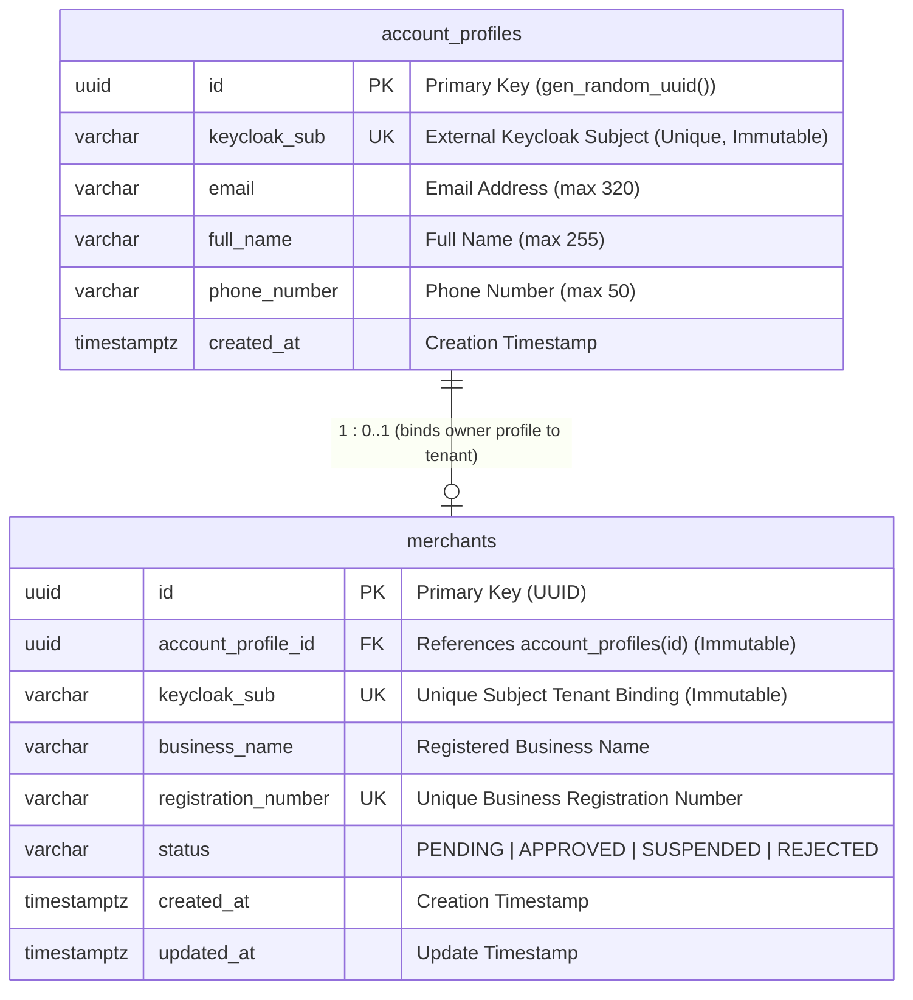

# OIDC Login Sequence, Accounts ERD & Login Evidence Review — Customer Lead Architecture Review

**Milestone:** November 1, 2026 — Design Report & Initial Working Logins Checkpoint  
**Task:** Issue #7 (`[NOV-07] Review OIDC sequence, Accounts ERD and login evidence mapping`)  
**Lead Architectural Reviewer:** Gajanthan (@Gajanthan23), Customer Lead (FE) & Customer Feature Steward  
**Required Cross-Team Reviewers:**  
- **Sinthuha (@Sinthuha-n)** — Customer Lead (BE) & Accounts Domain/Database Steward (Issues #5, #7)  
- **Suthankan1 (@Suthankan1)** — Platform & Security Lead (Shared OIDC Auth, Gateway, Accounts JWT, Issues #2, #3, #36, #37)  
- **Vibhushan (@Vibhushan-2003)** — Security QA Lead & Courier Lead (BE) (Independent Security QA, Issue #18)  
- **HarithKeshan (@Harithkeshan)** — Dispatcher/Admin Lead & Academic Report Assembly Lead (Issue #19)  
- **Eric (@EricPraveen)** — Clean-Clone Reproduction Lead (Issue #17) & Merchant Lead (FE)  
**Target Integration Branch:** `test`  
**Feature Branch:** `docs/nov07-oidc-erd-evidence`  
**Status:** **AUTHOR ARCHITECTURAL REVIEW COMPLETE — READY FOR TEAM SIGNOFF**

---

## 1. Scope, Purpose & Working Boundaries

This document provides a formal, evidence-based architectural, database schema, sequence flow, and empirical test-evidence review of the **OIDC Authentication Flow**, the **Accounts & Partners database schema (ERD)**, and the **Login Acceptance Evidence Mapping** for the SwiftDrop enterprise parcel delivery platform under Architecture Baseline v1.3.

### 1.1 Review-Only Deliverable Scope
- **Strictly Architectural & Empirical Documentation:** Per repository instructions (`AGENTS.md`), this task introduces **zero application code, zero security configuration changes, and zero schema migrations**.
- **Honest Milestone Separation:**
  - **Implemented Vertical Slice (Nov 1):** The running system demonstrates end-to-end authentication, public S256 PKCE exchange, edge routing via Spring Cloud Gateway, independent resource-server JWT verification, in-memory token management, PostgreSQL profile persistence (`account_profiles`, `merchants`), native email verification, TOTP MFA, and verified real Google OIDC broker login.
  - **Planned Target Baseline:** Cross-service gRPC communication, Kafka KRaft asynchronous domain events (`parcel.lifecycle.v1`), Delivery state machine transitions, Pricing zone quote engines, transactional outboxes, and SSE live tracking streams represent planned future architecture, accurately documented for the November 1 Academic Design Report (Issue #19).

### 1.2 Team Boundaries & Functional Ownership
- **Customer Pair (Gajanthan & Sinthuha):** Gajanthan stewards the customer business UX, booking journey, tracking views, and the single React SPA shell (`Issue #6`). Sinthuha stewards the Accounts & Partners business profiles, DTOs, and the owned PostgreSQL schema (`Issue #5`). Neither implements raw OIDC client protocols or low-level JWT security filters.
- **Platform Extra Slices (Suthankan1):** Per `docs/team/OWNERSHIP.md`, Suthankan1 owns shared authentication infrastructure (Keycloak realm, shared React auth provider `AuthSession`, Gateway JWT routing, and Accounts resource-server configuration). Post-Nov 1 bounded slices (PDF receipt generator, webhook engine, private proof adapter, GraphQL `deliveryStats` resolver) remain deferred.
- **Independent Security QA (Vibhushan):** Vibhushan independently verifies security posture, token rejections, role confinements, and profile isolation (`Issue #18`).

---

## 2. Documents & Diagram Sources Reviewed

The architectural review was conducted against active codebase implementations, schema migrations, and repository design artifacts:

1. **Architecture & Governance Baselines:**
   - [`AGENTS.md`](../../AGENTS.md) (Mandatory working discipline, documentation guard, non-negotiable v1.3 rules)
   - [`docs/architecture/BASELINE.md`](../architecture/BASELINE.md) (SwiftDrop v1.3 architecture baseline)
   - [`docs/architecture/DATA_OWNERSHIP.md`](../architecture/DATA_OWNERSHIP.md) (Service database isolation boundaries)
   - [`docs/architecture/OPEN_DECISIONS.md`](../architecture/OPEN_DECISIONS.md) (Open architectural decisions register)
   - [`docs/security/AUTHENTICATION.md`](../security/AUTHENTICATION.md) (Authentication rules and token lifetime policy)
   - [`docs/contracts/LOGIN_CONTRACT.md`](../contracts/LOGIN_CONTRACT.md) (Frozen authentication and token verification matrix)
2. **Team Coordination & Milestone Trackers:**
   - [`docs/team/OWNERSHIP.md`](../team/OWNERSHIP.md) (Nine-member team allocation and cross-module boundaries)
   - [`docs/milestones/NOV_01.md`](../milestones/NOV_01.md) (November 1 milestone scope)
   - [`docs/milestones/NOV_01_READINESS_TRACKER.md`](../milestones/NOV_01_READINESS_TRACKER.md) (Working login verification tracker)
   - [`docs/milestones/LOGIN_ACCEPTANCE.md`](../milestones/LOGIN_ACCEPTANCE.md) (Master login acceptance and evidence register)
   - [`docs/milestones/ISSUE_18_INDEPENDENT_SECURITY_QA_REPORT.md`](../milestones/ISSUE_18_INDEPENDENT_SECURITY_QA_REPORT.md) (Formal QA report by Vibhushan)
3. **Primary Diagrams Reviewed:**
   - **Figure 13:** Google Login via Keycloak Sequence (`docs/diagrams/editable/13_google_oidc_sequence.drawio`, `docs/diagrams/rendered/13_google_oidc_sequence.svg`)
   - **Figure 15:** Accounts & Partners / Pricing & Zones ERD (`docs/diagrams/editable/15_accounts_pricing_erd.drawio`, `docs/diagrams/rendered/15_accounts_pricing_erd.svg`)
   - **Figure 01:** Customer Use Cases (`docs/diagrams/rendered/01_customer_use_cases.svg`)
   - **Figure 05:** System Context Diagram (`docs/diagrams/rendered/05_system_context.svg`)
   - **Figure 06:** Logical Container Architecture (`docs/diagrams/rendered/06_logical_architecture.svg`)
   - **Figure 10:** Customer Delivery Booking Sequence (`docs/diagrams/rendered/10_customer_delivery_sequence.svg`)
4. **Active Codebase Implementation Sources:**
   - **Frontend React SPA:** `frontend/src/auth/` (`session.ts`, `contracts.ts`, `AuthProvider.tsx`, `AuthPages.tsx`, `context.ts`), `frontend/src/features/customer/`
   - **API Gateway:** `services/api-gateway/src/main/resources/application.yml`, `services/api-gateway/src/main/java/com/swiftdrop/apigateway/`
   - **Accounts & Partners Service:**
     - Database Migrations: `services/accounts-service/src/main/resources/db/migration/V1__create_account_profiles.sql`, `V2__create_merchants.sql`
     - Domain Entities & Repositories: `AccountProfile.java`, `AccountProfileRepository.java`, `Merchant.java`, `MerchantRepository.java`
     - Service & DTOs: `CurrentUserProfileService.java`, `CurrentUserProfile.java`, `CurrentUserProfileController.java`
     - Identity & Security: `TrustedIdentity.java`, `KeycloakRoleExtractor.java`, `ProfileSecurityConfiguration.java`
   - **Keycloak Configuration:** `platform/identity/realm-swiftdrop.json`, `platform/identity/validate-identity.sh`

---

## 3. Review of the OIDC Login & Session Sequences

The SwiftDrop platform implements OpenID Connect (OIDC) using the **Authorization Code Flow with Proof Key for Code Exchange (PKCE, RFC 7636, S256)**. The React Single Page Application acts as a public client with zero client secrets.

### 3.1 Trace of Implemented Flow 1: Local Customer Registration, Login & Profile Retrieval

The canonical local customer authentication flow proceeds across 12 distinct, verifiable steps:

```mermaid
sequenceDiagram
    autonumber
    actor User as User (Browser)
    participant SPA as React SPA (:5173)
    participant KC as Keycloak (:8090)
    participant GW as Spring Cloud Gateway (:8080)
    participant ACC as Accounts Service (:8081)
    participant DB as PostgreSQL (accounts_db)

    User->>SPA: 1. Opens /login or /register
    SPA->>SPA: 2. Generates PKCE code_verifier, code_challenge (S256), state & nonce
    SPA->>User: 3. Browser redirect to Keycloak /auth
    User->>KC: 4. GET /realms/swiftdrop/protocol/openid-connect/auth (S256 challenge)
    User->>KC: 5. Submits credentials / completes registration (passwords kept in KC)
    KC->>KC: 6. Enforces email verification / OTP MFA; binds default composite role CUSTOMER
    KC->>User: 7. HTTP 302 redirect to registered redirect_uri (/auth/callback?code=KC_CODE&state=...)
    User->>SPA: 8. Browser loads /auth/callback with authorization code
    SPA->>SPA: 9. Validates state; window.history.replaceState clears code from URL bar
    SPA->>KC: 10. POST /protocol/openid-connect/token (KC_CODE + code_verifier)
    KC->>KC: 11. Verifies code_verifier against stored S256 challenge
    KC-->>SPA: 12. Returns Access JWT (aud: swiftdrop-api, CUSTOMER role), ID Token, Refresh Token
    SPA->>SPA: 13. Stores tokens in memory; snapshot status = 'authenticated'
    SPA->>GW: 14. GET /api/v1/users/me (Bearer Access JWT)
    GW->>GW: 15. Validates JWT signature (JWKS), issuer, aud, exp; strips spoofed headers; checks CORS
    GW->>ACC: 16. Forwards GET /api/v1/users/me with original Authorization header
    ACC->>ACC: 17. Independent Resource Server JWT validation; extracts TrustedIdentity (sub, email, name, roles)
    ACC->>DB: 18. SELECT * FROM account_profiles WHERE keycloak_sub = :sub
    alt Profile Absent (First Login)
        ACC->>DB: 19. INSERT INTO account_profiles (...) VALUES (gen_random_uuid(), :sub, ...) ON CONFLICT DO NOTHING
        DB-->>ACC: 20. Persisted row with immutable UUID & keycloak_sub
    else Profile Present
        DB-->>ACC: 21. Existing profile row
    end
    ACC-->>GW: 22. HTTP 200 OK CurrentUserProfile JSON (id, sub, email, fullName, roles)
    GW-->>SPA: 23. HTTP 200 OK forwarded to browser
    SPA->>User: 24. Renders Customer Space (/customer) with user profile
    
    opt RP-Initiated Logout
        User->>SPA: 25. Clicks "Sign out"
        SPA->>SPA: 26. Clears in-memory tokens; snapshot status = 'unauthenticated'
        SPA->>KC: 27. POST /protocol/openid-connect/logout (id_token_hint, post_logout_redirect_uri=/)
        KC->>KC: 28. Terminates SSO session (online sessions = 0)
        KC-->>User: 29. Redirects to http://localhost:5173/
        SPA->>User: 30. Protected /customer redirects to /login
    end
```

### 3.2 Trace of Implemented Flow 2: Brokered Google OIDC Authentication

Figure 13 (`13_google_oidc_sequence`) diagrams Google login through Keycloak. The actual verified runtime flow is traced below:

```mermaid
sequenceDiagram
    autonumber
    actor User as User (Browser)
    participant SPA as React SPA (:5173)
    participant KC as Keycloak Identity Broker (:8090)
    participant Google as Google Authorization Server
    participant GW as API Gateway (:8080)
    participant ACC as Accounts Service (:8081)

    User->>SPA: 1. Clicks "Continue with Google"
    SPA->>SPA: 2. S256 PKCE challenge, state, nonce generated
    SPA->>KC: 3. Initiates auth with kc_idp_hint=google
    KC->>KC: 4. Resolves Google IdP config (alias: google, syncMode: IMPORT)
    KC->>User: 5. HTTP 303 redirect to https://accounts.google.com/o/oauth2/v2/auth
    User->>Google: 6. Browser loads Google Sign-In with client_id & redirect_uri
    User->>Google: 7. Human user authenticates & consents to openid, email, profile
    Google->>User: 8. HTTP 302 redirect to Keycloak broker endpoint with Google auth code
    User->>KC: 9. GET /realms/swiftdrop/broker/google/endpoint?code=GOOGLE_CODE&state=...
    KC->>Google: 10. Backchannel POST https://oauth2.googleapis.com/token (Google secret + code)
    Google-->>KC: 11. Returns Google Access Token & Google ID Token
    KC->>KC: 12. Validates Google ID token; imports/syncs federated identity; assigns CUSTOMER role
    KC->>User: 13. HTTP 302 redirect to frontend (/auth/callback?code=KC_CODE&state=...)
    User->>SPA: 14. Browser arrives at /auth/callback
    SPA->>KC: 15. POST /protocol/openid-connect/token (KC_CODE + code_verifier)
    KC-->>SPA: 16. Returns SwiftDrop Access JWT (aud: swiftdrop-api), ID Token, Refresh Token
    Note over SPA,KC: Google tokens are NOT sent to SPA. API never sees Google tokens.
    SPA->>GW: 17. GET /api/v1/users/me (Bearer SwiftDrop Access JWT)
    GW->>ACC: 18. Route forwarded after edge token validation
    ACC->>ACC: 19. Resolves account_profiles row bound to Google user's Keycloak sub
    ACC-->>SPA: 20. HTTP 200 OK Customer Profile JSON (CUSTOMER role only)
```

### 3.3 Evaluation of Figure 13 (`13_google_oidc_sequence`) & Required Discrepancy Fixes

A thorough review of Figure 13 source (`docs/diagrams/editable/13_google_oidc_sequence.drawio`) and preview (`docs/diagrams/rendered/13_google_oidc_sequence.svg`) identifies three key findings:

1. **Obsolete Status Wording in Note 2:**
   - *Figure 13 text:* `"Google provider setup is planned, not verified."`
   - *Actual Implementation Truth:* **Real Google OIDC login was fully verified and achieved PASS on 2026-10-20 (PR #55, commit `bf875a0`)** and re-verified on the canonical `swiftdrop` realm on 2026-10-21 (PR #64). The note is factually outdated.
   - *Required Action for Report Assembly (Issue #19):* Update the caption and diagram annotation in the report to state: *"Google Identity Provider broker integration verified with live human sign-in on accounts.google.com, profile retrieval (HTTP 200), CUSTOMER role confinement, and clean logout (L03 = PASS)."*
2. **Legacy Realm & Client Identifiers:**
   - Figure 13 provenance refers to legacy `devarom` realm and `devarom-frontend` client. The active codebase operates on canonical `swiftdrop` realm and `swiftdrop-frontend` client with audience `swiftdrop-api`.
3. **Completeness Scope (Sequence Coverage):**
   - Figure 13 exclusively depicts the Google broker path. It does not illustrate the local customer email/password registration path, native email verification link delivery via SMTP/Mailpit, or the JIT insert into PostgreSQL `account_profiles`. The Mermaid sequence diagrams in Sections 3.1 and 3.2 provide the missing comprehensive documentation for the academic design report.

---

## 4. Review of the Accounts Database ERD (Figure 15 vs Actual Schema)

The Accounts & Partners domain owns user business profiles and merchant tenant records within its dedicated PostgreSQL database (`accounts_db`).

### 4.1 Comparison Table: Figure 15 ERD vs Actual Database Schema

The table below contrasts the design diagram against the Flyway migrations (`V1__create_account_profiles.sql`, `V2__create_merchants.sql`) and JPA entities:

| Feature / Attribute | Figure 15 ERD (`15_accounts_pricing_erd`) | Actual Database Schema (`accounts_db`) | Status / Assessment |
|---|---|---|---|
| **User Profile Table** | `USER_PROFILES` | `account_profiles` | **Renamed** to snake_case table name |
| **User Primary Key** | `user_id` (unspecified type) | `id UUID PRIMARY KEY` (`gen_random_uuid()`) | **Standardized** to RFC 4122 UUID |
| **Keycloak Subject Binding** | `UK keycloak_sub (EXT)` | `keycloak_sub VARCHAR(255) NOT NULL UNIQUE`, CHECK non-blank | **Accurate** in ERD; implemented with non-blank CHECK |
| **Profile Attributes** | `name, email, phone` | `email VARCHAR(320) NOT NULL`, `full_name VARCHAR(255) NOT NULL`, `phone_number VARCHAR(50) NOT NULL` | **Aligned**; precise RFC lengths and column names (`full_name`, `phone_number`) |
| **Account Status** | `account_status` | *None* (managed in Keycloak) | **Excluded from DB**; Keycloak owns user enabled/disabled status |
| **Timestamps** | *Omitted* | `created_at TIMESTAMP WITH TIME ZONE NOT NULL` | **Implemented**; `updated_at` omitted on profile (immutable profile base) |
| **Identity Immutability** | *Omitted* | Trigger `account_identity_immutable` prevents updating `id` or `keycloak_sub` | **Security Invariant** enforced in PostgreSQL trigger |
| **Roles Table** | `ROLES (PK role_code, description, Keycloak mapping)` | **DOES NOT EXIST** | **Excluded by Design**; Keycloak is authoritative for roles |
| **User-Roles Join Table** | `USER_ROLES (PK/FK user_id, PK/FK role_code)` | **DOES NOT EXIST** | **Excluded by Design**; roles carried in JWT claims only |
| **Merchant Table** | `MERCHANTS` | `merchants` | **Implemented** in `V2__create_merchants.sql` |
| **Merchant Primary Key** | `merchant_id` | `id UUID PRIMARY KEY` | **Standardized** to UUID |
| **Merchant Foreign Key** | `FK owner_user_id -> profiles` | `account_profile_id UUID NOT NULL REFERENCES account_profiles(id)` | **Aligned**; indexed FK |
| **Merchant Subject Binding** | *Implicit* | `keycloak_sub VARCHAR(255) NOT NULL UNIQUE` | **Explicit Invariant**; 1-to-1 tenant binding per subject |
| **Merchant Attributes** | `name, approval_status` | `business_name VARCHAR(255) NOT NULL`, `registration_number VARCHAR(100) NOT NULL UNIQUE`, `status VARCHAR(30) NOT NULL` | **Enhanced**; unique registration number, non-blank checks, enum status |
| **Merchant Timestamps** | *Omitted* | `created_at TIMESTAMPTZ NOT NULL`, `updated_at TIMESTAMPTZ NOT NULL` | **Implemented** |
| **Merchant Identity Immutability** | *Omitted* | Trigger `merchant_identity_immutable` prevents updating `id`, `account_profile_id`, `keycloak_sub` | **Security Invariant** enforced in PostgreSQL trigger |
| **Merchant API Key Fields** | `API key hash / scope / expiry / revoked` | *None in Nov 1 schema* | **Deferred** under Open Decision `DEC-MER-01` |
| **Couriers Table** | `COURIERS (PK courier_id, UK/FK user_id, active/eligibility)` | **DOES NOT EXIST in accounts_db** | **Bounded Context Isolation**; operational courier data in Delivery Operations |

### 4.2 Architectural Justification: Elimination of Roles Tables from PostgreSQL

Figure 15 includes `ROLES` and `USER_ROLES` tables inside `accounts_db`. In the actual implementation, **these tables were intentionally not created**:
1. **Single Source of Truth:** Keycloak is the authoritative identity and access management provider. Keycloak defines realm roles (`CUSTOMER`, `MERCHANT`, `COURIER`, `DISPATCHER`, `ADMIN`) and client roles.
2. **Elimination of Synchronization Drift:** Persisting a local relational copy of roles in `accounts_db` introduces data duplication, cache invalidation lag, and cross-system split-brain states when an administrator revokes a role in Keycloak.
3. **Stateless Claim Extraction:** Every API request carries a signed Keycloak access token. The resource server extracts roles in memory using `KeycloakRoleExtractor.java`:
   ```java
   List<String> roles = realmAccess.get("roles");
   TrustedIdentity identity = new TrustedIdentity(sub, email, name, roles);
   ```
4. **DTO Shape Conformance:** When `GET /api/v1/users/me` is called, `CurrentUserProfileService` merges the database profile attributes with the in-memory verified JWT roles, returning `CurrentUserProfile(id, keycloakSub, email, fullName, phoneNumber, roles, merchantProfile, createdAt)` without writing roles to PostgreSQL.

### 4.3 Implemented Accounts Database Schema (Truth Model)

The true, implemented structure of `accounts_db` is represented below:



---

## 5. Master Login Acceptance Evidence Mapping

This mapping correlates each acceptance criterion from `LOGIN_ACCEPTANCE.md` and the NOV-01 milestone with its verified components, test procedures, empirical evidence artifacts, observed results, and outstanding limitations:

| ID | Verified Requirement | Application Component | Verification Procedure & Test Harness | Evidence Source & PR Commit | Observed Result | Outstanding Limitation / Blocker |
|---|---|---|---|---|---|---|
| **L01** | Full-Stack Local Startup & Health | Keycloak (:8090), Gateway (:8080), Accounts (:8081), Postgres (:5438), Mailpit (:8025), Frontend (:5173) | `./platform/local/check-readiness.sh` & `python3 tests/security-e2e/demo_smoke.py` | `LOGIN_ACCEPTANCE.md` (lines 9, 34, 37); PR #53 (`882c65e`), PR #70 (`c11bf89`) | **PASS** (13/13 readiness checks passed; 4/4 demo scenarios passed) | Independent peer clean-clone reproduction pending under L10 |
| **L02** | Local Registration & JIT Profile Creation | React SPA (`/register`), Keycloak OIDC, Gateway, Accounts Service, PostgreSQL | Vitest `session.test.ts`, Accounts `CurrentUserProfileIntegrationTest` (53 tests) | `LOGIN_ACCEPTANCE.md` (lines 10, 30); PR #42 (`7ebd42a`), PR #45 (`c6b31bb`) | **PASS** (PKCE exchange; JIT insert into `account_profiles`; zero passwords in DB) | None |
| **L03** | Brokered Real Google OIDC Login | Google Cloud Console OAuth App (`devarom`), Keycloak Google IdP broker, React SPA, Gateway, Accounts | `google_broker_smoke.py`, live Chrome interactive sign-in on `accounts.google.com` | `LOGIN_ACCEPTANCE.md` (lines 11, 35-37, 139-150); PR #55 (`bf875a0`), PR #64 (`0b01f0a`) | **PASS** (User completed Google sign-in; Customer page loaded profile HTTP 200; CUSTOMER-only role; clean logout with 0 active sessions) | Peer review pending Gajanthan/Vibhushan |
| **L04** | RP-Initiated Logout & Session Invalidation | React SPA `AuthSession.logout()`, Keycloak OIDC Logout endpoint | `session.test.ts`, `test_jwt_rejection.py`, Keycloak admin API session counts | `LOGIN_ACCEPTANCE.md` (lines 12, 150); PR #42, PR #55 | **PASS** (Tokens cleared from memory; Keycloak sessions zeroed; `/customer` redirects to `/login`) | None |
| **L05** | Role Landing Pages & Privilege Confinement | Keycloak realm roles (`swiftdrop`), React `RoleGuard`, Landing routes (`/customer`, `/merchant`, `/courier`) | `test_role_and_ownership.py` (L07-ROLE-03); route tests | `LOGIN_ACCEPTANCE.md` (lines 13, 80); PR #41, PR #75 (`1a968b8`), PR #78 (`ba9bd3b`) | **PARTIALLY VERIFIED** (Public registration strictly confined to CUSTOMER; `/customer`, `/merchant`, `/courier` implemented; `/dispatcher`, `/admin` pending) | Dispatcher & Admin role landing pages pending under Issues #15, #16 |
| **L06** | JWT Rejection & Edge Security (401) | Spring Cloud Gateway (:8080) and Accounts Service (:8081) | 27 automated tests in `test_jwt_rejection.py` (missing, malformed, unsigned `alg=none`, untrusted key, wrong-iss, wrong-aud, expired, nbf-future) | `LOGIN_ACCEPTANCE.md` (lines 14, 51-77); `ISSUE_18_INDEPENDENT_SECURITY_QA_REPORT.md` (Section 3); PR #76 (`2438689`) | **PASS** (All 27 edge & direct rejection tests passed; RFC 7807 ProblemDetail returned) | None (Independently verified by Vibhushan) |
| **L07** | Role Denial (403) & Privilege Elevation Prevention | Gateway and Accounts Service | 5 automated tests in `test_role_and_ownership.py` (L07-ROLE-01 to 05) | `LOGIN_ACCEPTANCE.md` (lines 15, 78-82); `ISSUE_18_INDEPENDENT_SECURITY_QA_REPORT.md` (Section 4); PR #76 (`2438689`) | **PASS** (Token lacking approved role rejected with 403; public signup assigns solely CUSTOMER; staff ops fail closed) | Unmapped downstream staff endpoints return 404 (BLOCKED by downstream Issues #14/15) |
| **L08** | Customer Profile Isolation & Anti-Spoofing | Gateway and Accounts Service | 8 automated tests in `test_role_and_ownership.py` (L08-OWN-01 to 08) | `LOGIN_ACCEPTANCE.md` (lines 16, 83-90); `ISSUE_18_INDEPENDENT_SECURITY_QA_REPORT.md` (Section 5); PR #76 (`2438689`) | **PASS** (Customer A & B isolated; Gateway strips spoofed headers; Accounts ignores query params) | Direct IDOR on `/users/{id}` unmapped by design (BLOCKED dependency) |
| **L09** | Cancellation & Provider Outage Resilience | React SPA `AuthSession` | Vitest `session.test.ts`, `google_broker_smoke.py` (L03-NEG-02, L03-NEG-03) | `LOGIN_ACCEPTANCE.md` (lines 17, 113, 114); PR #42, PR #54 | **PASS** (`access_denied`, state mismatch, or provider 503 set problem state; zero false session) | None |
| **L10** | Clean-Clone Reproduction on Fresh Workstation | Full repository clone and startup | Execution of `docs/development/CLEAN_CLONE_RUNBOOK.md` | `LOGIN_ACCEPTANCE.md` (line 18); `NOV_01_READINESS_TRACKER.md` (line 58) | **PENDING** (Dry-run verified by Suthankan1; independent peer execution pending Eric @EricPraveen) | Assigned to Eric (@EricPraveen, Issue #17) |
| **L11** | Secrets Hygiene in Source Control & Client Bundle | Git repository, `.env.example`, Vite frontend bundle | Git commit history scan, regex scanner, Vite build artifact inspection | `LOGIN_ACCEPTANCE.md` (line 19); `PLATFORM_SIGNOFF_NOV01.md` (Section 6.2) | **PASS** (Zero committed secrets; `.env` gitignored; public Vite bundle contains zero client secrets) | None |
| **L12** | Report Figures & Integration Review | 20 Draw.io source figures, architecture rationale | Cross-team architectural review documents | `NOV_11_COMMUNICATIONS_MERCHANT_REVIEW.md`, `ISSUE_12_DELIVERY_DESIGN_REVIEW.md`, this document (`NOV_07`) | **IN PROGRESS** (Figures 13 and 15 reviewed herein; final academic report assembly by HarithKeshan #19) | Pending final report compilation |

---

## 6. Security, Privacy & Token Hygiene Review

The Customer lead review confirms compliance with repository security rules:

1. **Token In-Memory Lifecycle:** The React SPA stores Access Tokens, ID Tokens, and Refresh Tokens **strictly in browser memory** within the `AuthSession` closure. Tokens are never written to `localStorage`, `sessionStorage`, cookies, or browser cache.
2. **Address Bar Sanitization:** `AuthSession.initializeOnce()` executes `window.history.replaceState(null, '', '/auth/callback')` immediately upon handling authorization responses. Authorization codes, error codes, and state parameters are stripped from the browser URL bar before user navigation.
3. **Redaction of Sensitive Evidence:** Test reports, log captures, and documentation contain zero bearer tokens, authorization codes, password hashes, or Google client secrets. Real user emails and names from Google sign-in are redacted.
4. **Tenant Isolation:** Merchant endpoints in Accounts Service enforce fail-closed tenant validation via `MerchantTenantAuthorizationProvider`. Cross-tenant lookups return RFC 7807 403 Forbidden.

---

## 7. Register of Open Architectural Decisions

| Decision ID | Summary / Question | Affected Modules | Recommended Option | Rationale & Trade-Off |
|---|---|---|---|---|
| **DEC-ACC-01** | Merchant API Key Persistence: Relational Table vs Keycloak Client Credentials | Accounts, Merchant, Communications | **Relational API Key Table in Accounts (Proposed)** | A dedicated `merchant_api_keys` table in `accounts_db` with bcrypt/argon2 hashes, prefix identifiers, scopes, and revocations allows fast in-process validation without burdening Keycloak with high-frequency machine credentials. |
| **DEC-ACC-02** | Customer Phone Number Collection at First Login | Accounts, React Frontend | **Permit Empty Phone on Initial OIDC JIT; Prompt in Profile UX** | Google OIDC does not return phone numbers. `AccountProfileRepository.insertIfAbsent` safely inserts `''` (empty string). A post-login profile completion prompt avoids blocking registration. |

---

## 8. Academic Design Report Recommendations (Issue #19)

For HarithKeshan's Academic Design Report assembly (Issue #19):
1. **Figure 13 Caption & Status:** Update caption to explicitly note that Google OIDC brokered authentication is **IMPLEMENTED and EMPIRICALLY VERIFIED (L03 = PASS)**.
2. **Figure 15 ERD Clarification:** Add an explanatory note in the database section stating that `ROLES` and `USER_ROLES` tables shown in the conceptual ERD are intentionally realized via Keycloak OIDC claims to preserve single-source-of-truth identity hygiene, and that `merchants` table implements 1-to-1 tenant binding with database-enforced immutability triggers.
3. **Evidence Citation:** Reference `docs/milestones/LOGIN_ACCEPTANCE.md` and `docs/reviews/NOV_07_OIDC_ACCOUNTS_LOGIN_REVIEW.md` for verifiable proof of the initial login deliverable.
